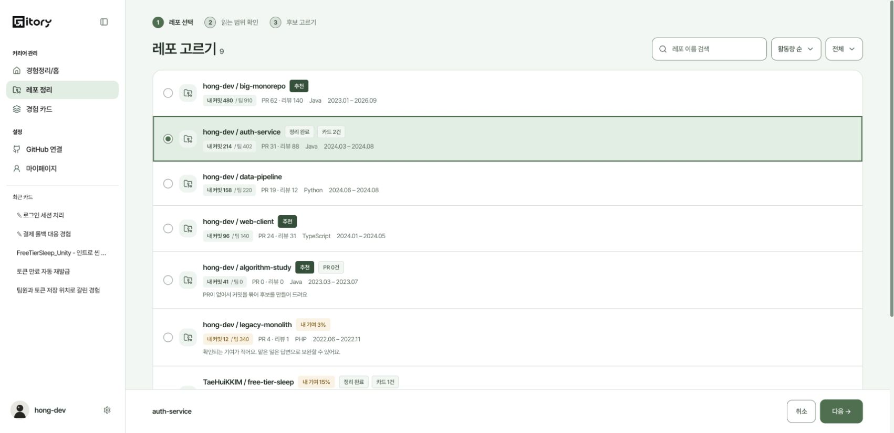
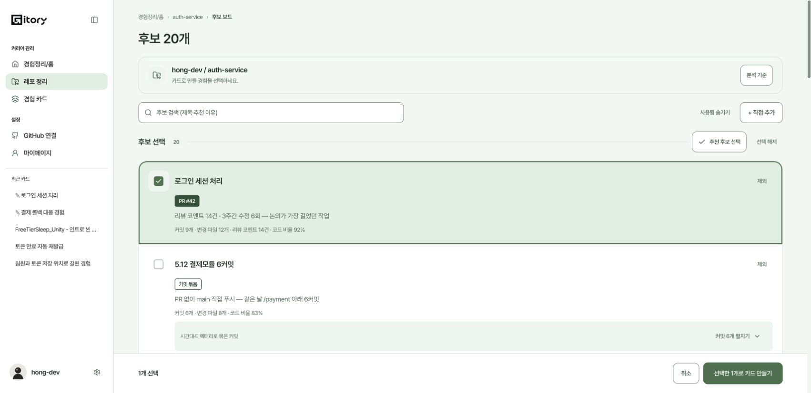
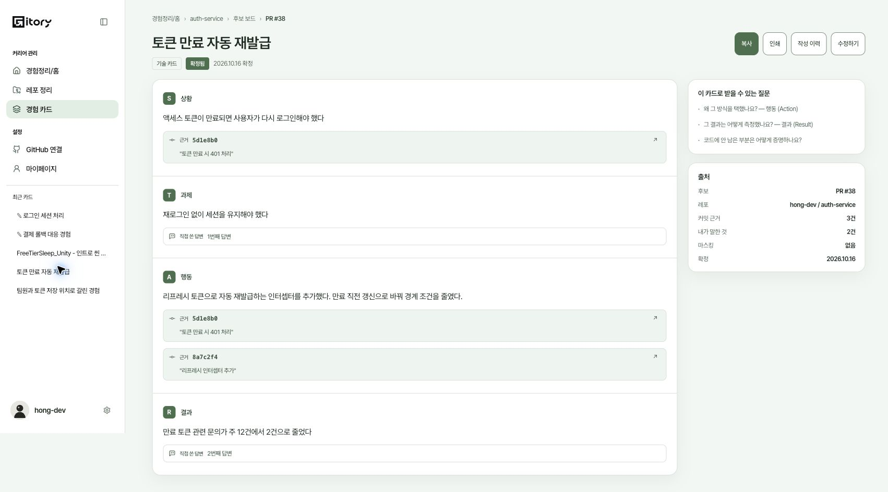
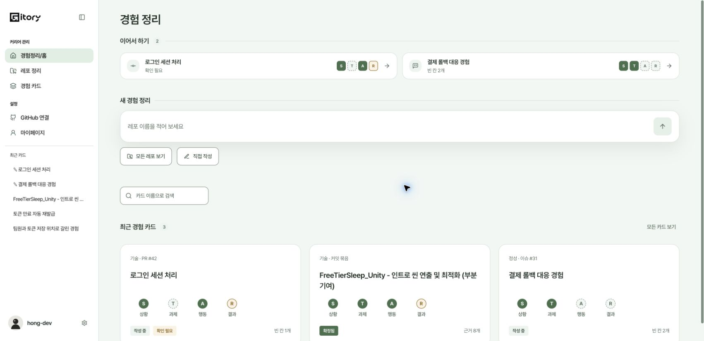
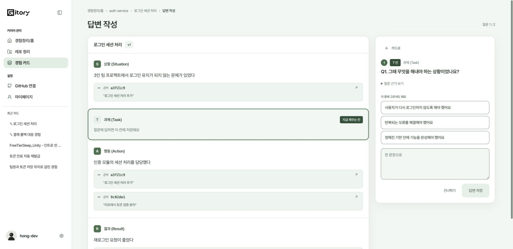
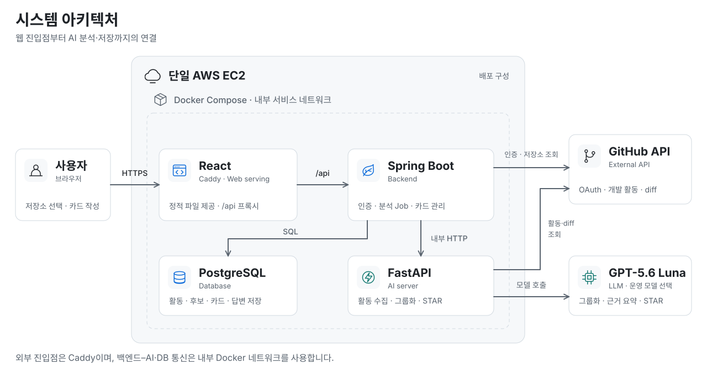
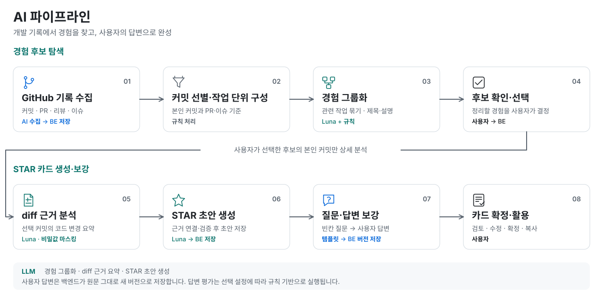

<div align="center">
  

  <h1>Gitory</h1>

  <p><strong>커밋과 PR을 자소서 경험으로</strong></p>
  <p>개발 기록에서 내가 한 일을 찾고, 근거가 연결된 경험 카드로 정리합니다.</p>
  <p>카카오테크 캠퍼스 4기 · 경북대 1팀</p>

  <p>
    <a href="#서비스-소개">서비스 소개</a> ·
    <a href="#서비스-화면">서비스 화면</a> ·
    <a href="#주요-기능">주요 기능</a> ·
    <a href="#서비스-구성">서비스 구성</a> ·
    <a href="#기술-스택">기술 스택</a> ·
    <a href="#로컬에서-실행하기">로컬에서 실행하기</a> ·
    <a href="#팀-소개">팀 소개</a> ·
    <a href="./docs/README.md">개발 문서</a>
  </p>
</div>

---

## 서비스 소개

프로젝트는 끝났는데, 내가 어떤 문제를 풀고 무엇을 배웠는지 설명하기 어려울 때가 있습니다.

**Gitory는 GitHub의 커밋·PR·리뷰를 바탕으로 개발 경험을 정리하는 서비스입니다.**
함께 작업한 기록에서 내 기여를 찾아 경험별로 묶고, 자소서와 면접에 활용할 수 있는 카드로 만듭니다.

| 기록에서 찾고 | 근거로 정리하고 | 내 이야기로 완성합니다 |
| :--- | :--- | :--- |
| 흩어진 커밋과 PR을 경험 단위로 묶습니다. | 코드 변경과 연결된 STAR 초안을 확인합니다. | 부족한 내용은 질문에 답하거나 직접 작성해 보강합니다. |

> **STAR란?** 상황(Situation) · 과제(Task) · 행동(Action) · 결과(Result)를 기준으로 경험을 설명하는 방식입니다.

## 서비스 화면

[샘플 데모](https://gitory-prototypes.vercel.app)에서 캡처한 화면입니다. 표시된 저장소·커밋·카드 내용은 체험용 예시이며, 이미지를 누르면 크게 볼 수 있습니다.

| 01. 저장소 선택 | 02. 경험 후보 확인 |
| :---: | :---: |
| [](./docs/images/readme/02-repositories.jpg) | [](./docs/images/readme/03-candidates.jpg) |

**03. 근거가 연결된 STAR 카드**

[](./docs/images/readme/04-star-card.jpg)

<details>
<summary><strong>경험 정리 홈 · 답변 보강 화면 더 보기</strong></summary>

| 경험 정리 홈 | 질문에 답하며 빈칸 보강 |
| :---: | :---: |
| [](./docs/images/readme/01-home.jpg) | [](./docs/images/readme/05-interview.jpg) |

</details>

## 주요 기능

### 01. 개발 기록에서 경험 찾기

GitHub에 로그인하고 공개 저장소를 선택하면 커밋·PR·리뷰 등 개발 활동을 수집합니다.
경험 후보에 연결된 작업을 살펴보고, 정리할 경험을 직접 고를 수 있습니다.

### 02. 근거가 연결된 STAR 초안

선택한 경험의 코드 변경을 분석해 STAR 초안을 만듭니다.
문장에 연결된 커밋 근거를 확인할 수 있고, 근거가 부족한 내용은 빈칸이나 확인이 필요한 항목으로 남깁니다.

### 03. 질문으로 빈칸 채우기

기록만으로 알기 어려운 본인의 역할과 판단, 결과를 질문으로 되짚습니다.
답변을 카드에 반영하고 직접 수정하면서 나의 경험으로 완성합니다.

### 04. 경험 카드 관리와 활용

GitHub 기록이 없는 경험도 직접 작성할 수 있습니다.
임시 저장·수정·확정·버전 관리로 내용을 다듬고, 표시할 정보를 가린 뒤 본문·STAR·근거 포함 형식으로 복사해 활용합니다.

### 05. 공고 매칭과 자소서

국내 IT 기업의 채용 공고를 매일 가져와, 공고 본문에서 필수·우대 조건을 원문 인용과 함께 뽑습니다.
확정한 경험 카드의 문장과 공고 조건을 맞춰 보고, 공고마다 맞는 정도와 조건별로 근거가 된 카드 문장을 보여 줍니다.
매칭 근거 카드로 공고에 맞는 자소서 초안을 쓰는 기능은 준비 중입니다(화면 먼저 작업, 서버 개발 예정).

**사용 흐름**

```text
GitHub 연결 → 저장소 선택 → 경험 후보 확인 → STAR 초안 → 질문·직접 수정 → 카드 확정·활용 → 공고 매칭 → 자소서 초안(준비 중)
```

## 서비스 구성

### 시스템 아키텍처

[](./docs/images/architecture/system-architecture.svg)

단일 EC2에서 **Caddy가 HTTPS와 React 정적 파일을 제공**하고, `/api` 요청을 Spring Boot로 전달합니다.
백엔드는 인증·분석 작업과 데이터 저장을 관리하며, 내부 네트워크의 FastAPI에 AI 분석을 요청합니다.

### AI 파이프라인

[](./docs/images/architecture/ai-pipeline.svg)

**GPT-5.6 Luna**로 경험을 묶고, 사용자가 고른 경험의 코드 변경을 분석해 근거가 연결된 STAR 초안을 만듭니다.
보강 질문도 Luna가 카드의 빈 칸과 근거를 보고 만들며, 사용자 답변은 백엔드가 원문 그대로 카드의 새 버전으로 저장합니다.

**공고 매칭**은 위 흐름에 이어지는 별도 파이프라인입니다.

```text
채용 공고 가져오기(매일) → Luna로 필수·우대 조건 뽑기(원문 인용 확인) → 조건 색인(임베딩)
→ 확정 카드 문장으로 조건 검색 → 공고별 맞는 정도·조건별 근거 카드 → 자소서 초안(준비 중)
```

위 그림에는 아직 공고 매칭 단계가 없으며, 그림은 매칭·자소서가 정리되면 함께 고칩니다.

> 그림은 저장소에 정의된 배포 구성과 구현된 처리 흐름 기준입니다. LLM 기반 경험 그룹화·STAR 초안 생성에는 관련 환경변수와 기능 스위치 설정이 필요합니다.

## 기술 스택

| 영역 | 사용 기술 |
| --- | --- |
| Frontend | React 19 · TypeScript · Vite · TanStack Query · React Router · Zod |
| Backend | Java 21 · Spring Boot · Spring Security · Spring Data JPA · Flyway |
| AI | Python 3.11 · FastAPI · Pydantic |
| Database | PostgreSQL 17 |
| Infrastructure | AWS EC2 · Docker Compose · Caddy · GitHub Actions · CloudWatch |
| Test | Vitest · Playwright · JUnit · Testcontainers · pytest |

## 로컬에서 실행하기

### 필요한 도구

| 도구 | 버전 | 쓰는 곳 |
| --- | --- | --- |
| Node.js | 22 (`frontend/.nvmrc`, CI 는 22·24) | 프론트엔드 · E2E |
| JDK | 21 | 백엔드 |
| Python | 3.11 | AI 서버 |
| Docker · `docker compose` | — | 로컬 DB, 백엔드 시험(Testcontainers), 전체 스택 |

### 가장 빠른 체험 — 프론트 데모 모드

백엔드 없이 브라우저 안의 목 API 로 모든 화면이 돕니다. PR 0건 저장소, 후보 0개, 수집 실패 같은 상황도 샘플로 볼 수 있습니다([목 시나리오](./frontend/README.md#목-시나리오-데모용)).

```bash
cd frontend
npm install
npm run dev        # http://localhost:5173
```

설치 없이 보려면 [샘플 데모](https://gitory-prototypes.vercel.app)를 엽니다.

### 전체 스택 띄우기

| 방법 | 명령 | 언제 쓰나 |
| --- | --- | --- |
| 가짜 GitHub·LLM 스택 | `docker compose -f e2e/compose.yaml -p gitory-e2e up -d --build --wait` (저장소 루트) | 키 없이 db·ai·backend·web 을 운영과 같은 Dockerfile 로 띄웁니다. 화면은 `http://localhost:8088` 입니다. 끝나면 `down -v` 로 내립니다. [E2E README](./e2e/README.md) |
| 운영 구성 | `cd deploy && cp .env.example .env` 로 값을 채운 뒤 `docker compose up -d --build` | 진짜 GitHub OAuth App 과 LLM 게이트웨이 키가 필요합니다. 내 컴퓨터에서는 `SITE_ADDRESS=localhost` 로 둡니다. 변수 설명은 `deploy/.env.example` 주석, 절차는 [배포 가이드](./docs/DEPLOYMENT.md) 4절에 있습니다. |
| 파트별로 따로 | AI 는 uvicorn, 백엔드는 `./gradlew bootRun` | 한 파트만 고칠 때 씁니다. [BE–AI 연결 문서](./docs/BE_AI_INTEGRATION.md)의 로컬 실행 절을 따릅니다. |

### 파트별 시험

CI 와 같은 명령입니다.

| 파트 | 명령 |
| --- | --- |
| Frontend | `cd frontend && npm ci && npm run typecheck && npm test` · 화면 E2E 는 `npx playwright install chromium` 뒤 `npm run e2e:static` |
| Backend | `cd backend && ./gradlew build` (Docker 실행 중이어야 합니다) |
| AI | `cd ai && python -m pip install -r requirements-dev.txt && python -m pytest -q` |
| E2E | 위 가짜 스택을 띄운 뒤 `cd e2e && npm ci && npx playwright install chromium && npm test` |

자세한 내용은 [Frontend README](./frontend/README.md) · [AI README](./ai/README.md) · [Backend 아키텍처](./backend/ARCHITECTURE.md)의 로컬 실행 절 · [E2E README](./e2e/README.md)에 있습니다. 백엔드 README 는 작성 중입니다(#441).

## 팀 소개

**카카오테크 캠퍼스 4기 경북대 1팀**이 기획부터 개발·배포까지 함께 만드는 프로젝트입니다.

| 이름 | 팀 역할 | 프로젝트 역할 | GitHub |
| --- | --- | --- | --- |
| 곽태훈 | 팀장 | Backend | [@taehun0208](https://github.com/taehun0208) |
| 권혁진 | AI 리드 | AI | [@hyukjin0324](https://github.com/hyukjin0324) |
| 김경무 | 플래너 | Frontend | [@ganggang-0605](https://github.com/ganggang-0605) |
| 김태희 | FE 리드 | Frontend | [@TaeHuiKKIM](https://github.com/TaeHuiKKIM) |
| 장성준 | BE 리드 | Backend | [@Grow22](https://github.com/Grow22) |
| 최민서 | 메이커 | AI | [@chxisoei](https://github.com/chxisoei) |

[프로젝트 기여 내역 보기](https://github.com/kakaotechcampus-4/ktc4-kyungpook-1/graphs/contributors)

## 개발 문서

| 시작하려는 작업 | 문서 |
| --- | --- |
| 무엇을 왜 만드는지 · AI 와 사람의 역할 나눔 | [서비스 기획](./docs/overview/service-plan.md) |
| 아키텍처 · 데이터 모델 · 리스크 · 테스트 전략 | [테크스펙](./docs/overview/tech-spec.md) |
| 프론트엔드 실행 · 샘플 데이터 체험 | [Frontend README](https://github.com/kakaotechcampus-4/ktc4-kyungpook-1/blob/develop/frontend/README.md) |
| 백엔드 구조와 모듈 경계 이해 | [Backend 아키텍처](https://github.com/kakaotechcampus-4/ktc4-kyungpook-1/blob/develop/backend/ARCHITECTURE.md) |
| AI 서버 실행과 API 확인 | [AI README](https://github.com/kakaotechcampus-4/ktc4-kyungpook-1/blob/develop/ai/README.md) |
| BE–AI 연동 · Swagger · 환경변수 확인 | [BE–AI 연결 및 API 문서](https://github.com/kakaotechcampus-4/ktc4-kyungpook-1/blob/develop/docs/BE_AI_INTEGRATION.md) |
| 배포 · 운영 설정 확인 | [배포 가이드](https://github.com/kakaotechcampus-4/ktc4-kyungpook-1/blob/develop/docs/DEPLOYMENT.md) |

화면 개선, API 계약, 오류 재현과 검증 기록은 [개발 문서 모음](./docs/README.md)에서 확인할 수 있습니다.
