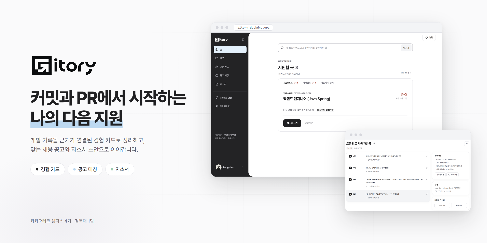
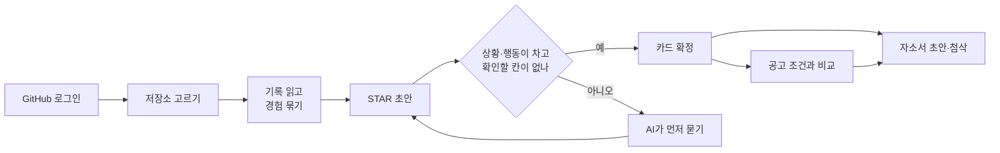
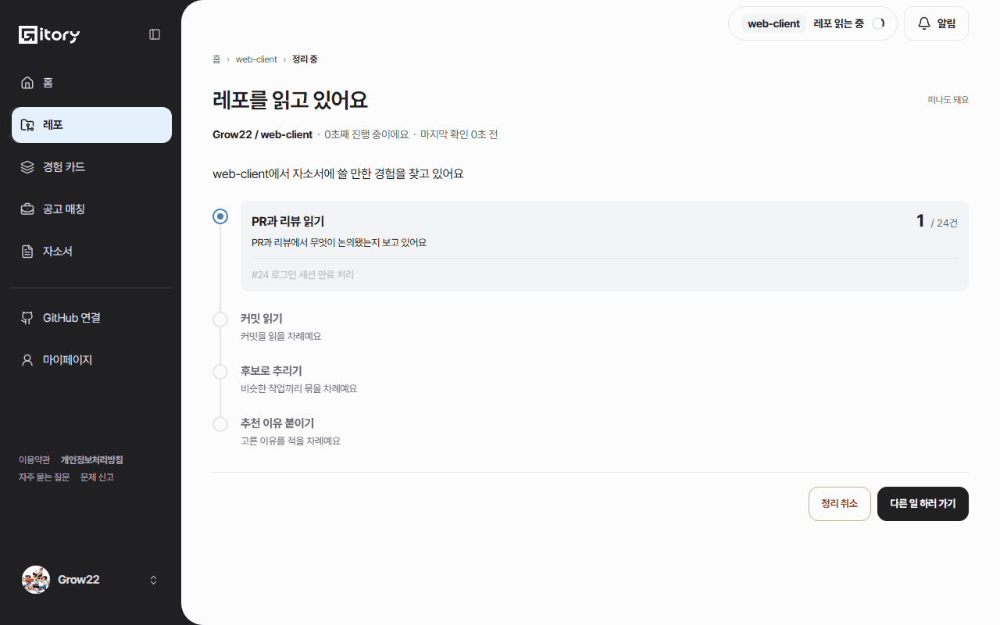
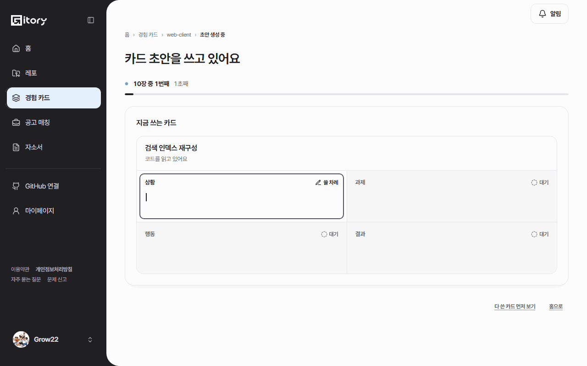
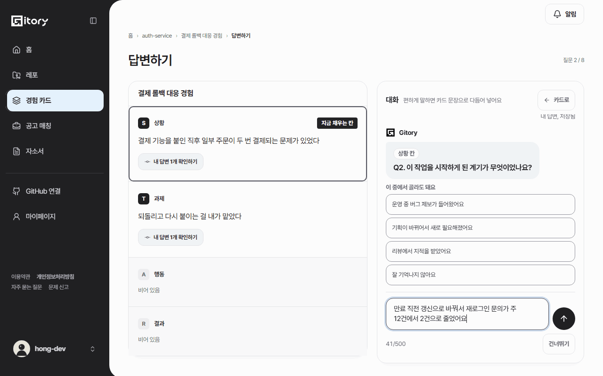
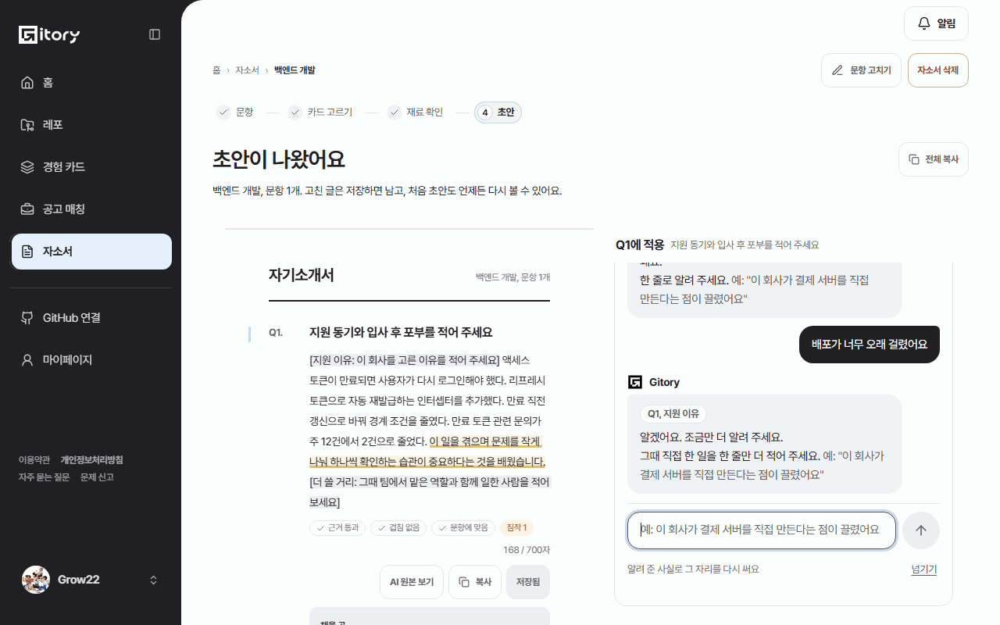
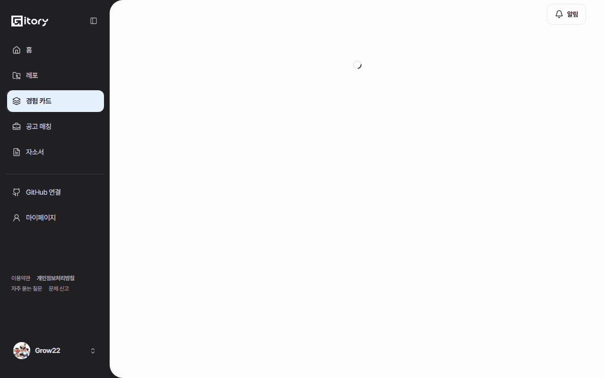
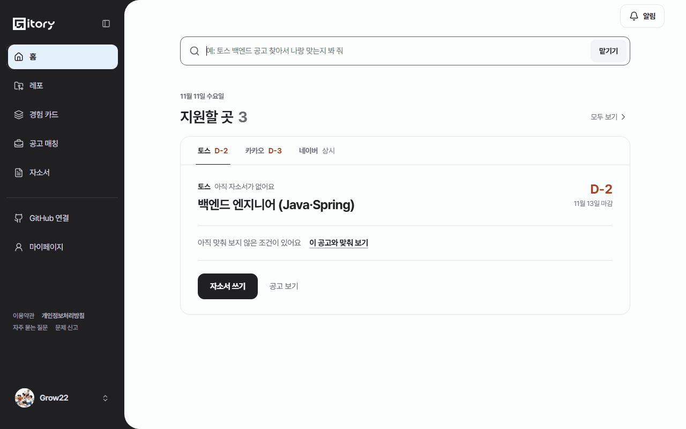
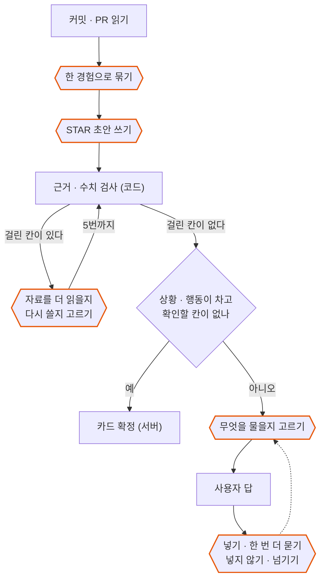
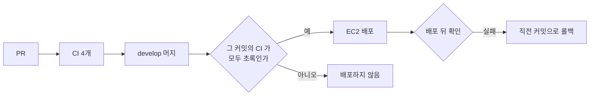

<p align="center">
  
</p>

<div align="center">
  <h1>Gitory</h1>
  <p><strong>커밋과 PR에서 시작하는 나의 다음 지원</strong></p>
  <p>GitHub 기록을 근거가 연결된 경험 카드로 정리하고,<br />내 경험에 맞는 채용 공고와 자소서 초안으로 이어갑니다.</p>
  <p>카카오테크 캠퍼스 4기 · 경북대 1팀</p>
  <p>
    <a href="https://gitory.duckdns.org/"><strong>Gitory 시작하기 ↗</strong></a> ·
    <a href="https://gitory.duckdns.org/login">로그인 없이 둘러보기</a> ·
    <a href="./docs/README.md">개발 문서</a> ·
    <a href="./CONTRIBUTING.md">기여 가이드</a>
  </p>
  <p>
    <a href="#한눈에-보기">한눈에 보기</a> ·
    <a href="#주요-기능과-화면">기능과 화면</a> ·
    <a href="#ai는-어디까지-맡기나">AI는 어디까지 맡기나</a> ·
    <a href="#서비스-구성">서비스 구성</a> ·
    <a href="#품질과-자동화">품질과 자동화</a> ·
    <a href="#로컬에서-시작하기">로컬 실행</a> ·
    <a href="#팀-소개">팀 소개</a>
  </p>
</div>

---

## 한눈에 보기

커밋은 쌓였지만, 자소서 앞에서는 내가 어떤 문제를 풀었는지 다시 찾아야 합니다.
Gitory는 **개발자 취업 준비생이 GitHub 기록에서 자신의 기여를 찾고, 지원에 쓸 경험으로 정리하는 서비스**입니다.

| 경험을 찾습니다 | 근거를 확인합니다 | 지원으로 이어갑니다 |
| :--- | :--- | :--- |
| 저장소에 흩어진 내 작업을 경험 후보로 묶고, 추천 후보로 STAR 초안을 바로 씁니다. | 문장마다 연결된 커밋을 확인하고, 부족한 맥락은 AI의 질문에 답해 채웁니다. | 확정 카드로 공고 조건을 비교하고, 문항별 자소서 초안을 쓰고 다듬습니다. |

> **STAR**는 상황(Situation) · 과제(Task) · 행동(Action) · 결과(Result)로 경험을 설명하는 방식입니다.

**다른 방법과 무엇이 다른가**

| 흔히 하는 방법 | 어려운 점 | Gitory |
| --- | --- | --- |
| 커밋 로그를 챗봇에 붙여 넣고 경험 정리를 부탁 | 남의 커밋이 섞이고, 문장의 근거를 다시 찾아야 함 | 본인 기여만 거르고, 문장마다 근거 커밋을 연결 |
| 포트폴리오를 손으로 정리 | 시간이 오래 걸리고 빠뜨림 | 저장소를 고르면 후보 묶기부터 STAR 초안까지 이어서 진행 |
| 공고를 보며 자격 요건을 눈으로 대조 | 내가 뭘 갖췄는지 한눈에 안 보임 | 조건마다 맞음 · 부족 · 직접 확인을 나누고 근거 카드로 연결 |
| 자소서 첨삭 서비스 | 내 경험을 다시 설명해야 함 | 확정 카드가 그대로 재료가 되고, 빈칸은 대화로 채움 |

<p align="center">
  
</p>



정리가 끝나면 추천 후보로 카드 초안까지 이어서 쓰고, 조건이 맞는 카드는 서버가 확정합니다.
확인할 칸이 남은 카드만 사용자가 보고, 빈칸은 AI가 먼저 질문해 채웁니다.

## 주요 기능과 화면

아래 정지 화면은 **2026년 11월 9일 [운영 서비스](https://gitory.duckdns.org/)에서 직접 캡처**했습니다.
공개 저장소의 개발 기록으로 만든 경험 카드와 당시의 공고·자소서 초안입니다. 수치·마감일은 캡처 시점의 값이며, 이미지를 누르면 원본을 볼 수 있습니다.

### 01. 홈에서 다음 할 일 찾기

내 카드와 맞는 공고, 조건을 채운 경험, 이어서 볼 자소서를 한곳에서 봅니다.
입력창에 할 일을 한 문장으로 적으면 AI가 공고 찾기·매칭·자소서 시작 같은 도구를 차례로 실행합니다. 모자란 정보는 되묻고, 끝나면 결과 화면으로 연결합니다.

[](./docs/images/readme/01-home.png)

### 02. 저장소에서 내 경험 고르기

공개 저장소에서 본인의 커밋·PR·리뷰를 읽고, 함께 한 작업을 경험 후보로 묶습니다.
읽는 과정은 화면에 그대로 보입니다. 정리가 끝나면 추천 후보로 카드 초안을 바로 쓰고, 다시 정리할 때는 지난 정리 뒤 새로 생긴 기록만 읽습니다.
후보 보드에서 **한 번에 최대 10개**를 골라 카드로 만들 수도 있고, 코드에 남지 않은 경험은 직접 쓸 수 있습니다.

<details>
<summary><strong>저장소 선택 · 경험 후보 보드 보기</strong></summary>

**저장소 선택** — 기여가 많은 저장소, 아직 정리하지 않은 저장소, 이미 정리한 저장소를 구분합니다.

[](./docs/images/readme/02-repositories.png)

**경험 후보 보드** — 읽은 기록의 범위와 부분 결과 여부를 확인하고, 카드로 남길 작업을 고릅니다.

[](./docs/images/readme/03-candidates.png)

</details>

### 03. 근거가 연결된 STAR 카드 완성하기

고른 경험의 코드 변경을 읽어 상황·과제·행동·결과 초안을 씁니다. 각 칸에서 **근거 커밋으로 이동**할 수 있고, 초안을 만든 과정과 작성 이력도 볼 수 있습니다.
기록만으로 알 수 없는 역할·판단·결과는 AI가 먼저 묻습니다. 질문마다 그 질문에 맞는 답변 예시가 붙고, 답하면 그 칸이 채워집니다.
상황과 행동이 찬 카드는 스스로 확정되고, 확인할 칸이 남은 카드만 직접 보고 확정합니다.

[](./docs/images/readme/04-star-card.png)

### 04. 공고의 조건과 내 경험 비교하기

수집한 개발 직무 공고를 기업·직무로 찾고, 확정한 카드로 조건을 비교합니다.
공고마다 **맞는 조건·부족한 경험·직접 확인할 조건**을 나누고, 판단의 근거가 된 카드로 연결합니다.
부족한 조건은 내 저장소에서 근거를 더 찾아 채울 수 있습니다. 공고 원문으로 가거나 그 공고의 자소서를 바로 시작합니다.

[](./docs/images/readme/06-posting.png)

<details>
<summary><strong>내 카드로 맞춰 본 공고 목록 보기</strong></summary>

[](./docs/images/readme/05-matching.png)

</details>

### 05. 경험 카드로 자소서 쓰고 다듬기

지원 공고와 문항을 넣으면 AI가 문항마다 쓸 카드를 고르고, 부족한 재료를 묻고, 초안을 씁니다.
빠진 내용은 **대화로 채우거나 직접 고칠 수 있고**, 진단과 첨삭 · 짐작한 내용 확인 · 글자 수 · 복사까지 한 화면에서 끝냅니다.
맞는 카드가 없는 문항에는 다른 카드와 저장소 기록을 제안하고, 나중에 새 카드가 생기면 그 문항에 쓸 수 있다고 알려 줍니다.

[](./docs/images/readme/07-cover-letter.png)

### 움직이는 화면

AI가 일하는 동안 화면이 멈춰 있지 않습니다. 읽는 기록, 써지는 글, 고르는 이유를 그대로 보여 줍니다.
아래는 로그인 없이 쓰는 **샘플 데이터** 화면입니다.

<table>
  <tr>
    <td width="50%"><strong>레포 정리</strong> — 읽은 PR·커밋과 묶은 이유가 차례로</td>
    <td width="50%"><strong>카드 초안</strong> — 네 칸이 한 글자씩, 고칠 때는 달라진 뒷부분만</td>
  </tr>
  <tr>
    <td></td>
    <td></td>
  </tr>
  <tr>
    <td><strong>되묻기</strong> — 답하면 그 칸에 다듬어 넣고, 다음 빈칸을 물음</td>
    <td><strong>자소서 채우기</strong> — 한 줄로 알려 주면 그 자리를 다시 씀</td>
  </tr>
  <tr>
    <td></td>
    <td></td>
  </tr>
  <tr>
    <td><strong>맞는 기업 고르기</strong> — 고르는 과정과 이유를 실시간으로</td>
    <td><strong>홈 한 줄 명령</strong> — 공고 찾기·매칭·자소서 시작을 도구로 이어 실행</td>
  </tr>
  <tr>
    <td></td>
    <td></td>
  </tr>
</table>

### 그 밖의 기능

- **알림** — 카드 초안이 끝나거나, 정리한 저장소를 다시 읽었거나, 새 공고가 내 카드와 맞거나, 새 카드를 쓸 수 있는 자소서 문항이 있으면 알려 주고 이어서 할 일로 연결합니다.
- **저장소 새 활동 반영** — 정리한 저장소에 새 push가 있으면 홈에 들어올 때 서버가 다시 읽어 새 카드 초안을 만듭니다.
- **기업별 공고 모아 보기** — 한 기업의 공고를 모아 보고, 목록의 검색·직무 조건을 그대로 이어 적용합니다.
- **관심 분야와 메일 알림** — 인적사항은 관심 분야만 받아 공고를 고르는 데 쓰고, 메일 수신을 켜면 새 공고 메일을 받습니다.

## AI는 어디까지 맡기나

Gitory의 AI는 **고르기만 합니다.** 근거와 수치는 코드가 검사하고, 실행과 저장은 서버가 하며, 확인할 칸이 남은 카드는 확정하지 않습니다.
그 안에서 AI는 다음 일을 스스로 정합니다.

| 어디서 | AI가 정하는 것 | 넘지 못하는 선 |
| --- | --- | --- |
| 경험 묶기 | 어느 작업들이 한 경험인지 | 없는 번호는 버리고, 빠뜨린 작업은 따로 살림 |
| 카드 초안 | 검사에 걸린 칸을 자료를 더 읽고 쓸지, 지금 근거로 다시 쓸지, 둘지 | 다시 쓰기 5번, 더 읽는 자료 3개 |
| 되묻기 | 물을지 그만 물을지, 어느 칸을 물을지, 답을 넣을지 한 번 더 물을지 | 카드마다 8번, 칸마다 2번, 출처 없는 숫자는 못 넣음 |
| 자소서 | 문항마다 쓸 카드, 걸린 문장을 고칠지 둘지, 새 카드를 어느 자리에 끼울지 | 다시 쓰기 2번, 끼우는 문장은 2곳·2문장까지 |
| 홈 한 줄 명령 | 도구 7개 중 무엇을 부를지, 사용자에게 물을지, 끝낼지 | 도구 호출 6번, 같은 일을 되풀이하면 멈춤 |



주황 육각형이 AI가 판단하는 곳입니다. 네모는 코드와 서버가 정해진 대로 하는 곳입니다.

**다 맡겨 봤더니** — AI에게 더 맡겼다가 숫자로 확인하고 코드로 옮긴 일들입니다.

- 새 카드를 자소서에 더할 때 "지금 글은 두고 한두 문장만 더해라"라고 다시 쓰게 했더니 5문항 중 4문항이 원래 문장을 바꿨습니다. 지금은 AI가 **끼울 자리와 문장만** 내고 코드가 끼웁니다. 되돌린 문항 4/5 → 1/5.
- STAR 초안의 근거 커밋 번호를 모델이 한 글자만 틀려도 카드가 통째로 비었습니다. 코드가 **앞 7자로 맞춰** 확인합니다.
- 결정 이유가 없던 행동 칸은 PR 본문을 읽게 하고 측정으로 고른 판을 넣어 이유 점수 0.20 → 0.93(0~2)이 됐습니다.
- 지시 주입 사례 84개를 LLM 작업 12종에 넣었을 때 모델이 따른 사례는 0입니다.

> [!IMPORTANT]
> **AI 규칙 네 가지** — ① 기록에 없는 내용은 쓰지 않고 빈칸으로 둡니다. ② 숫자와 커밋 번호는 코드가 다시 확인합니다. ③ 모르면 사용자에게 묻고, 확인할 칸이 남은 카드는 확정하지 않습니다. ④ 호출 횟수·다시 쓰기 횟수에 상한이 있고, 넘으면 멈추고 알립니다.

판단의 갈래와 상한은 [에이전트 설계](./docs/AGENT_DESIGN.md), 막는 장치와 그 시험은 [가드레일](./docs/GUARDRAILS.md), 잰 숫자는 [AI 품질 평가 결과](./ai/evals/RESULTS.md)에 있습니다.

## 근거를 남기는 방식

| 구분 | 맡은 일 |
| --- | --- |
| **AI** | 경험 묶기, 코드 변경 요약, STAR 초안과 되묻기, 공고 조건 추출, 자소서 재료 선택·작성·첨삭 |
| **코드** | 본인 기여 거르기, 근거 커밋 확인, 근거 없는 문장 표시, 공고 조건의 원문 인용 검증, 요청·재시도·호출 한도 |
| **사용자** | 확인할 칸이 남은 카드의 검토와 확정, 질문에 답하기, 문장 고치기, 자소서 최종 확인 |

- **문장마다 출처를 따라갈 수 있습니다.** 코드에서 찾은 근거와 사용자가 답한 내용을 구분합니다.
- **기록에 없는 내용은 확인을 요청합니다.** 빈칸과 확인 필요 표시를 질문·편집으로 보완합니다.
- **수집 범위와 실패 상태를 드러냅니다.** 부분 수집, 후보 없음, 분석 실패를 구분하고 다음 행동을 안내합니다.

## 서비스 구성

### 시스템 아키텍처

[](./docs/images/architecture/system-architecture.svg)

단일 AWS EC2에서 Docker Compose로 운영합니다. **Caddy가 HTTPS와 React 정적 파일을 제공**하고 `/api` 요청은 Spring Boot로 보냅니다.
Spring Boot는 인증·작업 상태·카드·매칭·자소서 데이터를 맡고, AI 처리는 내부 FastAPI에 요청합니다.
PostgreSQL은 서비스 데이터를, Redis는 사용자별 호출 횟수를, ChromaDB는 공고 조건 벡터를 보관합니다.

### 경험 정리부터 지원까지의 AI 흐름

[](./docs/images/architecture/ai-pipeline.svg)

LLM은 경험 묶기·STAR 초안·되묻기·공고 조건 추출·자소서 작성에 씁니다. 공고 매칭은 조건을 임베딩해 찾은 뒤 카드의 근거와 함께 비교합니다.
기본 모델은 `gpt-5.6-luna`이며 작업별 모델·추론 강도는 환경변수로 바꿉니다.

> 구성도는 저장소의 구현과 배포 설정 기준입니다. 공고 자동 수집·홈 한 줄 명령 같은 기능은 환경변수와 기능 스위치로 켭니다. [배포 가이드](./docs/DEPLOYMENT.md) · [AI README](./ai/README.md)

### 기술 스택

| 영역 | 사용 기술 |
| --- | --- |
| Frontend | React 19 · TypeScript · Vite · TanStack Query · React Router · Zod |
| Backend | Java 21 · Spring Boot 4 · Spring Security · Spring Data JPA · Flyway |
| AI | Python 3.11 · FastAPI · Pydantic · OpenAI 호환 LLM 클라이언트 |
| Data | PostgreSQL 17 · Redis 7 · ChromaDB · ONNX 임베딩 / 외부 임베딩 API |
| Infrastructure | AWS EC2 · Docker Compose · Caddy · GitHub Actions · CloudWatch · DB 정기 백업 |
| Test | Vitest · Playwright · JUnit · Testcontainers · ArchUnit · pytest |

## 품질과 자동화

| 층 | 무엇을 지키나 | 실행 |
| --- | --- | --- |
| 화면 단위 (약 1,800개) | 화면 규칙과 API 계약(zod), 목 서버 동작 | `cd frontend && npx vitest run` |
| 화면 E2E (378개) | 정적 빌드 · 모바일 · 실제 API 연동 흐름 | `npm run e2e:static` · `e2e:mobile` · `e2e:real` |
| 서버 (약 3,900개) | API 계약, 동시성, 마이그레이션, 모듈 경계 8규칙(ArchUnit), 실제 PostgreSQL(Testcontainers) | `cd backend && ./gradlew build` |
| AI (약 1,500개) | 응답 모양, 가드레일, 지시 주입 대응 | `cd ai && python -m pytest tests -q` |
| 전체 서비스 E2E (4 시나리오) | 로그인부터 카드 확정·되묻기까지, 가짜 GitHub·LLM 으로 전 서비스 | `docker compose -f e2e/compose.yaml up --build --wait` 뒤 `cd e2e && npx playwright test` |
| AI 품질 평가 | 작업별 평가 세트로 재고, 바꾼 뒤 다시 잼 | [평가 결과](./ai/evals/RESULTS.md) · [결과 파일](./ai/evals/results/history/) |

규칙 코드의 시험은 코드를 되돌리면 실패하는지(변이 확인)까지 보고 PR 본문에 적습니다.

| 언제 | 무엇이 돌아가나 |
| --- | --- |
| PR 마다 | `backend CI`(빌드·테스트·경계 검사, 마이그레이션 검사, 번호 순서 검사) · `AI CI` · `frontend`(타입·단위·E2E 세 벌) · `e2e`(전체 서비스) |
| develop 머지 | 위 네 CI 가 모두 초록일 때만 `deploy` 가 서버에 배포하고, 올라간 뒤 확인에 실패하면 직전 커밋으로 자동 롤백 |
| 매일 | DB 백업(7일 보관), 사이트 상태 확인, PR 요약 알림 |



## 로컬에서 시작하기

### 프론트엔드 샘플 체험

Node.js 22 이상에서 백엔드 없이 화면과 사용 흐름을 볼 수 있습니다.

```bash
git clone https://github.com/kakaotechcampus-4/ktc4-kyungpook-1.git
cd ktc4-kyungpook-1/frontend
npm ci
cp .env.example .env.local
npm run dev
```

`http://localhost:5173`에서 **샘플로 체험하기**를 누르세요.
예시 환경변수의 `VITE_API_MOCK=true`는 브라우저 안 샘플 API를 씁니다. 샘플 데이터는 실제 계정·서버 저장과 구분됩니다.

### 실제 API 연결과 검증

| 작업 | 시작 문서 |
| --- | --- |
| 프론트엔드 API 연결 · 단위/E2E 검사 | [Frontend README](./frontend/README.md) |
| JDK 21 · 로컬 DB · GitHub OAuth · 서버 실행 | [Backend README](./backend/README.md) |
| AI 서버 실행 · LLM·임베딩 설정 · API | [AI README](./ai/README.md) |
| Spring Boot–FastAPI 연결 · 환경변수 | [BE–AI 연결 가이드](./docs/BE_AI_INTEGRATION.md) |
| Docker Compose 배포 · 롤백 · 로그 · 백업 | [배포 가이드](./docs/DEPLOYMENT.md) |

## 팀 소개

**카카오테크 캠퍼스 4기 경북대 1팀**이 기획부터 개발·배포까지 함께 만드는 프로젝트입니다.

| 이름 | 팀 역할 | 프로젝트 역할 | GitHub |
| --- | --- | --- | --- |
| 곽태훈 | 팀장 | Backend | [@taehun0208](https://github.com/taehun0208) |
| 권혁진 | AI 리드 | AI | [@hyukjin0324](https://github.com/hyukjin0324) |
| 김경무 | 플래너 | Frontend | [@ganggang-0605](https://github.com/ganggang-0605) |
| 김태희 | FE 리드 | Frontend | [@TaeHuiKKIM](https://github.com/TaeHuiKKIM) |
| 장성준 | BE 리드 | Backend | [@Grow22](https://github.com/Grow22) |
| 최민서 | 메이커 | AI | [@chxisoei](https://github.com/chxisoei) |

[프로젝트 기여 내역 보기](https://github.com/kakaotechcampus-4/ktc4-kyungpook-1/graphs/contributors)

## 개발 문서

| 알고 싶은 내용 | 문서 |
| --- | --- |
| 서비스가 해결하는 문제와 기획 배경 | [서비스 기획](./docs/overview/service-plan.md) |
| 아키텍처 결정 · 데이터 모델 · 테스트 전략 | [테크스펙](./docs/overview/tech-spec.md) |
| AI가 스스로 정하는 곳과 상한 · 막는 장치 | [에이전트 설계](./docs/AGENT_DESIGN.md) · [가드레일](./docs/GUARDRAILS.md) |
| 고친 문제와 나아진 숫자 · 측정 · 기술 결정 | [개선 기록](./docs/improvement-log.md) · [측정 기록](./docs/metrics-log.md) · [기술 결정 기록](./docs/tech-decisions.md) |
| 백엔드 모듈 책임과 의존 방향 | [Backend 아키텍처](./backend/ARCHITECTURE.md) |
| 요청·응답 계약과 API 스냅샷 | [공유 계약](./contracts/README.md) · [OpenAPI](./docs/openapi/README.md) |
| 브랜치 · 커밋 · PR · 리뷰 규칙 | [기여 가이드](./CONTRIBUTING.md) |
| 화면 개선 · 오류 재현 · 발표와 데모 기록 | [개발 문서 모음](./docs/README.md) |
| 화면·구성도 갱신 기준 | [캡처 기록](./docs/images/readme/README.md) · [구성도 출처](./docs/images/architecture/README.md) |

날짜가 있는 기획·작업 문서는 작성 시점의 기록입니다. 현재 기능과 실행 설정은 최신 코드·파트별 가이드·운영 화면을 함께 확인하세요.
