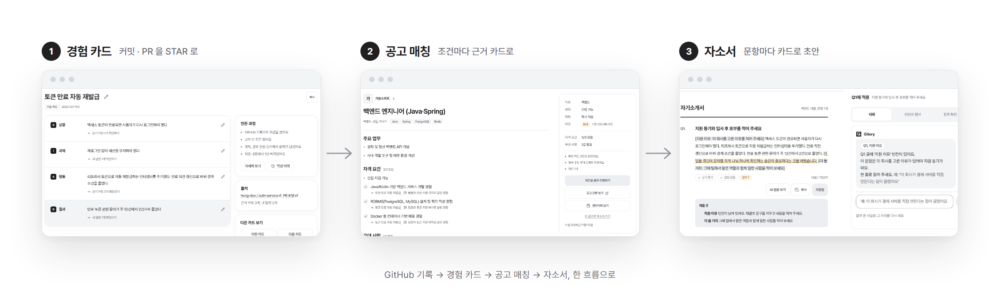
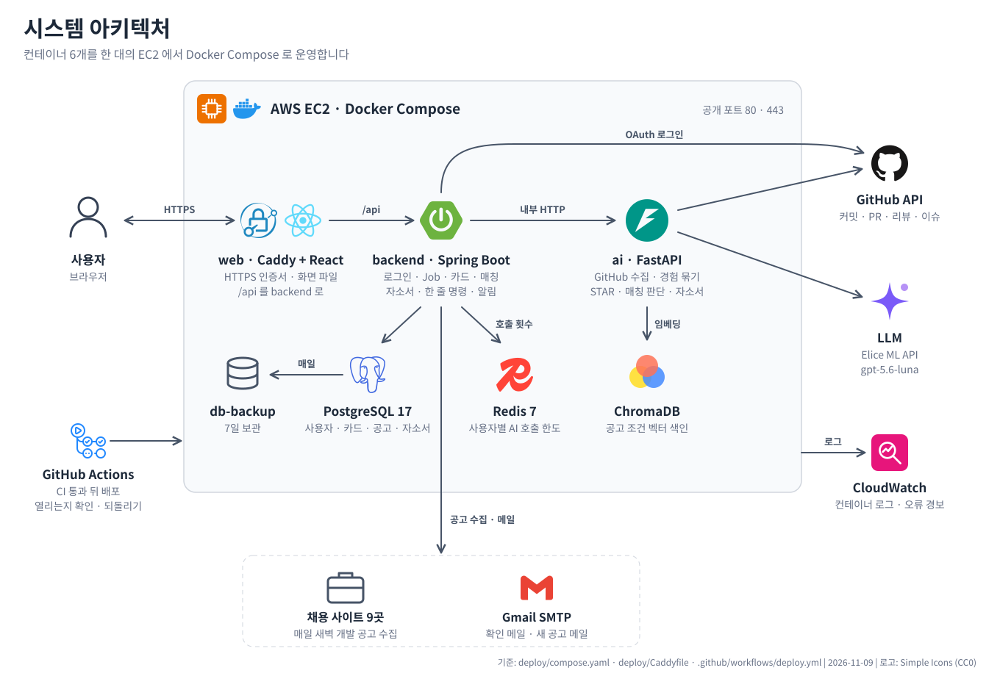
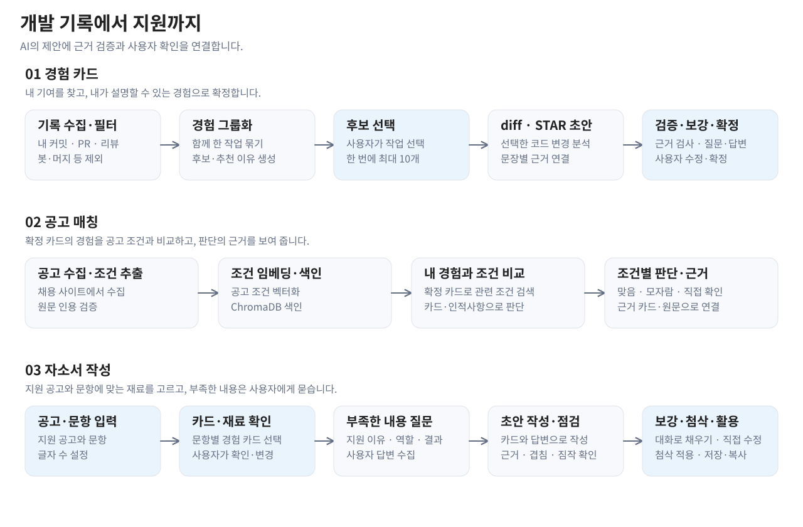
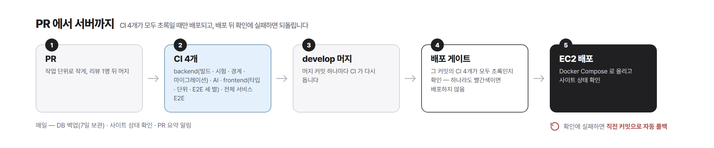
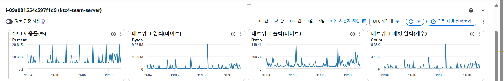
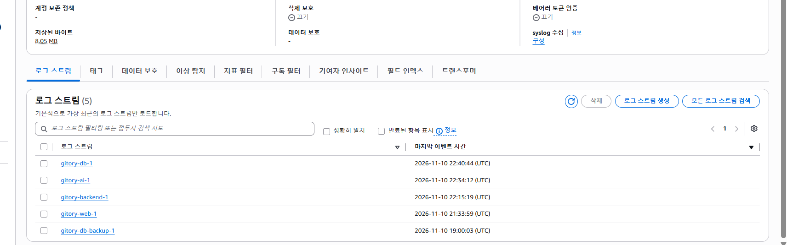

<p align="center">
  
</p>

<div align="center">
  <h1>Gitory</h1>
  <p><strong>커밋과 PR이 자소서가 되기까지</strong></p>
  <p>GitHub 기록을 근거가 연결된 경험 카드로 정리하고,<br />내 경험에 맞는 채용 공고와 자소서 초안으로 이어갑니다.</p>
  <p>카카오테크 캠퍼스 4기 · 경북대 1팀</p>
  <p>
    <a href="https://gitory.duckdns.org/"><strong>Gitory 시작하기 ↗</strong></a>&nbsp;&nbsp;·&nbsp;&nbsp;
    <a href="https://gitory.duckdns.org/login">로그인 없이 둘러보기</a>&nbsp;&nbsp;·&nbsp;&nbsp;
    <a href="./docs/README.md">개발 문서</a>
  </p>
</div>

---

## 🎬 시연 영상

https://github.com/user-attachments/assets/7c769b51-049e-4cbc-aecd-0da89dfcb1f6

저장소를 고르는 순간부터 경험 카드, 맞는 공고, 자소서 초안까지 실제 서비스 화면 그대로 담았습니다.

## 📑 목차

- **[왜 만들었나](#-왜-만들었나)** — 문제와 네 걸음 흐름
- **[핵심 기능](#-핵심-기능)** — 기능 5개, 움직이는 화면으로
- **[Agentic AI 설계](#-agentic-ai-설계)** — AI 가 스스로 정하는 범위와 그 한계
- **[서비스 구성](#-서비스-구성)** — 아키텍처와 기술 스택
- **[품질과 배포](#-품질과-배포)** — 시험 층, CI 와 배포
- **[실행·배포 방법](#-실행배포-방법)** · **[팀](#-팀)** · **[개발 문서](#-개발-문서)**

## 🤔 왜 만들었나

커밋은 쌓였지만 자소서 앞에서는 내가 어떤 문제를 풀었는지 다시 찾아야 합니다.
Gitory 는 **개발자 취업 준비생이 GitHub 기록에서 자신의 기여를 찾아, 근거가 연결된 경험 카드로 정리하고, 맞는 공고와 자소서까지 이어 가는 서비스**입니다.

<p align="center">
  
</p>

## 💻 핵심 기능

아래 화면은 로그인 없이 쓸 수 있는 **샘플 데이터**로 찍은 실제 서비스 화면입니다.

### 1. 한 줄로 맡기기

홈 입력창에 할 일을 한 문장으로 적으면 AI 가 공고 찾기 · 매칭 · 자소서 시작 같은 도구 7개를 차례로 실행합니다.
모자란 정보는 되묻고, 끝나면 결과 화면으로 연결합니다.

<p align="center"></p>

### 2. 저장소 정리

공개 저장소에서 본인의 PR · 리뷰 · 커밋만 읽어 같은 일을 한 묶음의 경험으로 정리하고, 추천 이유를 붙입니다.
읽는 과정이 화면에 그대로 보이고, 끝나면 추천 후보로 카드 초안을 바로 씁니다.

<p align="center"></p>

### 3. 경험 카드

고른 경험의 코드 변경을 읽어 상황 · 과제 · 행동 · 결과를 근거 커밋과 함께 씁니다. 출처 없는 숫자는 코드가 걸러 내고 다시 쓰게 합니다.
상황과 행동 칸이 채워지면 카드는 자동으로 확정되고, 기록만으로 알 수 없는 칸은 AI 가 먼저 물어본 뒤 답을 카드 문장으로 다듬어 넣습니다.

<p align="center"></p>

<p align="center"></p>

### 4. 공고 매칭

수집한 개발 직무 공고를 확정 카드와 비교해 조건마다 **맞음 · 부족 · 직접 확인**을 나누고, 판단의 근거가 된 카드로 연결합니다.
한 저장소의 카드로 지금 지원할 수 있는 기업을 고르는 과정과 이유도 실시간으로 보여 줍니다.

<p align="center"></p>

### 5. 자소서

공고와 문항을 넣으면 AI 가 문항마다 쓸 카드를 고르고 초안을 씁니다. 빈칸은 대화로 채우고, 진단과 첨삭 · AI 가 짐작한 내용 확인 · 글자 수까지 한 화면에서 끝냅니다.
새 카드가 생기면 쓰던 글은 그대로 두고 필요한 문장만 끼워 넣습니다.

<p align="center"></p>

초안이 나오면 AI 가 그 글을 다시 읽고 아쉬운 점과 잘한 점을 짚어 고친 글을 내놓습니다. 적용하기 전까지 종이는 그대로이고, 적용해도 원본은 남습니다.

<p align="center"></p>

## 🧠 Agentic AI 설계

AI 는 **판단만** 맡습니다. 근거와 수치는 코드가 검사하고, 실행과 저장은 서버가 하며, 확인할 칸이 남은 카드는 확정하지 않습니다.

| 어디서 | AI 가 정하는 것 | 지키는 한계 |
| --- | --- | --- |
| 경험 묶기 | 어느 작업들이 한 경험인지 | 존재하지 않는 번호는 버리고, 빠뜨린 작업은 따로 남김 |
| 카드 초안 | 검사에 걸린 칸을 자료를 더 읽고 쓸지, 지금 근거로 다시 쓸지, 그대로 둘지 | 다시 쓰기 5번, 더 읽는 자료 3개 |
| 되묻기 | 물을지 그만둘지, 어느 칸을 물을지, 답을 넣을지 한 번 더 물을지 | 카드마다 8번, 칸마다 2번, 출처 없는 숫자는 넣지 않음 |
| 자소서 | 문항마다 쓸 카드, 걸린 문장을 고칠지 둘지, 새 카드를 어느 자리에 끼울지 | 다시 쓰기 2번, 끼우는 문장은 2곳·2문장까지 |
| 홈 한 줄 명령 | 도구 7개 중 무엇을 부를지, 사용자에게 물을지, 끝낼지 | 도구 호출 6번, 같은 일을 되풀이하면 멈춤 |

홈 한 줄 명령은 환경변수 스위치(`VITE_ASSISTANT_ENABLED` · 서버 `assistant.enabled`)로 켜고 끕니다. 코드 기본값은 꺼짐이지만 배포 이미지([frontend/Dockerfile](./frontend/Dockerfile))와 운영 서버에서는 켜져 있어, 운영과 샘플 둘러보기 모두에서 홈 입력 칸이 보입니다.

<p align="center">
  
</p>

**AI 에게 더 맡겨 본 뒤 바꾼 것** — 처음에는 AI 에게 맡겼다가, 숫자로 확인한 뒤 코드가 맡도록 바꾼 일들입니다.

- 새 카드를 자소서에 더할 때 '지금 글은 두고 한두 문장만 더해 달라' 고 다시 쓰게 했더니 5문항 중 4문항에서 원래 문장이 바뀌었습니다. 지금은 AI 가 **끼울 자리와 문장만** 고르고 코드가 끼워 넣습니다. 되돌린 문항 4/5 → 1/5.
- 근거 커밋 번호를 모델이 한 글자만 틀리게 적어도 카드가 통째로 비었습니다. 지금은 코드가 **앞 7자리로 맞춰** 확인합니다.
- 행동 칸에 '왜 그렇게 했는지' 가 빠지던 문제는 PR 본문을 함께 읽게 하고 여러 프롬프트를 측정해 가장 나은 것을 골라, 이유 점수가 0.20 → 0.93(0~2점)으로 올랐습니다.
- 프롬프트 주입 사례 84개를 LLM 작업 12종에 넣어 봤을 때 모델이 그 지시를 따른 경우는 0건입니다.

> [!IMPORTANT]
> **AI 규칙 네 가지** — ① 기록에 없는 내용은 쓰지 않고 빈칸으로 둡니다. ② 숫자와 커밋 번호는 코드가 다시 확인합니다. ③ 모르면 사용자에게 묻고, 확인할 칸이 남은 카드는 확정하지 않습니다. ④ 호출 횟수·다시 쓰기 횟수에 상한이 있고, 넘으면 멈추고 알립니다.

판단 기준과 상한은 [에이전트 설계](./docs/AGENT_DESIGN.md), 막는 장치와 시험은 [가드레일](./docs/GUARDRAILS.md), 측정한 숫자는 [AI 품질 평가 결과](./ai/evals/RESULTS.md)에 있습니다.

**에이전트 프레임워크(LangGraph · LangChain)는 일부러 쓰지 않았습니다.** 모델 호출은 OpenAI 호환 API 하나뿐이고, 단계 분기 · 상한 · 되돌리기를 코드 줄로 두면 단위 시험과 변이 확인으로 잡을 수 있기 때문입니다. 홈 한 줄 명령의 도구 호출 루프, STAR 초안의 고쳐 쓰기 루프, 되묻기 루프는 각각 상태와 상한을 가진 일반 함수입니다. 분기가 더 늘어나면 그때 옮길 계획입니다. 이유와 다른 선택지는 [기술 결정 116번](./docs/tech-decisions.md#116-에이전트-프레임워크--langgraph를-쓸까-직접-짤까-ai-2026-11-11)에 있습니다.

**실행 과정은 사용자 화면에 남고, 글 원문은 밖으로 나가지 않습니다.** AI 가 무엇을 어떤 순서로 했는지는 그 사용자의 화면에서 확인합니다.

| 어디서 | 무엇이 보이나 |
| --- | --- |
| 홈 한 줄 명령 | 부른 도구의 순서와 단계마다 나온 결과가 대화로 남음 |
| 경험 카드 | 'AI 가 한 일' — 쓰기 → 검사 → 자료 열기 · 다시 쓰기 · 되돌림 (`card_draft_step` 에 저장) |
| 레포 정리 | 읽은 PR·커밋과 같은 일로 묶은 이유 |
| 자소서 | 카드 고르기 → 질문 → 초안 → 첨삭의 각 단계와 대화 (`cover_letter_turn` 에 저장) |

운영자가 보는 것은 AI 호출 기록 `ai_call`(경로 · 모델 · 토큰 · 끝난 방식 · 걸린 시간)과 CloudWatch 로그(예외 종류만)뿐입니다. 사용자 글 · 카드 본문 · 모델 응답 원문은 로그에 남기지 않고 Langfuse 같은 외부 추적 도구로도 보내지 않으므로, 관리자 화면은 따로 두지 않았습니다.
개인정보는 GitHub 권한 `read:user` 하나(공개 저장소만)로 시작하고, 모델에 보내기 전에 토큰 · 키 · 이메일을 가리며, 탈퇴하면 DB 의 정보를 지웁니다(서버 로그와 백업은 7일 뒤 사라짐). 처리 항목과 보관 기간은 [개인정보처리방침](https://gitory.duckdns.org/privacy)에 있고, 시연과 채점용 둘러보기는 로그인 없는 샘플 데이터로 돌아 실제 사용자 정보가 들어가지 않습니다.

## 🧱 서비스 구성

[](./docs/images/architecture/system-architecture.svg)

단일 AWS EC2에서 Docker Compose로 운영합니다. **Caddy가 HTTPS와 React 정적 파일을 제공**하고 `/api` 요청은 Spring Boot로 보냅니다.
Spring Boot는 인증·작업 상태·카드·매칭·자소서 데이터를 맡고, AI 처리는 내부 FastAPI에 요청합니다.
PostgreSQL은 서비스 데이터를, Redis는 사용자별 호출 횟수를, ChromaDB는 공고 조건 벡터를 보관합니다.

<details>
<summary><strong>경험 정리부터 지원까지의 AI 흐름 보기</strong></summary>

[](./docs/images/architecture/ai-pipeline.svg)

LLM 은 경험 묶기 · STAR 초안 · 되묻기 · 공고 조건 추출 · 자소서 작성에 쓰고, 공고 매칭은 조건을 임베딩해 찾은 뒤 카드의 근거와 함께 비교합니다. 기본 모델은 `gpt-5.6-luna` 이며 작업별 모델 · 추론 강도는 환경변수로 바꿉니다.

</details>

| 영역 | 사용 기술 |
| --- | --- |
| **Frontend** |       |
| **Backend** |      |
| **AI** |     |
| **Data** |     |
| **Infra** |      |
| **Test** |       |

## ✅ 품질과 배포

| 층 | 무엇을 지키나 | 어디에 |
| --- | --- | --- |
| 화면 단위 (약 1,800개) | 화면 규칙과 API 계약(zod), 샘플 서버 동작 | [frontend/src/test](./frontend/src/test) |
| 화면 E2E (378개) | 정적 빌드 · 모바일 · 실제 API 연동 흐름 | [frontend/e2e](./frontend/e2e) · [frontend/e2e-real](./frontend/e2e-real) |
| 서버 (약 3,900개) | API 계약, 동시성, 마이그레이션, 모듈 경계 8규칙(ArchUnit), 실제 PostgreSQL(Testcontainers) | [backend/src/test](./backend/src/test) |
| AI (약 1,500개) | 응답 모양, 가드레일, 지시 주입 대응 | [ai/tests](./ai/tests) |
| 전체 서비스 E2E (4 시나리오) | 로그인부터 카드 확정·되묻기까지, 가짜 GitHub·LLM 으로 전 서비스 | [e2e/tests](./e2e/tests) |
| AI 품질 평가 | 작업별 평가 세트로 측정하고, 바꾼 뒤 다시 측정 | [평가 결과](./ai/evals/RESULTS.md) · [결과 파일](./ai/evals/results/history/) |

| 언제 | 무엇이 돌아가나 |
| --- | --- |
| PR 마다 | [backend CI](./.github/workflows/backend-ci.yml)(빌드·테스트·경계 검사, 마이그레이션 검사, 번호 순서 검사) · [AI CI](./.github/workflows/ai-ci.yml) · [frontend](./.github/workflows/frontend-ci.yml)(타입·단위·E2E 세 벌) · [e2e](./.github/workflows/e2e.yml)(전체 서비스) |
| develop 머지 | 위 네 CI 가 모두 초록일 때만 [deploy](./.github/workflows/deploy.yml) 가 서버에 배포하고, 올라간 뒤 확인에 실패하면 직전 커밋으로 자동 롤백 |
| 매일 | DB 백업(7일 보관), [사이트 상태 확인](./.github/workflows/uptime.yml), [PR 요약 알림](./.github/workflows/daily-pr-digest.yml) |

**검증 전에는 배포되지 않고, 올라간 뒤 확인에 실패하면 스스로 되돌립니다.** 머지 커밋마다 CI 4개가 다시 돌고, 넷이 모두 초록일 때만 배포 워크플로가 서버를 올립니다. 올라간 뒤 상태 확인에 실패하면 직전 커밋으로 자동 롤백합니다.

<p align="center">
  
</p>

<details>
<summary><strong>운영에서 무엇을 지켜보나 — CloudWatch 로그와 상태 확인</strong></summary>

서버(EC2 1대)의 CPU · 네트워크 그래프를 CloudWatch 로 보고, 컨테이너 다섯(web · backend · ai · db · db-backup)의 로그는 로그 그룹에 스트림 하나씩으로 모읍니다. 10분마다 외부에서 사이트 상태를 확인하고(`uptime.yml`), 매일 DB 를 백업해 7일 보관합니다.

<p align="center">
  
  
</p>

</details>

## 🚀 실행·배포 방법

운영 서비스는 [gitory.duckdns.org](https://gitory.duckdns.org/)에서 바로 쓸 수 있고, 로그인 없이 [샘플 데이터로 둘러보기](https://gitory.duckdns.org/login)도 됩니다. 직접 띄우거나 검증하려면 파트별 문서를 따라가면 됩니다.

```bash
# 1) 화면만 1분 안에 — 백엔드 없이 샘플 데이터로 (Node 22)
cd frontend && npm ci && npm run dev        # http://localhost:5173

# 2) 전체 서비스 — 가짜 GitHub·LLM 으로 Spring·FastAPI·DB 까지 (Docker)
docker compose -f e2e/compose.yaml -p gitory-e2e up -d --build --wait   # http://localhost:8088
docker compose -f e2e/compose.yaml -p gitory-e2e down                   # 끝나면 내리기
```

실제 GitHub·LLM 과 연결하거나 서버에 배포하려면 아래 문서를 따라가면 됩니다.

| 작업 | 시작 문서 |
| --- | --- |
| 화면만 띄우기(백엔드 없이 샘플 데이터) · 단위/E2E 검사 | [Frontend README](./frontend/README.md) |
| JDK 21 · 로컬 DB · GitHub OAuth · 서버 실행 | [Backend README](./backend/README.md) |
| AI 서버 실행 · LLM·임베딩 설정 · API | [AI README](./ai/README.md) |
| Spring Boot–FastAPI 연결 · 환경변수 | [BE–AI 연결 가이드](./docs/BE_AI_INTEGRATION.md) |
| Docker Compose 배포 · 롤백 · 로그 · 백업 | [배포 가이드](./docs/DEPLOYMENT.md) |

## 👥 팀

카카오테크 캠퍼스 4기 경북대 1팀

<table>
  <tr>
    <th></th>
    <th colspan="2" align="center">Backend</th>
    <th colspan="2" align="center">Frontend</th>
    <th colspan="2" align="center">AI</th>
  </tr>
  <tr>
    <th align="left">역할</th>
    <td align="center" width="150"><strong>팀장</strong></td>
    <td align="center" width="150"><strong>BE 리드</strong></td>
    <td align="center" width="150"><strong>FE 리드</strong></td>
    <td align="center" width="150"><strong>플래너</strong></td>
    <td align="center" width="150"><strong>AI 리드</strong></td>
    <td align="center" width="150"><strong>메이커</strong></td>
  </tr>
  <tr>
    <th align="left">사진</th>
    <td align="center" width="150"><a href="https://github.com/taehun0208"></a></td>
    <td align="center" width="150"><a href="https://github.com/Grow22"></a></td>
    <td align="center" width="150"><a href="https://github.com/TaeHuiKKIM"></a></td>
    <td align="center" width="150"><a href="https://github.com/ganggang-0605"></a></td>
    <td align="center" width="150"><a href="https://github.com/hyukjin0324"></a></td>
    <td align="center" width="150"><a href="https://github.com/chxisoei"></a></td>
  </tr>
  <tr>
    <th align="left">이름</th>
    <td align="center" width="150">곽태훈</td>
    <td align="center" width="150">장성준</td>
    <td align="center" width="150">김태희</td>
    <td align="center" width="150">김경무</td>
    <td align="center" width="150">권혁진</td>
    <td align="center" width="150">최민서</td>
  </tr>
  <tr>
    <th align="left">GitHub</th>
    <td align="center" width="150"><a href="https://github.com/taehun0208">@taehun0208</a></td>
    <td align="center" width="150"><a href="https://github.com/Grow22">@Grow22</a></td>
    <td align="center" width="150"><a href="https://github.com/TaeHuiKKIM">@TaeHuiKKIM</a></td>
    <td align="center" width="150"><a href="https://github.com/ganggang-0605">@ganggang-0605</a></td>
    <td align="center" width="150"><a href="https://github.com/hyukjin0324">@hyukjin0324</a></td>
    <td align="center" width="150"><a href="https://github.com/chxisoei">@chxisoei</a></td>
  </tr>
</table>

## 📚 개발 문서

협업 규칙(브랜치 · PR · 리뷰 1명 필수)은 [기여 가이드](./CONTRIBUTING.md)에 있고, PR 1,000여 개를 모두 팀원 리뷰를 거쳐 머지했습니다.

| 알고 싶은 내용 | 문서 |
| --- | --- |
| 서비스가 해결하는 문제와 기획 배경 | [서비스 기획](./docs/overview/service-plan.md) |
| 아키텍처 결정 · 데이터 모델 · 테스트 전략 | [테크스펙](./docs/overview/tech-spec.md) |
| AI가 스스로 정하는 곳과 상한 · 막는 장치 | [에이전트 설계](./docs/AGENT_DESIGN.md) · [가드레일](./docs/GUARDRAILS.md) |
| 고친 문제와 나아진 숫자 · 측정 · 기술 결정 | [개선 기록](./docs/improvement-log.md) · [측정 기록](./docs/metrics-log.md) · [기술 결정 기록](./docs/tech-decisions.md) |
| 백엔드 모듈 책임과 의존 방향 | [Backend 아키텍처](./backend/ARCHITECTURE.md) |
| 요청·응답 계약과 API 스냅샷 | [공유 계약](./contracts/README.md) · [OpenAPI](./docs/openapi/README.md) |
| 화면 개선 · 오류 재현 · 발표와 데모 기록 | [개발 문서 모음](./docs/README.md) |
