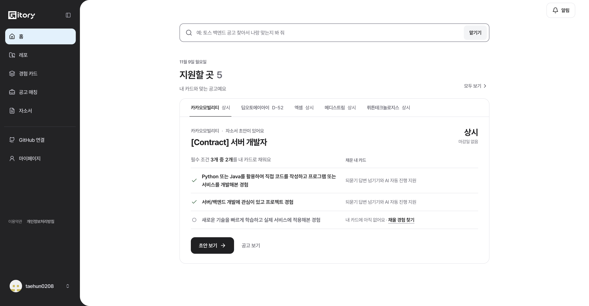
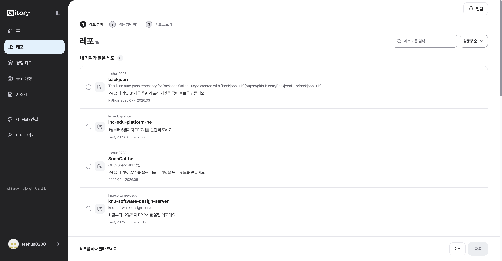
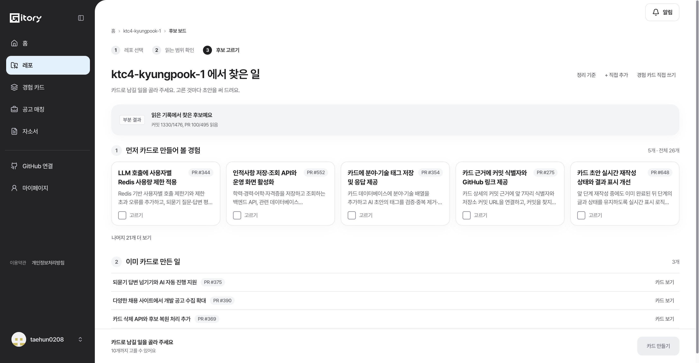
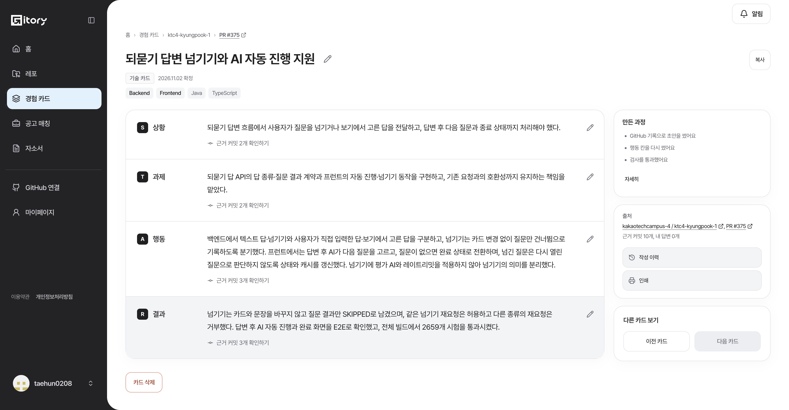
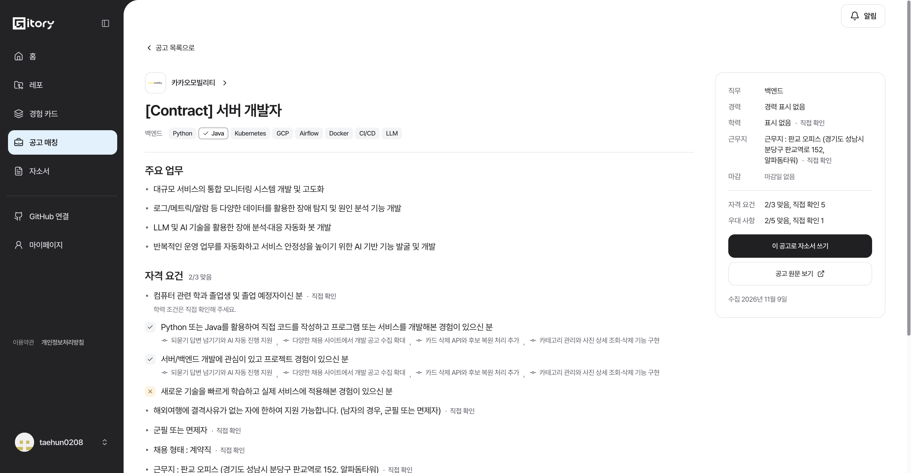
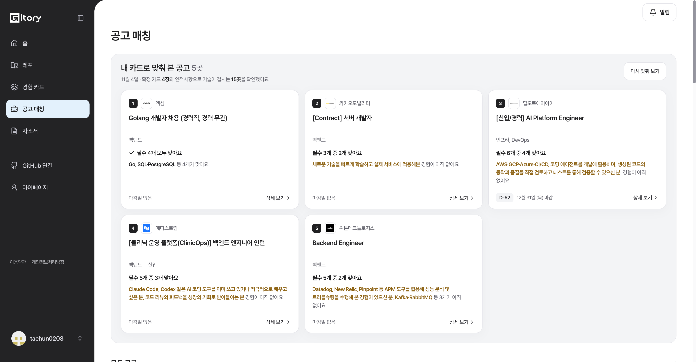
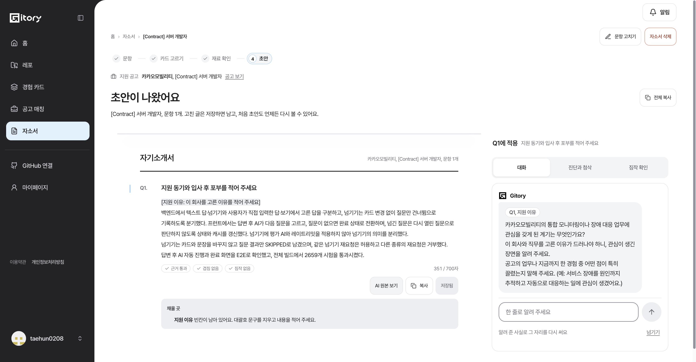

<div align="center">
  

  <h1>Gitory</h1>

  <p><strong>커밋과 PR에서 시작하는 나의 다음 지원</strong></p>
  <p>개발 기록을 근거가 연결된 경험 카드로 정리하고,<br />내 경험에 맞는 채용 공고와 자소서 초안으로 이어갑니다.</p>
  <p>카카오테크 캠퍼스 4기 · 경북대 1팀</p>

  <p>
    <a href="https://gitory.duckdns.org/"><strong>Gitory 시작하기 ↗</strong></a> ·
    <a href="./docs/README.md">개발 문서</a> ·
    <a href="./CONTRIBUTING.md">기여 가이드</a>
  </p>
  <p>
    <a href="#서비스-소개">서비스 소개</a> ·
    <a href="#주요-기능과-화면">기능과 화면</a> ·
    <a href="#근거를-남기는-방식">근거 검증</a> ·
    <a href="#서비스-구성">서비스 구성</a> ·
    <a href="#로컬에서-시작하기">로컬 실행</a> ·
    <a href="#팀-소개">팀 소개</a>
  </p>
</div>

---

## 서비스 소개

커밋은 쌓였지만, 자소서 앞에서는 내가 어떤 문제를 풀었는지 다시 찾아야 합니다.
Gitory는 **개발자 취업 준비생이 GitHub 기록에서 자신의 기여를 찾고, 지원에 쓸 경험으로 정리하는 서비스**입니다.

AI가 커밋·PR·리뷰를 읽어 경험 후보를 묶고, 추천 후보의 코드 변경을 근거로 STAR 초안을 바로 씁니다.
상황과 행동이 채워진 카드는 스스로 확정되고, 확인할 칸이 남은 카드만 사용자가 봅니다. 빈 칸은 AI가 먼저 질문해 채웁니다.
확정 카드는 채용 공고의 조건과 비교하고, 문항별 자소서 초안을 쓰는 재료가 됩니다.

| 경험을 찾습니다 | 근거를 확인합니다 | 지원으로 이어갑니다 |
| :--- | :--- | :--- |
| 저장소에 흩어진 내 작업을 경험 후보로 묶고, 추천 후보로 STAR 초안을 바로 씁니다. | STAR 문장에 연결된 커밋을 확인하고, 부족한 맥락은 AI의 질문에 답해 채웁니다. | 확정 카드로 공고 조건을 비교하고 자소서 초안을 작성·보강합니다. |

> **STAR**는 상황(Situation) · 과제(Task) · 행동(Action) · 결과(Result)로 경험을 설명하는 방식입니다.

```text
GitHub 로그인 → 저장소 선택 → 경험 후보 묶기 → STAR 초안 → 칸이 차면 자동 확정
                                 (추천 후보로 바로)  (빈 칸은 AI가 먼저 질문)
                                                                       ↓
                                    자소서 작성·첨삭 ← 공고 조건과 내 경험 비교
```

## 주요 기능과 화면

아래는 **2026년 11월 9일 [운영 서비스](https://gitory.duckdns.org/)에서 직접 캡처한 화면**입니다.
공개 저장소의 개발 기록으로 만든 경험 카드와 당시의 공고·자소서 초안을 보여 줍니다.
표시된 수치·마감일·매칭 결과는 캡처 시점의 값이며, 이미지를 누르면 원본을 볼 수 있습니다.

### 01. 홈에서 다음 할 일 찾기

내 카드와 맞는 공고, 조건을 채운 경험, 이어서 볼 자소서를 한곳에서 확인합니다.
홈의 입력창에 원하는 일을 한 문장으로 맡기면 AI가 공고 찾기·매칭·자소서 시작 등 필요한 도구를 순서대로 실행합니다.
추가 정보가 필요하면 선택지나 질문으로 되묻고, 결과 화면으로 연결합니다.

[](./docs/images/readme/01-home.png)

### 02. 저장소에서 내 경험 고르기

공개 저장소에서 본인의 커밋·PR·리뷰를 수집하고, 함께 한 작업을 경험 후보로 묶습니다.
후보의 설명과 출처를 살펴보고 **한 번에 최대 10개**를 골라 카드로 만들 수 있습니다.
이미 카드로 만든 일은 별도로 표시하며, 코드에 남지 않은 경험은 직접 작성할 수 있습니다.

<details>
<summary><strong>저장소 선택 · 경험 후보 보드 보기</strong></summary>

**저장소 선택** — 기여가 많은 저장소, 아직 정리하지 않은 저장소, 이미 정리한 저장소를 구분합니다.

[](./docs/images/readme/02-repositories.png)

**경험 후보 보드** — 읽은 기록의 범위와 부분 결과 여부를 확인하고, 카드로 남길 작업을 고릅니다.

[](./docs/images/readme/03-candidates.png)

</details>

### 03. 근거가 연결된 STAR 카드 완성하기

고른 경험의 코드 변경을 분석해 상황·과제·행동·결과 초안을 작성합니다.
각 칸에서 **근거 커밋으로 이동**할 수 있고, 초안을 만든 과정과 작성 이력도 확인할 수 있습니다.

기록만으로 알 수 없는 역할·판단·결과는 AI가 먼저 묻고, 답하면 그 칸을 채웁니다.
상황과 행동이 찬 카드는 스스로 확정되고, 확인할 칸이 남은 카드만 직접 보고 확정합니다. 복사하거나 인쇄해 자소서 작성과 면접 복습에 활용합니다.
경험 카드는 저장소·활동별 폴더와 상태·기술 필터로 관리합니다.

[](./docs/images/readme/04-star-card.png)

### 04. 공고의 조건과 내 경험 비교하기

수집한 개발 직무 공고를 기업·직무로 찾고, 확정한 카드와 인적사항을 바탕으로 조건을 비교합니다.
공고마다 **맞는 조건·부족한 경험·직접 확인할 조건**을 구분하고, 판단의 근거가 된 경험 카드로 연결합니다.
공고 원문으로 이동하거나 해당 공고의 자소서 작성을 시작할 수 있습니다.
공고 목록의 캘린더에서는 마감일과 직접 등록한 면접 등 일정을 확인합니다.

[](./docs/images/readme/06-posting.png)

<details>
<summary><strong>내 카드로 맞춰 본 공고 목록 보기</strong></summary>

[](./docs/images/readme/05-matching.png)

</details>

### 05. 경험 카드로 자소서 쓰고 다듬기

지원 공고와 문항을 입력하면 AI가 문항별로 쓸 경험 카드를 고르고, 부족한 재료를 질문합니다.
답변을 바탕으로 초안을 작성하고, 빠진 내용은 **대화로 채우거나 직접 수정**할 수 있습니다.
진단과 첨삭, 짐작한 내용 확인, 글자 수 확인, 문항별·전체 복사까지 한 화면에서 진행합니다.

[](./docs/images/readme/07-cover-letter.png)

### 그 밖의 기능

- **알림** — 카드 초안이 끝나거나, 정리한 저장소를 다시 읽었거나, 새 공고가 내 카드와 맞으면 화면 위 알림으로 알려 주고 이어서 할 일로 연결합니다.
- **저장소 새 활동 반영** — 정리한 저장소에 새 push가 있으면 홈에 들어올 때 서버가 다시 읽어 새 카드 초안을 만듭니다.
- **맞는 기업 고르기** — 한 저장소의 카드로 맞는 기업을 고르는 과정을 실시간으로 보여 주고, 고른 이유를 함께 남깁니다.
- **기업별 공고 모아 보기** — 한 기업의 공고를 모아 보고, 목록에서 쓰던 검색·직무 조건을 그대로 이어 적용합니다.
- **인적사항** — 관심 분야·학력·경력·어학·자격증을 마이페이지에 입력하면 공고 매칭에 쓰고, 학력·자격증·어학은 자소서 작성에도 씁니다.
- **메일 알림** — 인적사항에서 메일 수신을 켜면 확인 메일과 새 공고 메일을 받습니다.

## 근거를 남기는 방식

Gitory는 AI가 제안한 문장을 코드와 사용자가 함께 확인하도록 설계했습니다.

| 구분 | 맡은 일 |
| --- | --- |
| **AI** | 경험 그룹화, 코드 변경 요약, STAR 초안과 보강 질문, 공고 조건 추출, 자소서 재료 선택·작성·첨삭 |
| **코드** | 본인 기여 필터링, 근거 커밋 존재 확인, 근거 없는 문장 처리, 공고 조건의 원문 인용 검증, 요청·재시도·호출 한도 관리 |
| **사용자** | 확인할 칸이 남은 카드 검토와 확정, AI 질문에 답변, 문장 수정, 자소서 최종 확인 (후보를 직접 고르거나 카드를 직접 쓸 수도 있음) |

- **문장마다 출처를 따라갈 수 있습니다.** 코드에서 찾은 근거와 사용자가 답한 내용을 구분합니다.
- **기록에 없는 내용은 확인을 요청합니다.** 빈칸과 확인 필요 표시를 질문·편집으로 보완합니다.
- **수집 범위와 실패 상태를 드러냅니다.** 부분 수집, 후보 없음, 분석 실패를 구분하고 다음 행동을 안내합니다.

검증 규칙과 관련 테스트는 [가드레일 문서](./docs/GUARDRAILS.md)에 정리했습니다.

## 서비스 구성

### 시스템 아키텍처

[](./docs/images/architecture/system-architecture.svg)

단일 AWS EC2에서 Docker Compose로 운영합니다. **Caddy가 HTTPS와 React 정적 파일을 제공**하고, `/api` 요청은 Spring Boot로 전달합니다.
Spring Boot는 인증·작업 상태·카드·매칭·자소서 데이터를 관리하고 내부 FastAPI에 AI 처리를 요청합니다.
PostgreSQL은 서비스 데이터를, Redis는 사용자별 호출 횟수를, AI의 ChromaDB 색인은 공고 조건 벡터를 보관합니다.

### 경험 정리부터 지원까지의 AI 흐름

[](./docs/images/architecture/ai-pipeline.svg)

LLM은 경험 묶기·STAR 생성·보강 질문·공고 조건 추출·자소서 작성에 사용합니다.
공고 매칭은 조건을 임베딩해 검색한 뒤 카드의 근거와 함께 비교합니다.
기본 생성 모델은 `gpt-5.6-luna`이며 작업별 모델·추론 강도를 환경변수로 설정할 수 있습니다.

> 구성도는 최신 저장소의 구현과 배포 설정 기준입니다. AI 기능·공고 자동 수집·홈 작업 실행 등은 환경변수와 기능 스위치 설정에 따라 활성화됩니다. 상세 설정은 [배포 가이드](./docs/DEPLOYMENT.md)와 [AI README](./ai/README.md)를 확인하세요.

### 기술 스택

| 영역 | 사용 기술 |
| --- | --- |
| Frontend | React 19 · TypeScript · Vite · TanStack Query · React Router · Zod |
| Backend | Java 21 · Spring Boot 4 · Spring Security · Spring Data JPA · Flyway |
| AI | Python 3.11 · FastAPI · Pydantic · OpenAI 호환 LLM 클라이언트 |
| Data | PostgreSQL 17 · Redis 7 · ChromaDB · ONNX 임베딩 / 외부 임베딩 API |
| Infrastructure | AWS EC2 · Docker Compose · Caddy · GitHub Actions · CloudWatch · DB 정기 백업 |
| Test | Vitest · Playwright · JUnit · Testcontainers · ArchUnit · pytest |

## 로컬에서 시작하기

### 프론트엔드 샘플 체험

Node.js 22 이상에서 백엔드 없이 화면과 사용 흐름을 확인할 수 있습니다.

```bash
git clone https://github.com/kakaotechcampus-4/ktc4-kyungpook-1.git
cd ktc4-kyungpook-1/frontend
npm ci
cp .env.example .env.local
npm run dev
```

`http://localhost:5173`에서 **샘플로 체험하기**를 선택하세요.
예시 환경변수의 `VITE_API_MOCK=true`는 브라우저의 샘플 API를 사용합니다. 샘플 데이터는 실제 계정·서버 저장과 구분됩니다.

### 실제 API 연결과 검증

| 작업 | 시작 문서 |
| --- | --- |
| 프론트엔드 API 연결 · 단위/E2E 검사 | [Frontend README](./frontend/README.md) |
| JDK 21 · 로컬 DB · GitHub OAuth · 서버 실행 | [Backend README](./backend/README.md) |
| AI 서버 실행 · LLM·임베딩 설정 · API | [AI README](./ai/README.md) |
| Spring Boot–FastAPI 연결 · 환경변수 | [BE–AI 연결 가이드](./docs/BE_AI_INTEGRATION.md) |
| Docker Compose 배포 · 롤백 · 로그 · 백업 | [배포 가이드](./docs/DEPLOYMENT.md) |

## 팀 소개

**카카오테크 캠퍼스 4기 경북대 1팀**이 기획부터 개발·배포까지 함께 만드는 프로젝트입니다.

| 이름 | 팀 역할 | 프로젝트 역할 | GitHub |
| --- | --- | --- | --- |
| 곽태훈 | 팀장 | Backend | [@taehun0208](https://github.com/taehun0208) |
| 권혁진 | AI 리드 | AI | [@hyukjin0324](https://github.com/hyukjin0324) |
| 김경무 | 플래너 | Frontend | [@ganggang-0605](https://github.com/ganggang-0605) |
| 김태희 | FE 리드 | Frontend | [@TaeHuiKKIM](https://github.com/TaeHuiKKIM) |
| 장성준 | BE 리드 | Backend | [@Grow22](https://github.com/Grow22) |
| 최민서 | 메이커 | AI | [@chxisoei](https://github.com/chxisoei) |

[프로젝트 기여 내역 보기](https://github.com/kakaotechcampus-4/ktc4-kyungpook-1/graphs/contributors)

## 개발 문서

| 알고 싶은 내용 | 문서 |
| --- | --- |
| 서비스가 해결하는 문제와 기획 배경 | [서비스 기획](./docs/overview/service-plan.md) |
| 아키텍처 결정 · 데이터 모델 · 테스트 전략 | [테크스펙](./docs/overview/tech-spec.md) |
| 백엔드 모듈 책임과 의존 방향 | [Backend 아키텍처](./backend/ARCHITECTURE.md) |
| 요청·응답 계약과 API 스냅샷 | [공유 계약](./contracts/README.md) · [OpenAPI](./docs/openapi/README.md) |
| 브랜치 · 커밋 · PR · 리뷰 규칙 | [기여 가이드](./CONTRIBUTING.md) |
| 화면 개선 · 오류 재현 · 발표와 데모 기록 | [개발 문서 모음](./docs/README.md) |
| 화면·구성도 갱신 기준 | [캡처 기록](./docs/images/readme/README.md) · [구성도 출처](./docs/images/architecture/README.md) |

날짜가 있는 기획·작업 문서는 작성 시점의 기록입니다. 현재 기능과 실행 설정은 최신 코드·파트별 가이드·운영 화면을 함께 확인하세요.
