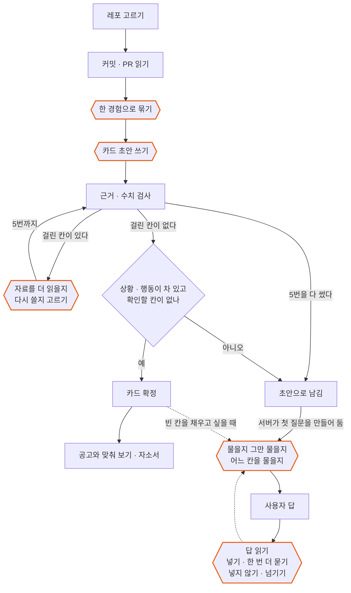

# 에이전트 설계

Gitory 에서 AI 가 스스로 정하는 일이 무엇인지, 그 판단이 엇나가지 않게 무엇이 받쳐 주는지 적었습니다.
막는 장치는 [가드레일](GUARDRAILS.md)에, 품질을 잰 결과는 [평가 결과](../ai/evals/RESULTS.md)에 따로 있습니다.

## 한눈에

레포를 고르고 정리를 시작하면, 정리가 끝까지 성공했을 때 추천 후보로 카드 초안까지 이어서 만들고, 조건이 맞는 카드는 서버가 확정하며, 모자란 카드는 서버가 첫 되묻기 질문을 만들어 둡니다. 부분 결과이거나 초안을 만들지 못하면 후보 보드로 가서 사용자가 고릅니다.
아래 그림에서 주황 육각형은 AI 가 판단하는 곳이고, 네모와 마름모는 코드가 정해진 대로 하는 곳입니다. 걸린 칸을 어떻게 할지, 더 물을지, 답을 넣을지는 AI 가 그때그때 고릅니다.
AI 는 고르기만 합니다. 근거와 수치는 코드가 검사하고, 실행과 저장은 서버가 하며, 확인할 칸이 남은 카드는 확정하지 않습니다.

| 어디서 | AI 가 정하는 것 | 넘지 못하는 선 |
| --- | --- | --- |
| 경험 묶기 | 어느 작업들이 한 경험인지 | 없는 번호는 버리고, 빠뜨린 작업은 따로 살림 |
| 카드 초안 | 걸린 칸을 자료를 더 읽고 쓸지, 지금 근거로 다시 쓸지, 둘지 | 다시 쓰기 5번, 자료 3개 |
| 되묻기 질문 | 물을지 그만 물을지, 어느 칸을 물을지 | 카드마다 8번, 칸마다 2번 |
| 되묻기 답 | 넣기 · 한 번 더 묻기 · 넣지 않기 · 넘기기 | 한 번 더 묻기는 1번, 출처 없는 숫자는 못 넣음 |
| 자소서 | 문항마다 쓸 카드, 걸린 문장을 고칠지 둘지, 맞는 카드가 없는 문항에 쓸 만한 카드·레포 기록 | 다시 쓰기 2번, 질문은 문항마다 4개, 제안은 3개 |
| 홈 한 줄 명령 | 도구 7개 중 부를 것 · 사용자에게 묻기 · 끝내기 | 도구는 6번까지, 같은 일을 되풀이하면 멈춤, 맞춰 보기 전엔 모자란 조건을 채우지 않음 |

## 1. 단계 분기: AI 의 답에 따라 다음 일이 갈립니다

AI 는 코드에 정해 둔 값 중에서만 고릅니다. 목록 밖의 값을 내면 한 번 더 묻거나 코드가 정한 값으로 바꾸고, 그래도 안 되면 미리 정해 둔 기본 동작(틀 질문, 고쳐 쓰기, 실패 처리)으로 넘어갑니다.

### 카드 초안

1. AI 가 상황 · 과제 · 행동 · 결과 네 칸을 씁니다.
2. 코드가 칸마다 검사합니다. 근거 커밋이 없는 문장, 출처가 없는 수치, 클래스·함수 이름처럼 코드에만 나오는 낱말이 걸립니다.
3. 걸린 칸마다 AI 가 셋 중 하나를 고릅니다. 열 자료가 하나도 남지 않았으면 묻지 않고 코드가 다시 쓰기로 정합니다.

| 고르는 값 | 뜻 |
| --- | --- |
| `OPEN` | 이슈 · 리뷰 · 답댓글 중 하나를 더 읽고 다시 씁니다 |
| `REWRITE` | 지금 가진 근거로 다시 씁니다 |
| `KEEP` | 그대로 둡니다 |

4. 다시 쓴 칸에 전에 없던 문제가 생기면, 코드가 고치기 전 글로 되돌립니다.

걸린 칸이 없거나, 5번을 다 썼거나, 모든 칸을 그대로 두기로 했거나, 남은 시간이 10초보다 적으면 멈춥니다.
끝까지 근거를 찾지 못한 문장은 지우고, 출처가 없는 수치는 지우지 않고 '확인 필요' 로 남깁니다.

- 코드: `ai/services/star_generator.py` 의 `_repair` · `_choose` · `_plan` · `_worse`, 검사는 `ai/services/star_check.py`
- 시험: `ai/tests/test_star_repair.py`, `ai/tests/test_star_materials.py`

### 카드 확정

상황과 행동이 채워져 있고 '확인 필요' 칸이 없으면, 사용자가 확정을 누르지 않아도 서버가 카드를 확정합니다.
시간 안에 다 쓰지 못한 카드와 확인할 칸이 남은 카드는 확정하지 않고 초안으로 둡니다.

- 코드: `backend/.../card/domain/Card.java` 의 `settle`, `VersionSlots.java` 의 `isAutoConfirmable`
- 시험: `CardTest`

### 되묻기 질문

초안을 쓴 뒤 확정되지 않은 카드는 서버가 첫 질문을 만들어 둡니다. 사용자는 카드를 열어 답하면 되고, 확정된 카드의 빈 칸도 원하면 질문을 받아 채울 수 있습니다.
첫 질문의 칸은 코드가 정합니다(경험 카드는 상황, 수치가 없는 기술 카드는 결과). 그다음부터는 코드가 물을 수 있는 칸을 추리고, AI 는 그 안에서 어느 칸을 어떻게 물을지(`ASK`), 아니면 그만 물을지(`END`)를 고르고 왜 그렇게 골랐는지 한 줄로 남깁니다. 이 이유는 사용자가 칸을 직접 고르지 않았을 때 화면에 보입니다.

- 고를 수 없는 칸을 고르면 한 번 다시 묻고, 또 어기면 정해 둔 질문을 씁니다.
- 한 카드에 8번, 같은 칸은 2번까지 묻습니다. 건너뛴 칸은 다시 묻지 않습니다.
- 서버가 스스로 만드는 첫 질문은 카드당 한 번이고 사용자의 호출 한도에 세지 않습니다. AI 가 못 만들면 그냥 두고, 사용자가 칸을 직접 쓰면 그 칸을 묻던 질문은 닫습니다.
- 코드: `ai/services/interview_agent.py`, `ai/services/interview_llm.py`, `backend/.../card/domain/interview/InterviewAskService.java`, `InterviewAutoAsker.java`
- 시험: `ai/tests/test_interview_llm_loop.py`, `InterviewAskServiceTest`, `InterviewAutoAskerTest`

### 되묻기 답

사용자의 답은 그대로 카드에 들어가지 않습니다. AI 가 먼저 읽고 넷 중 하나로 처리합니다.

| AI 의 판단 | 그다음 |
| --- | --- |
| `APPLY` 쓸 만하다 | 카드 문장으로 다듬어 그 칸에 넣습니다. 답이 다른 빈 칸 얘기까지 담고 있으면 그 칸도 같이 채웁니다 |
| `ASK_MORE` 조금 모자라다 | 빠진 것 하나를 한 번 더 묻습니다 |
| `OFF_TOPIC` 질문과 상관없다 | 카드에 넣지 않고 같은 질문을 그대로 둡니다 |
| `DONT_KNOW` 모르겠다고 한다 | 그 질문을 넘깁니다 |

- '하하하하' 처럼 뜻 없는 글자만 적은 답은 모델을 부르지 않고 카드에도 넣지 않습니다.
- 한 번 더 묻기는 한 번만 합니다.
- 넣은 문장은 다음 답을 보내기 전까지 화면에서 고치거나 넣기 전으로 되돌릴 수 있습니다.
- 코드: `ai/services/interview_llm.py` 의 `reply`, `backend/.../card/domain/InterviewReplyService.java`
- 시험: `ai/tests/test_interview_reply.py`, `InterviewReplyApiTest`

### 자소서

- 문항마다 AI 가 내 확정 카드 중에서 쓸 카드를 고릅니다. 문항들이 같은 카드를 고르거나 2순위 카드를 두었을 때는, 감독 역할의 AI 가 문항마다 1순위, 2순위, 카드 없이 쓰기 중 무엇을 쓸지 정합니다. 감독이 답하지 못하면 코드가 뒤 문항을 2순위로 바꿉니다.
- 재료가 모자라면 쓰기 전에 사용자에게 묻습니다. 문항마다 4개까지입니다.
- 쓴 글은 코드가 검사합니다. 카드에 없는 숫자나 낱말이 걸리면 고칠지 둘지를 AI 가 정하고, 다시 쓰기는 문항마다 2번까지입니다.
- 마지막에 전체를 한 번 읽습니다. 문항끼리 같은 이야기를 되풀이하거나 문항이 묻는 것에서 벗어난 곳이 있으면 그 문항만 한 번 더 씁니다.
- 맞는 카드가 없는 문항은 대화를 열 때 AI 가 이 자소서가 아직 쓰지 않은 확정 카드와 카드가 되지 않은 레포 기록(경험 후보) 가운데 맞는 것을 3개까지 골라 한 줄 이유와 함께 보여 줍니다. 사용자가 고르면 그 카드로 그 문항만 처음부터 다시 쓰고, 레포 기록이면 카드를 먼저 만든 뒤 확정되면 다시 씁니다. 맞는 것이 없으면 빈 목록이고, 사용자는 떠오르는 일을 말로 이어 갑니다.
- 코드: `ai/services/cover_letter_assigner.py`, `cover_letter_asker.py`, `cover_letter_writer.py`, `cover_letter_drafter.py`, `cover_letter_suggester.py`
- 시험: `ai/tests/test_cover_letter_assignment.py`, `ai/tests/test_cover_letter_drafts.py`, `ai/tests/test_cover_letter_suggest.py`

### 홈 한 줄 명령

사용자가 할 일을 한 줄로 적으면, AI 가 걸음마다 셋 중 하나를 고릅니다.

| 고르는 값 | 뜻 |
| --- | --- |
| `CALL_TOOL` | 도구 하나를 부릅니다 |
| `ASK_USER` | 꼭 필요한 것이 빠졌을 때만 사용자에게 묻습니다 |
| `FINISH` | 한 일과 결과를 알리고 끝냅니다 |

- 도구를 실제로 돌리는 것은 Spring 입니다. AI 는 고르기만 하고, 결과를 받아 다음 걸음을 다시 고릅니다.
- 한 번 실행에 도구는 6번까지 부릅니다. 이미 성공한 일을 같은 값으로 또 고르면 한 번 다시 묻고, 그래도 같으면 끝냅니다.
- 코드: `ai/services/assistant_step.py`, `backend/.../assistant/domain/AssistantRunner.java`
- 시험: `ai/tests/test_assistant_step.py`, `AssistantRunnerTest`

## 2. 도구 연동: AI 가 쓰는 도구

### 홈 한 줄 명령의 도구

| 도구 | 하는 일 |
| --- | --- |
| `FIND_POSTINGS` | 회사 이름이나 키워드로 공고를 찾습니다(5건까지) |
| `MATCH_POSTING` | 찾은 공고를 내 확정 카드와 맞춰 봅니다 |
| `START_COVER_LETTER` | 사용자가 적은 문항으로 자소서 쓰기를 시작합니다 |
| `START_REPO_ANALYSIS` | 내 레포 정리를 시작합니다 |
| `FILL_POSTING_GAPS` | 맞춰 본 공고의 모자란 조건에 쓸 근거를 내 레포에서 찾습니다(맞춰 본 뒤에만, 카드로 만드는 것은 사용자) |
| `ASK_CARD_GAP` | 빈 칸이 있는 확정 카드에 질문 하나를 엽니다 |
| `POLISH_COVER_LETTER` | 초안이 끝난 자소서를 첨삭합니다(안 한 문항부터 3개까지) |

- AI 는 진짜 id 를 모릅니다. 공고는 `p1`, 레포는 `r1`, 카드는 `c1`, 자소서는 `l1` 같은 이름표만 보고, 이름표를 진짜 값으로 바꾸는 일은 서버가 합니다. 그래서 AI 가 남의 공고나 레포를 가리킬 수 없습니다.
- 도구마다 받을 수 있는 값이 정해져 있고, 벗어나면 실행하지 않습니다.
- 코드: `backend/.../assistant/domain/AssistantTools.java`, `ToolCall.java`

### 카드 초안이 여는 자료

처음 쓸 때는 커밋과 PR 만 봅니다. 걸린 칸이 있을 때만 그 칸에 필요한 자료를 골라 엽니다.

| 자료 | 쓸 수 있는 칸 |
| --- | --- |
| 이슈 | 상황 · 과제 |
| 리뷰 | 상황 · 과제 |
| 내가 단 답댓글 | 네 칸 모두 |

한 카드에서 3개까지 엽니다. 목록에 없는 자료를 고르면 코드가 무시합니다.

### 바깥 서비스

- GitHub 에서 커밋 · PR · 이슈 · 리뷰를 읽습니다(`ai/services/github_collector.py`).
- 공고 조건은 임베딩 검색으로 찾습니다(`ai/rag/`).

## 3. 상태 관리: 끊겨도 이어 갑니다

오래 걸리는 일은 모두 DB 에 상태를 남깁니다. 화면을 닫았다 와도, 서버가 다시 켜져도 이어 갑니다.

### 홈 한 줄 명령의 실행

| 상태 | 뜻 | 다음 |
| --- | --- | --- |
| `RUNNING` | 줄을 서 있거나 돌고 있음 | 사용자에게 물으면 `WAITING_USER`, 끝나면 `DONE`, 실패하면 `FAILED` |
| `WAITING_USER` | 사용자의 답을 기다림 | 답이 오면 다시 `RUNNING` |
| `DONE` · `FAILED` | 끝남 | 더 바뀌지 않음 |

- 걸음을 시작할 때 '하는 중' 으로 먼저 적고, 끝나면 결과로 바꿉니다. 어디까지 했는지가 늘 남습니다.
- 서버가 다시 켜지면 돌던 실행을 다시 줄 세웁니다. 하다 만 걸음은 실패로 닫고 이어 갑니다.
- 5분 동안 진행이 없으면 실패로 닫습니다. 그 뒤에 늦게 온 결과는 버립니다.
- 두 워커가 같은 실행을 집지 않게 DB 잠금으로 집습니다.
- 코드: `backend/.../assistant/domain/AssistantRun.java`, `AssistantRunner.java`, `AssistantWorker.java`
- 시험: `AssistantRunnerTest`

### 레포 정리 작업

- `QUEUED` 에서 `RUNNING` 을 거쳐 `SUCCEEDED` · `FAILED` · `CANCELED` 중 하나로 끝납니다.
- 단계(커밋 읽기, PR과 리뷰 읽기, 후보로 추리기, 추천 이유 붙이기)마다 진행을 남기고, 화면이 그대로 보여 줍니다.
- 서버가 다시 켜지면 돌던 작업을 다시 줄 세웁니다. 오래 진행이 없으면 실패로 닫습니다.
- 코드: `backend/.../job/domain/AnalysisJob.java`, `JobRunner.java`, `JobWorker.java`
- 시험: `AnalysisJobTest`, `JobRunnerTest`

### 되묻기

- 질문마다 결과(답함, 넘김, 한 번 더 물음)를 남깁니다.
- 이미 끝난 질문에 같은 답이 다시 오면 AI 를 부르지 않고 처음 결과를 돌려줍니다.
- 답을 읽는 사이에 카드가 바뀌었으면 넣지 않고, 저장되지 않았다고 알립니다.

## 4. 예외 처리: AI 가 답을 못 줄 때

AI 가 늦거나 정해진 모양에서 벗어난 답을 주면 한 번 다시 묻습니다. 그래도 안 되면 일마다 정해 둔 길로 갑니다.
사용자는 무슨 일이 있었는지와 다음에 할 수 있는 일을 화면에서 봅니다.

| 어디서 | 모델이 답을 못 주면 | 사용자가 보는 것 |
| --- | --- | --- |
| 경험 묶기 | 작업을 실패로 닫습니다 | "AI가 잠시 응답하지 않아요" 와 `다시 시도` |
| 카드 초안 | 시간이 모자라면 못 쓴 칸을 비우고, 스스로 확정하지 않습니다 | "시간 안에 다 채우지 못했어요" |
| 되묻기 질문 | 정해 둔 질문으로 대신합니다 | 질문이 그대로 옵니다 (AI 서버 자체가 응답하지 않으면 오류 안내) |
| 되묻기 답 | 카드에 아무것도 넣지 않습니다 | "지금은 문장으로 다듬지 못했어요. 적은 그대로 넣을까요?" |
| 자소서 | 못 쓴 문항은 빈칸을 둔 뼈대로 주고, 전체가 실패하면 실패로 닫습니다 | "초안 쓰기를 마치지 못했어요" 처럼 멈춘 단계가 든 제목과 `다시 시도`(다시 할 수 있을 때) |
| 자소서 제안·다시 쓰기 | 제안을 못 받으면 저장하지 않고 다음에 대화를 열 때 다시 묻습니다. 고른 카드로 다시 쓰지 못하면 카드도 글도 바꾸지 않습니다 | 제안 없이 대화만 열립니다. 다시 쓰기는 "다시 쓰지 못했어요. 글은 그대로예요" |
| 홈 한 줄 명령 | 이미 시작한 자소서나 정리가 있으면 그 결과로 가는 버튼과 함께 끝내고, 없으면 실패로 닫습니다 | 실패했을 때 "지금은 답을 받지 못했어요. 할 일을 다시 적어 주세요." |

화면에 뜨는 말 전체는 [가드레일 문서의 4절](GUARDRAILS.md#4-ai-가-실패했을-때-화면에-보이는-말)에 있습니다.
레포 정리 중 AI 가 응답하지 않을 때 안내가 뜨고 다시 시도하면 끝까지 가는지는, 서비스 코드가 바뀔 때마다 전체 서비스 E2E 시험이 확인합니다(`e2e/tests/scenario-4-ai-outage.spec.ts`).

## 5. 이렇게 만든 이유

- **AI 는 고르고, 실행과 저장은 서버가 합니다.** AI 가 잘못 골라도 실행하기 전에 걸러집니다. 사용자 데이터는 AI 가 준 값이 아니라 로그인한 사용자 기준으로만 읽습니다.
- **근거 확인은 AI 에게 맡기지 않습니다.** 커밋 번호 대조와 수치 확인은 코드가 합니다. 같은 입력이면 늘 같은 결과가 나와야 하는 일이기 때문입니다. 커밋 번호를 대조하는 Spring 코드는 AI 를 부르는 모듈을 쓰지 못하게 빌드에서 막아 두었습니다(`ModuleBoundaryTest`).
- **모든 반복에 끝이 있습니다.** 다시 쓰기, 질문, 걸음마다 상한이 있고, 같은 일을 되풀이하면 멈춥니다.
- **순서가 늘 같은 곳은 코드로 고정했습니다.** 커밋을 읽고, 묶고, 초안을 쓰는 순서는 매번 같아서 AI 가 고를 것이 없습니다. AI 의 판단은 다음 일이 내용에 따라 달라지는 곳에만 두었습니다. 걸린 칸을 어떻게 할지, 더 물을지, 답을 넣을지가 그런 곳입니다.
- **사람에게는 꼭 필요할 때만 묻고, 왜 묻는지 보여 줍니다.** 되묻기 질문에는 AI 가 판단한 이유가 한 줄 붙고, 그만 물을 때도 이유를 남깁니다.

## 6. 더 읽을 곳

| 궁금한 것 | 문서 |
| --- | --- |
| 막는 장치와 그것을 확인하는 시험 | [가드레일](GUARDRAILS.md) |
| 품질을 재고 고친 기록 | [평가 결과](../ai/evals/RESULTS.md) |
| Spring 과 AI 가 주고받는 모양 | [BE–AI 연동](BE_AI_INTEGRATION.md), [분석과 STAR 생성](AI_DIFF_STAR_INTEGRATION.md) |
| 화면이 진행을 보여 주는 방식 | [정리 중 한 줄 안내](../frontend/docs/2026-10-29-AGENT_ACTIVITY.md), [카드를 만든 과정](../frontend/docs/2026-10-29-DRAFT_STEPS.md), [홈 한 줄 명령](../frontend/docs/2026-11-05-ASSISTANT.md) |
