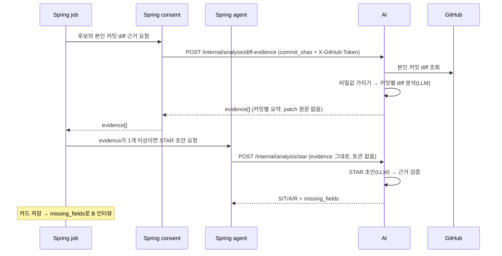

# A 파트 diff 근거·STAR 초안 연동 (BE 공유용)

사용자가 확정한 경험 후보 하나를 **인터뷰 전 STAR 초안**으로 만드는 단계의 Spring ↔ AI 계약입니다.
AI는 API 두 개를 제공하고, Spring이 같은 Job 안에서 차례로 호출합니다.
**GitHub 토큰은 `consent` 모듈 밖으로 나가지 않으므로**, 토큰이 필요한 diff-evidence는 `consent`가, 토큰이 필요 없는 star는 `agent`가 부릅니다.



## 왜 두 API로 나눴나

| 기준 | 결정 |
|---|---|
| GitHub 토큰 | 토큰이 필요한 단계(diff-evidence)와 필요 없는 단계(star)를 나눠, 토큰은 `consent`만 다룬다 |
| diff 원문 | AI 안에서만 쓴다. Spring은 커밋당 수백 자 요약만 받는다. patch는 DB에 저장하지 않는다는 기존 규칙과 같다 |
| `/star` 계약 | 기존 `StarAnalysisRequest` 형태 그대로다. `evidence`에 diff-evidence 응답을 넣기만 하면 된다 |
| 타임아웃·재시도 | 단계마다 따로 잡고, 실패한 단계만 다시 부를 수 있다 |
| 재사용 | evidence를 저장하면 STAR 재생성, B 인터뷰 질문, 근거 표시 화면에 다시 쓸 수 있다(선택) |

## 기존 결정과의 관계

이 계약은 이미 합의된 원칙 위에서, 비어 있던 한 단계를 채운다.

| 기존 결정 | 출처 | 이 계약에서 |
|---|---|---|
| 수집은 두 단계다. 처음엔 메타데이터만, diff는 **선택된 후보만** 다시 조회한다 | PR #65, `ai/README.md` | 그대로. diff-evidence가 선택된 후보의 본인 커밋만 조회한다 |
| 상세 diff는 분석 중에만 쓰고 DB에 저장하지 않는다. Spring은 결과 문장과 근거 sha만 있으면 된다 | PR #65 BE 답변 | 그대로. patch는 Spring에도 넘어가지 않는다 |
| 후보 선정·그룹화·STAR 초안은 A가 만들고, Spring은 저장 후 B에 근거를 넘긴다 | PR #65, `contracts/README.md` | 그대로 |
| 후보 확정 → `card.compose` → `agent`(LLM) | `backend/ARCHITECTURE.md` 데이터 흐름 | star는 `agent`가 부른다. 토큰이 필요한 diff-evidence는 `consent`가 부른다(#132 리뷰) |
| STAR 입력은 diff 원문이 아니라 요약된 근거다 | AI `StarAnalysisRequest.evidence`, BE `DraftRequest.evidenceSummaries` | 그대로. 그 요약을 diff-evidence가 만든다 |

**비어 있던 단계:** `candidate-details`는 patch를 Spring에 돌려주고 "A의 diff 해석용"이라고만 적혀 있었다. 그런데 `/star`와 `DraftRequest`는 이미 요약된 근거를 받아서, **patch를 읽어 요약을 만드는 주체가 없었다.** diff-evidence가 이 자리를 AI 안에서 채운다.

STAR 흐름에서 Spring이 `candidate-details`를 직접 부를 필요는 없어졌다. `candidate-details`는 그대로 두고, diff-evidence가 내부에서 같은 조회를 재사용한다.

## BE 포트(`agent.port`)와의 필드 대응

현재 BE의 `CardDraftPort`는 AI 계약보다 정보가 적다. 특히 **결과 쪽에 칸 상태·빈 칸 목록이 없어서 B 인터뷰로 넘길 수 없으므로** 포트를 넓혀야 한다.

### `DraftRequest` → `/star` 요청

| BE `DraftRequest` | AI `StarAnalysisRequest` | 비고 |
|---|---|---|
| `analysisTargetLogin` | `target_login` | 같음 |
| `evidenceSummaries: List<String>` | `evidence[].summary` | **문자열 목록으로 펴면 안 된다.** 문장 근거를 sha로 연결하려면 커밋별 구조가 필요하다 |
| `churnLines: List<String>` | `evidence[].churn` | 커밋별 구조 안으로 들어간다 |
| `dependencyFiles` | `dependency_files` | 아직 사용하지 않음. `[]` |
| `answers` | `confirmed_answers` | 인터뷰 전이라 항상 `[]` |
| (없음) | `candidate_id`, `title`, `source_type`, `source_ref` | 추가 필요 |
| (없음) | `evidence[].sha`·`message`·`author_login`·`url`·`technical_points`·`summary_source` | diff-evidence 응답에 이미 들어 있다 |

**제안:** `DraftRequest`가 evidence를 문자열로 바꾸지 말고, diff-evidence 응답의 `evidence`를 **그대로 담아 넘기게** 한다. 필드가 늘어나도 BE 포트를 다시 고칠 필요가 없다.

### `/star` 응답 → `CardDraft`

| AI `StarAnalysisResponse` | BE `CardDraft` | 비고 |
|---|---|---|
| `title` | `title` | 같음 |
| `star.*.text` | `starText` | 같음 |
| `star.*.evidence[].sha` | `starEvidence` | sha만 옮기면 `message`·`url`은 버려진다(표시에 필요하면 추가) |
| `shared_with` | `sharedWith` | 같음 |
| `removed_claims` | `removed` | 같음 |
| `star.*.status` | **(없음)** | `FILLED`/`NEEDS_REVIEW`/`EMPTY`. 화면 칸 상태 |
| `star.*.confidence` | **(없음)** | `card_statement.confidence` |
| `star.*.insufficient_reason_code` | **(없음)** | 화면 `droppedFields.reason`(`NO_EVIDENCE`·`OVERCLAIM`·`UNSOURCED_NUMBER`·`TIMEOUT`) |
| `missing_fields` | **(없음)** | **B 인터뷰의 `missing_slots` 입력. 없으면 인터뷰를 시작할 수 없다** |
| `star.*.insufficient_reason`, `review_reason` | **(없음)** | 빈 칸·검토 필요 안내 문장 |

## 1. `POST /internal/analysis/diff-evidence` (`consent`가 호출)

### 요청

헤더 `X-GitHub-Token`: `/internal/collect`와 같은 방식으로 복호화한 토큰을 헤더에만 넣는다.

| 필드 | 타입 | 필수 | 설명 |
|---|---|---|---|
| `user_repository_id` | 양의 정수 | ✅ | 연결 저장소 ID. 응답에 그대로 돌아온다 |
| `repository` | object | ✅ | `github_repo_id`, `owner_login`, `name`, `default_branch` (수집 요청과 같다) |
| `commit_shas` | string[] (1개 이상) | ✅ | **후보에 속한 요청자 본인 커밋 SHA.** 51개 이상이면 앞 50개만 분석하고 `partial`로 알린다 |
| `github_pr_number` | 양의 정수 | | PR 후보면 PR 번호. 응답에 그대로 돌려줄 뿐 **커밋 조회에는 쓰지 않는다** |
| `title` | string (1자 이상) | ✅ | 후보(카드) 제목. 길이 상한 없음. 모델에는 앞 300자만 보낸다 |

PR 번호로 커밋을 고르지 않는다. PR에는 팀원 커밋과 기본 브랜치에 없는 커밋이 섞이기 때문이다. Spring이 고른 본인 커밋만 분석한다.

```json
{
  "user_repository_id": 7,
  "repository": {"github_repo_id": 123456, "owner_login": "kakaotechcampus-4", "name": "ktc4-kyungpook-1", "default_branch": "develop"},
  "commit_shas": ["0da9788", "6dba449"],
  "github_pr_number": 111,
  "title": "분석 Job 응답에 연결 저장소 id 추가"
}
```

### 응답 `data` (`DiffEvidenceResult`)

| 필드 | 설명 |
|---|---|
| `user_repository_id`, `github_pr_number` | 요청값 |
| `evidence[]` | 요청한 커밋 순서의 커밋별 근거(아래 표). 빠진 커밋은 들어 있지 않다 |
| `partial` | **요청한 커밋 일부가 근거에서 빠졌을 때만** `true`. 파일 patch가 잘리거나 생성 파일을 뺀 것은 partial이 아니다 |
| `partial_reason` | `CAP_EXCEEDED`(50개 초과분) · `GITHUB_RATE_LIMITED`(한도 소진) · `COMMIT_UNAVAILABLE`(GitHub이 커밋을 찾지 못함, 422). 여럿이면 `GITHUB_RATE_LIMITED` > `COMMIT_UNAVAILABLE` > `CAP_EXCEEDED` 순으로 하나 |
| `missing_commit_shas` | 요청했지만 근거에서 빠진 커밋 SHA |

`evidence[]` 항목 (`DiffEvidence`)

| 필드 | 설명 |
|---|---|
| `sha`, `message`, `author_login`, `url` | 커밋 정보. `message`는 비밀값을 가리고 2,000자로 자른 값 |
| `churn` | `"+71/-0"` 형식의 변경량 |
| `summary` | 이 커밋이 무엇을 어떻게, 왜 바꿨는지 한 문장(최대 200자) |
| `summary_source` | **필수.** `DIFF`: 모델이 diff를 읽고 쓴 요약. `COMMIT_MESSAGE`: 모델 요약을 쓸 수 없어 커밋 메시지 첫 줄로 대신한 값(아래) |
| `technical_points` | patch에서 확인한 기술적 선택 최대 3개. 없으면 `[]` |

`summary_source=COMMIT_MESSAGE`가 되는 경우: 모델이 그 커밋을 빠뜨림, 요약이 비어 있음, 그 커밋 하나만으로도 출력 상한을 넘음, 콘텐츠 제한에 걸림, 요청 마감·호출 수 상한에 닿음. **실패하지 않고 커밋은 근거에 남는다.** STAR 단계는 이런 근거만으로 받친 문장의 신뢰도를 `MEDIUM`으로 낮춘다.

`meta.tool_calls_made`는 GitHub API 호출 수다.

### 오류

| HTTP | `error.code` | `retryable` | 상황 |
|---|---|---|---|
| 400 | `INVALID_PAYLOAD` | false | 필드·헤더 누락, `commit_shas` 없음·빈 배열 |
| 404 | `RESOURCE_NOT_FOUND` | false | 저장소가 없거나 토큰 권한으로 읽을 수 없음 |
| 502 | `GITHUB_API_ERROR` | **false** | GitHub 400·401·403·422(토큰 만료·권한 없음 등, 다시 해도 같음) |
| 502 | `GITHUB_API_ERROR` | true | GitHub 5xx·네트워크 오류·조회가 마감 안에 끝나지 않음 |
| 503 | `LLM_UNAVAILABLE` | **false** | AI 서버에 LLM 환경변수가 없음, LLM 키·권한·모델 이름 오류. **설정은 GitHub 조회 전에 확인한다** |
| 503 | `LLM_UNAVAILABLE` | true | LLM 호출 한도·연결 오류, 출력 형식이 재시도 후에도 맞지 않음 |

커밋 SHA 하나가 422면 요청 전체를 실패시키지 않고 그 커밋만 빼고 `partial`로 돌려준다.

## 2. `POST /internal/analysis/star` (`agent`가 호출)

인터뷰 전에 호출하므로 `confirmed_answers`는 빈 배열로 보낸다. **diff-evidence의 `evidence`가 비면 호출하지 않는다**(AI도 `evidence`가 비면 400).

| 필드 | 보낼 값 |
|---|---|
| `candidate_id` | 후보 ID(문자열) |
| `target_login` | 요청자 GitHub 로그인. 근거 커밋에 다른 작성자가 있으면 `shared_with`로 알려 준다 |
| `title`, `source_type`, `source_ref` | 후보(카드) 제목(길이 상한 없음), `PR`/`COMMIT_CLUSTER`, 예: `"PR #111"` |
| `evidence` | **diff-evidence 응답의 `evidence`를 그대로** 보낸다. 1개 이상 |
| `dependency_files` | `[]` (아직 사용하지 않음) |
| `confirmed_answers` | `[]` |

### 응답 `data` (`StarAnalysisResponse`) → 카드 저장

| 필드 | 의미 | 저장·사용 |
|---|---|---|
| `star.{S,T,A,R}.status` | `FILLED` / `NEEDS_REVIEW` / `EMPTY` | 프론트 `StarFieldState`와 같은 값 |
| `star.*.text` | STAR 문장(최대 200자). EMPTY면 `null` | `card_statement.body` |
| `star.*.confidence` | `HIGH` / `MEDIUM` / `LOW`. NEEDS_REVIEW는 항상 `LOW`, 커밋 메시지로만 받친 문장은 `MEDIUM` | `card_statement.confidence` |
| `star.*.evidence[]` | 문장을 받치는 커밋 `sha`·`message`·`url`. 입력에 있는 SHA만 남는다 | 문장 근거 링크(`evidence_type = COMMIT`) |
| `star.*.insufficient_reason_code` | EMPTY 칸의 이유 코드 | 화면 `droppedFields.reason` |
| `star.*.insufficient_reason` | EMPTY인 이유 문장 | 로그·보조 안내 |
| `star.*.review_reason` | NEEDS_REVIEW인 이유 | 화면 안내 |
| `missing_fields` | EMPTY 칸 목록 | **B 인터뷰의 `missing_slots` 입력** |
| `shared_with` | 근거 커밋의 다른 작성자 로그인(쉼표 구분). 없으면 `null` | 공동 작업 표시. 커밋을 빼지는 않는다(ARCHITECTURE.md 기여 귀속 규칙) |
| `removed_claims` | 근거 커밋과 확인 답변이 없어 AI가 지운 문장 | 저장·표시하지 않음. 품질 확인용 로그 |

`insufficient_reason_code` 값

| 코드 | AI가 내는 경우 |
|---|---|
| `NO_EVIDENCE` | 모델이 근거가 없다고 비움, 또는 인용한 커밋이 입력에 하나도 없어 AI가 지움 |
| `UNSOURCED_NUMBER` | 계약 호환용 예약 코드. 현재 생성에서는 반환하지 않음 |
| `TIMEOUT` | 마감(150초) 안에 초안을 받지 못함. 네 칸 모두 이 코드로 비우고 **200**을 반환한다 |
| `OVERCLAIM` | 계약에만 있다. Spring이 본인 커밋만 보내므로 AI는 지금 내지 않는다 |

**FILLED·NEEDS_REVIEW 문장에는 근거 커밋이 항상 1개 이상 붙는다.** 근거 0개 문장은 AI가 비우므로, "근거 0개 문장은 화면에 뜨지 않는다"(규칙 4)는 이미 지켜진 상태로 넘어간다.

### 오류

| HTTP | `error.code` | `retryable` | 상황 |
|---|---|---|---|
| 400 | `INVALID_PAYLOAD` | false | 스키마 불일치, `evidence` 비어 있음, `summary_source` 없음 |
| 503 | `LLM_UNAVAILABLE` | false | LLM 설정 없음, 키·권한·모델 이름 오류, 콘텐츠 제한 |
| 503 | `LLM_UNAVAILABLE` | true | LLM 호출 한도·연결 오류, 출력 형식이 재시도 후에도 맞지 않음 |

## 3. 처리 시간과 상한

AI는 **요청 하나의 전체 마감**을 두고, 마감 안에서만 GitHub·LLM을 호출한다. 마감에 닿으면 새 호출을 시작하지 않고, 진행 중인 LLM 호출도 남은 시간만 기다린다. Spring이 끊은 뒤 AI가 LLM 호출을 계속하지 않도록 **마감을 Spring 대기보다 짧게** 잡았다.

| API | AI 마감 | Spring 대기(제안) | 마감에 닿으면 |
|---|---|---|---|
| diff-evidence | 240초(GitHub 조회 포함) | 300초 | 남은 커밋은 커밋 메시지 요약(`COMMIT_MESSAGE`)으로 200 |
| star | 150초 | 180초 | 네 칸 `TIMEOUT`으로 200 |

diff-evidence의 그 밖의 상한

| 항목 | 값 |
|---|---|
| 분석 커밋 수 | 50개(넘으면 `CAP_EXCEEDED`) |
| LLM 호출 하나의 커밋 수 | 8개(출력이 길면 절반씩 나눠 다시 호출) |
| 요청 하나의 LLM 호출 수 | 16회(분할·재시도 포함). 넘으면 남은 커밋은 커밋 메시지 요약 |
| 동시 LLM 호출 | 3개 |
| LLM 호출 하나의 입력 | JSON 전체 64,000자, 그중 patch 24,000자 |
| 커밋 하나의 파일 목록 | 20개(변경량이 큰 순). 넘는 파일과 생성 파일(lock·빌드 산출물·이미지)은 개수만 보낸다 |

실제 LLM으로는 아직 측정하지 않았다. 모델 평가(Luna·medium) 기준으로 커밋 8개 이하 후보는 diff-evidence 약 10~20초, star 수 초로 추정한다. `backend/ARCHITECTURE.md`의 이전 실측값(초안 생성 122~139초, STAR 배치 140~315초)은 상한 참고값이다.

## 4. AI 운영 환경변수

그룹화(#109)와 같은 코드(`ai/services/llm_settings.py`)로 읽는다. 연결 정보는 공유하고, 모델과 추론 강도만 작업별로 바꿀 수 있다.

| 변수 | 기본값 | 설명 |
|---|---|---|
| `GITORY_LLM_BASE_URL` | (필수) | OpenAI 호환 게이트웨이 주소 |
| `GITORY_LLM_API_KEY` | (필수) | 게이트웨이 키. 없으면 503 `retryable=false` |
| `GITORY_LLM_TIMEOUT_SECONDS` | `120` | 마감이 없는 호출(그룹화)의 LLM 호출 하나 대기 제한. diff·STAR는 남은 마감 시간을 쓴다 |
| `GITORY_GROUPING_MODEL` / `GITORY_GROUPING_REASONING_EFFORT` | `gpt-5.6-luna` / `medium` | 경험 그룹화(#109) |
| `GITORY_DIFF_MODEL` / `GITORY_DIFF_REASONING_EFFORT` | `gpt-5.6-luna` / `medium` | diff 분석 |
| `GITORY_STAR_MODEL` / `GITORY_STAR_REASONING_EFFORT` | `gpt-5.6-luna` / `medium` | STAR 초안 |

설정이 없어도 AI 서버는 정상 기동한다. 해당 API를 호출할 때만 503을 반환한다.

## 5. BE 작업 목록

- [ ] `consent`: diff-evidence 호출 추가(`X-GitHub-Token` 헤더, 토큰 검증은 `collect`와 동일). `commit_shas`에 본인 커밋만 넣는다
- [ ] `agent`: star 호출 추가. `evidence`가 비면 부르지 않는다. `confirmed_answers`는 `[]`
- [ ] `CardDraftPort` 확장: 요청은 evidence 구조를 그대로, 응답에 `status`·`confidence`·`insufficient_reason_code`·`missing_fields` 추가(「BE 포트와의 필드 대응」)
- [ ] 분석 호출용 읽기 제한 분리(3절: diff-evidence 300초, star 180초)
- [ ] Job 흐름: 후보 확정 → diff-evidence → star → 카드·`card_statement` 저장 → `missing_fields`로 인터뷰 시작
- [ ] `retryable` 값에 따라 Job 재시도 또는 실패 처리(`retryable=false`는 재시도하지 않음)
- [ ] `partial=true`이면 카드는 만들되 `missing_commit_shas`가 반영되지 않았다는 사실을 Job 결과에 남김
- [ ] AI 컨테이너에 4절 환경변수 주입(키는 비밀값으로 관리)

## 6. 정할 것

1. **evidence 저장 여부.** 저장하면 STAR 재생성과 B 인터뷰 질문(커밋 메시지 대신 diff 요약으로 질문)에 다시 쓸 수 있다. 저장하지 않으면 같은 Job 안에서만 쓴다.
2. **`removed_claims`·`shared_with` 처리.** 로그만 남길지, 화면에 공동 작업 표시를 할지.
3. **`CardDraftPort` 확장 방식.** AI 응답을 그대로 담는 DTO로 바꿀지, 필요한 필드만 추가할지.
4. **`contracts/ingest/candidate-details.json` 설명 갱신.** STAR 흐름에서는 Spring이 직접 부르지 않는다는 점을 계약 설명에 남길지. 계약 파일은 바꾸면 세 파트 테스트가 함께 깨질 수 있어, 합의 후 바꾼다.

## 리뷰 반영(#132)

| # | 리뷰 | 반영 |
|---|---|---|
| 1 | 토큰이 `consent` 밖으로 안 나감 | 흐름을 `consent` → diff-evidence, `agent` → star로 수정 |
| 2 | 요청 전체 마감 없음 | diff 240초·star 150초 마감. 마감 후 새 호출 없음, 진행 중 호출도 남은 시간만 대기 |
| 3 | 같은 실패가 retryable=true | GitHub 400·401·403·422, LLM 키·권한·모델 이름·콘텐츠 제한은 false. 422 커밋은 빼고 partial. LLM 설정은 GitHub 조회 전 확인 |
| 4 | 커밋 하나 출력 초과 시 전체 실패 | 그 커밋만 커밋 메시지 요약. 요청당 LLM 호출 16회 상한 |
| 5 | 파일 목록 상한 없음 | 생성 파일은 개수만, 커밋당 파일 20개, 호출 하나 64,000자 |
| 6 | 빈 칸 이유가 문장뿐 | `insufficient_reason_code` 추가 |
| 7 | 수치 검사 오탐·누락 | 런타임 정규식 검사 제거 방향 검토 중. 아래 논의 참고 |
| 8 | `summary_source` 기본값 DIFF | 필수 |
| 9 | sha 51개 이상 400 | 앞 50개만 분석하고 `CAP_EXCEEDED` |
| 10 | 빈 evidence로 star 호출 | star는 evidence 1개 이상만 받음 |
| 11 | patch 잘림이 partial | 커밋이 빠졌을 때만 partial, `missing_commit_shas` 추가 |
| 12 | PR 번호만 보내면 팀원 커밋 섞임 | `commit_shas` 필수, PR 번호는 조회에 쓰지 않음 |
| - | 카드 제목 256자 | diff-evidence·star 모두 제목 길이 상한 없음 |


## 검토 중: 수치 정규식 검사 제거

리뷰 7번의 근거 없는 수치 방지 취지는 동의하지만, 정규식으로 사실 여부를 판단하는 방식은 재검토 중입니다. OAuth2·v2.0·배포 등의 오탐을 막으려면 예외 규칙이 늘어나고, 같은 숫자가 원문에 있어도 단위·대상·인과관계가 맞는지는 확인하지 못합니다.

이번 변경에서는 diff 요약·기술 포인트와 STAR 문장의 런타임 수치 검사를 제거했습니다. 근거 없는 수치를 만들지 말라는 프롬프트, 입력에 실재하는 SHA 검증, 근거 커밋과 확인 답변이 없는 문장 차단, 출처에 따른 신뢰도 표시는 유지합니다. UNSOURCED_NUMBER는 호환성을 위해 남기지만 현재 반환하지 않습니다. 수치 검사 유틸리티는 오프라인 eval 지표용으로 유지하며 사실 검증으로 해석하지 않습니다.

할루시네이션이 없다고 보장하는 결정은 아닙니다. 사용자 검토를 거치는 카드 초안이라는 전제로, 오탐으로 내용을 자동 삭제하기보다 검토 대상으로 남기는 방향을 고려하고 있습니다. DIFF·HIGH도 사실 검증 통과를 뜻하지 않습니다. 최종 적용 여부는 리뷰에서 논의하고 실제 오류 빈도를 평가한 뒤 필요하면 별도 의미 검증을 검토하겠습니다.
