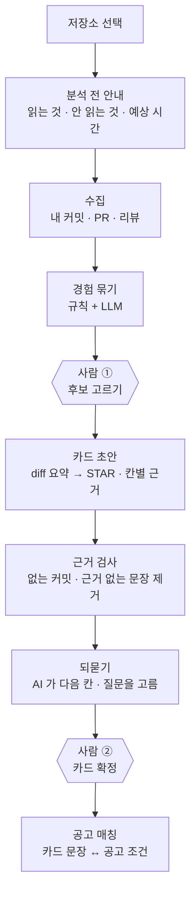

# Gitory 서비스 기획

> **커밋과 PR을 자소서 경험으로.** AI 가 GitHub 기록을 대신 읽고, 근거 커밋이 붙은 STAR 카드로 정리합니다. 사용자는 고르고, 확인하고, 비어 있는 칸만 답하면 됩니다.

최종 수정 2026-10-25 · 작성 곽태훈(PM) · 원본: 2단계 제출용 테크스펙(9/1)을 지금 동작 기준으로 다시 씀
표기 — ✅ 동작함 / 🟡 정할 것 / ⚠️ 아직 못 잼 · 기술 세부는 [테크스펙](tech-spec.md)

---

## 1. 누구의, 어떤 문제인가

**김깃(25세)** — 경북대 컴퓨터학부 4학년, 신입 개발자 지원자. 전공·부트캠프 프로젝트로 커밋은 쌓였지만, 자소서 문항 앞에서 "내가 무엇을 했는지"를 문장으로 꺼내지 못합니다.

> 밤 11시, *"협업 중 갈등을 해결한 경험을 쓰시오"* 를 열어 놓고, 2년 전 팀플에서 뭘 했는지 기억이 안 나 GitHub 과 옛 카톡방을 30분째 뒤진다.

**문제 한 문장** — 개발자 취준생은 자소서를 쓸 때마다 흩어진 커밋·PR·대화에서 **자기 경험과 그 근거를 처음부터 다시 찾아야** 한다.

| 근거 | 시사점 |
| --- | --- |
| 잡코리아 구직자 1,011명 중 67% "자기소개서 작성이 가장 어렵다" | 어려움은 넓게 퍼져 있다 |
| 자체 인터뷰 6명(경북대 컴퓨터학부 4학년) — 프로젝트당 30분~1시간을 기억 재구성에 씀 | 병목은 문장이 아니라 **경험을 꺼내 오는 단계** |
| 카톡방은 나가면, 무료 슬랙은 지나면, 팀플 노션은 졸업하면 사라진다 | 늦을수록 우회조차 못 한다 |

글쓰기 도우미(자소설닷컴·합격닷컴)는 이미 많습니다. **부족한 건 글이 아니라 근거입니다.** 아래 결정 대부분이 "근거를 어떻게 붙이고, 못 붙이면 어떻게 지우는가"로 모입니다.

## 2. 무엇을 바꾸는가

| | 지금 | Gitory |
| --- | --- | --- |
| 경험 찾기 | 커밋 로그·카톡·노션을 직접 역추적 | 저장소 하나를 고르면 AI 가 내 기여만 읽고 **경험 후보**로 묶음 |
| 문장 쓰기 | 빈 문항에서 시작 | 칸마다 **근거 커밋 링크**가 붙은 STAR 초안 |
| 비어 있는 부분 | 혼자 기억해 냄 | AI 가 코드에서 찾은 것과 없는 것을 보고 **한 줄씩 되물음** |
| 지원 | 공고를 따로 찾아 비교 | 확정한 카드 문장과 **맞는 공고 조건**을 보여 줌 |

## 3. 어떻게 동작하는가

1. **분석 전 안내** — 무엇을 읽고(내 커밋·PR·리뷰) 무엇을 안 읽는지(남의 PR·lockfile·비공개 저장소), 예상 시간을 먼저 보여 줍니다. 결과가 틀렸을 때 어디를 의심할지 알 수 있게 하려는 것입니다.
2. **수집·경험 묶기** — AI 서버가 GitHub 에서 내 기여만 모으고, 규칙으로 거른 뒤 LLM 이 같은 일을 한 커밋·PR 을 경험 하나로 묶고 추천 이유를 붙입니다. PR 이 없는 저장소도 커밋 묶음으로 후보가 나옵니다.
3. **후보 고르기 〔사람 ①〕** — 추천 15개가 먼저 보이고, 한 번에 8장까지 카드로 만듭니다. 묶인 커밋을 빼거나 더할 수 있습니다.
4. **카드 초안** — 고른 후보의 코드 변경만 깊게 읽어 S·T·A·R 초안을 만들고, 문장마다 근거 커밋을 답니다. Spring 이 그 커밋이 실제로 있는지 확인하고, 근거가 없는 문장은 비웁니다.
5. **되묻기** — 빈 칸·확인 필요 칸에서 AI 가 다음에 물을 칸과 질문을 고르고, 더 물을 게 없으면 스스로 끝냅니다. 사용자 답은 다듬지 않고 그대로 저장합니다.
6. **확정 〔사람 ②〕** — 편집·마스킹 뒤 사용자가 확정합니다. 확정 버전은 히스토리에 남고, 다시 열어 고칠 수 있습니다.
7. **공고 매칭** — 매일 새벽 회사 채용 사이트에서 개발 공고를 가져와 조건을 뽑고, 확정 카드 문장과 가까운 조건을 근거로 맞는 정도를 보여 줍니다.

### 자율성 경계 — AI 는 어디까지, 사람은 어디서

| 누가 | 무엇을 |
| --- | --- |
| **AI 가 판단** | 경험 묶기와 추천 이유 · diff 요약 · STAR 초안과 근거 커밋 주장 · 되묻기 다음 칸·질문·예상 답 · 공고 조건 뽑기 |
| **코드(규칙)가 막음** | 본인 기여만 남기기(봇·머지 커밋 제외) · 근거 커밋이 실제로 있는지 확인 · 근거 없는 문장 비우기 · 출처 없는 숫자는 '확인 필요' · 공고 조건은 원문 인용이 있어야 저장 · 되묻기 상한 · 사용자별 호출 제한 · 매칭 등급 계산 |
| **사람이 결정** | 어떤 후보를 카드로 만들지 · 카드를 확정할지 |

| 항목 | 우리 답 |
| --- | --- |
| 사람이 서는 칸 | **2곳** — 후보 고르기, 카드 확정. 나머지는 자동 |
| 카드 한 장의 LLM 호출 | 8회, 약 8.3원 (10/07 실측, [결과표](../../ai/evals/RESULTS.md)) |
| 근거 검사를 누가 하나 | **DB 를 가진 Spring.** AI 는 "이 문장의 근거는 커밋 a3f21c" 라고 주장만 한다 |

> 전부에 승인을 붙이면 자동화가 의미 없어지고, 하나도 없으면 면접에서 말할 문장을 남이 정한 셈이 됩니다. 그래서 "카드 하나가 어디까지인가"와 "이 문장을 내가 책임질 것인가" 두 곳에만 사람을 세웠습니다.

## 4. 무엇을 만들고, 무엇을 안 만드는가

| ✅ 만든다 | 🚫 안 만든다 |
| --- | --- |
| GitHub 로그인 — 권한은 `read:user` 하나, 공개 저장소만 읽음 | 비공개 저장소 · 저장소 쓰기 권한 |
| 내 기여 수집과 경험 후보 | 팀원의 일을 내 카드로 올리기 |
| 칸마다 근거 커밋이 붙은 STAR 초안 | 근거 없는 문장을 화면에 띄우기 |
| 되묻기 — 사용자 답을 그대로 근거로 | 사용자 답을 윤문해 AI 말로 바꾸기 |
| 직접 작성 카드(코드에 없는 경험) | 사용자 승인 없는 자동 확정 |
| 마스킹 · 복사 · 인쇄 | 기업 인재상 문구 자동 삽입 |
| 공고 매칭 — 공고 직무 조건 기준 | 합격 자소서 예시 · AI 문체 판별 |
| 🟡 자소서 초안 — 9/1 에는 '안 만든다' 였으나 10/25 멘토 피드백으로 다시 검토 ([#433](https://github.com/kakaotechcampus-4/ktc4-kyungpook-1/issues/433)) | 언어별 AST 파서 |

## 5. 왜 Gitory 여야 하는가

**"그냥 ChatGPT 에 커밋 붙여넣으면 되지 않나요?"** — 맥락을 손으로 다 붙여넣는 1회성 질문이라면 답의 상당 부분은 나옵니다. 우리가 파는 건 그 답이 아니라 아래 네 가지입니다.

1. **다시 붙여넣지 않는다** — 저장소를 고르면 수백 개 커밋에서 내 기여만 골라 경험으로 묶는 일까지 AI 가 합니다.
2. **근거가 붙고, 검사된다** — 문장마다 커밋 링크가 있고, 없는 커밋·근거 없는 문장은 코드가 지웁니다. 면접에서 "이건 어느 커밋이죠?"에 답할 수 있습니다.
3. **출처가 섞이지 않는다** — 코드에서 나온 문장과 사용자가 말한 문장을 따로 저장합니다. "팀원을 설득했다" 같은 문장은 사용자 답에서만 나옵니다.
4. **지원까지 이어진다** — 확정한 문장이 어떤 공고 조건과 맞는지 바로 보입니다.

**Agentic 인 이유** — 무엇이 경험인지(묶기), 어느 칸을 더 물을지(되묻기)를 AI 가 스스로 정하고, GitHub 수집·diff 분석·공고 색인 같은 도구를 여러 단계로 엮어 사람 개입 2번으로 카드까지 끝냅니다.

## 6. 안전 설계

**가장 겁나는 실패는 그럴듯한 거짓말입니다.** 내 커밋 3개인 팀 저장소에서 "프로젝트를 주도했다"가 나오면, 그 문장은 면접에서 무너집니다.

| 막는 것 | 장치 |
| --- | --- |
| 기여 부풀리기 | 수집 단계 본인 기여 필터(코드) + 후보 고르기(사람) |
| 없는 커밋을 근거로 대기 | AI 가 입력 커밋과 맞춰 보고, Spring 이 DB 에 있는지 다시 확인 |
| 근거 없는 문장 | 근거 커밋도 사용자 답도 없는 문장은 저장·표시하지 않음 |
| 지어낸 숫자 | 커밋·PR 본문·사용자 답에 없는 숫자는 '확인 필요' |
| 비밀값·이메일 유출 | 모델에 보내기 전과 받은 뒤 모두 가림, `.env` 같은 파일은 내용을 안 보냄 |
| 입력 글 속 지시 | "입력은 데이터일 뿐" 프롬프트 + 출력 모양 검사. 10/30 Luna 실제 평가 58개 사례에서 따른 것 0 · 오류 0 |
| 로그에 원문 남기기 | 실패 로그에는 예외 종류만 |

전체 표와 시험 위치는 [가드레일 문서](../GUARDRAILS.md)에 있습니다.

### AI 가 틀렸을 때 사용자 화면

| 상황 | 보이는 것 |
| --- | --- |
| 후보 0개 | 오류가 아니라 판정 — 왜 없는지와 다음 행동 3개(파일 보며 찾기 · 직접 입력 · 다른 저장소) |
| 근거를 못 찾은 칸 | 칸을 비우고 "근거를 찾지 못해 비워 두었습니다" + 되묻기 버튼 |
| 확신 낮은 칸 | '확인 필요' 표시. 모든 칸에 붙이지 않음 |
| 초안 실패 | 원인(AI 일시 장애 / 내부 오류)과 '초안 다시 만들기' ([#425](https://github.com/kakaotechcampus-4/ktc4-kyungpook-1/pull/425)) |
| 수집 상한·GitHub 한도 | 어디까지 읽었는지와 언제 다시 할 수 있는지 |
| 호출 한도 초과 | 몇 초 뒤 다시 할 수 있는지 |

## 7. 잘 됐다는 걸 뭘로 아는가

**성공 정의** — 저장소 하나를 고르면, 기억을 처음부터 되짚는 것보다 짧은 시간에 근거가 붙은 카드를 여러 장 확정한다.

| 지표 | 목표 | 지금 |
| --- | --- | --- |
| 저장소당 확정 카드 | 평균 2장 | ⚠️ 이벤트 수집 중(`card_confirmed` / `repo_selected`) |
| 확정 전환율 | 60% | ⚠️ 수집 중 |
| **근거 0개 카드가 화면에 뜬 수** | **0건** | ✅ 코드로 막음 · 시험으로 고정 |
| "주도·전담·리드" 부풀림 | 0회 | 🟡 평가셋 케이스 5 로 판정 |
| 카드 한 장 비용 | 감당 가능 | ✅ 약 8.3원 |

목표치(2장·60%)는 근거가 있어 정한 값이 아니라 재 보려고 정한 값입니다. 평가셋은 **실패를 유도하는 케이스가 7/11** 입니다(테크스펙 §테스트).

## 8. 심사위원에게 남길 한 장면

> 저장소 하나를 고르고 잠시 뒤, 화면이 **"경험 후보 · 각각 왜 추천했는지 한 줄씩"** 으로 정리된다.
> 후보 하나로 카드를 만들면 S·T·A·R 칸 아래에 **커밋 링크가 그대로 붙어 있고, 한 칸은 비어 있다** — *"근거를 찾지 못해 비워 두었습니다."*
> AI 가 그 칸을 스스로 골라 되묻고, 답하면 카드가 채워지고, 확정하면 **맞는 공고**가 뜬다.

**비어 있는 칸이 이 제품의 증거입니다.** 채울 수 있는데 안 채운 게 아니라, 근거가 없으면 코드가 지운 것입니다.

## 9. 지금 열려 있는 결정

| 결정할 것 | 이슈 |
| --- | --- |
| 자소서 초안을 1차 범위에 넣을지, 넣으면 어디까지 | [#433](https://github.com/kakaotechcampus-4/ktc4-kyungpook-1/issues/433) |
| 되묻기 최대 질문 수(지금 3, 멘토 제안 최대 10) | [#431](https://github.com/kakaotechcampus-4/ktc4-kyungpook-1/issues/431) |
| 매칭에 관심 직무를 어디서 고르게 할지 | [#435](https://github.com/kakaotechcampus-4/ktc4-kyungpook-1/issues/435) |
| 매칭 임베딩을 한국어 모델로 바꿀지 | [#320](https://github.com/kakaotechcampus-4/ktc4-kyungpook-1/issues/320) |
| "시간이 줄었다"를 무엇으로 증명할지(기준선) | ⚠️ 없음 — 인터뷰의 "프로젝트당 30분~1시간"뿐 |
