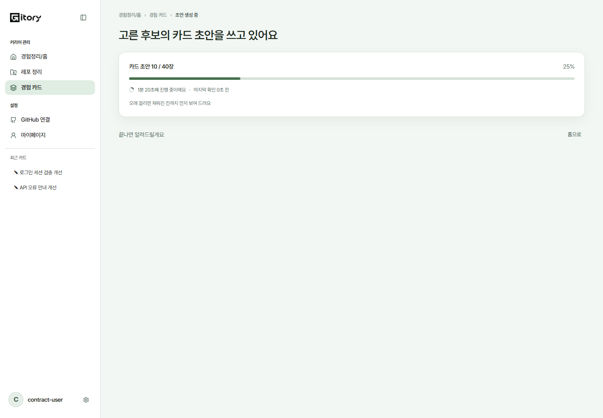
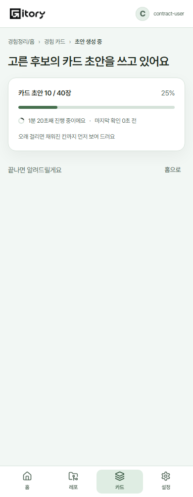
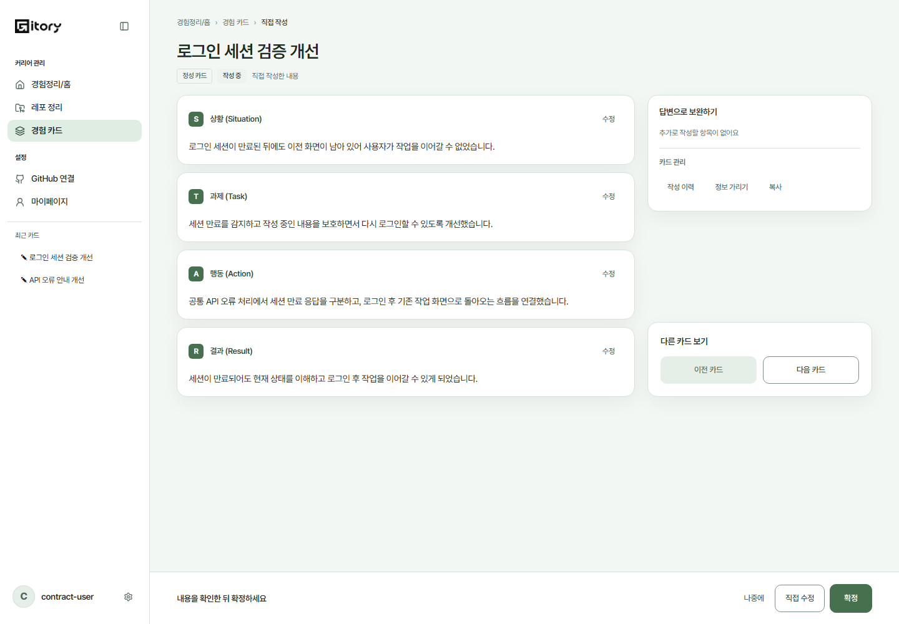
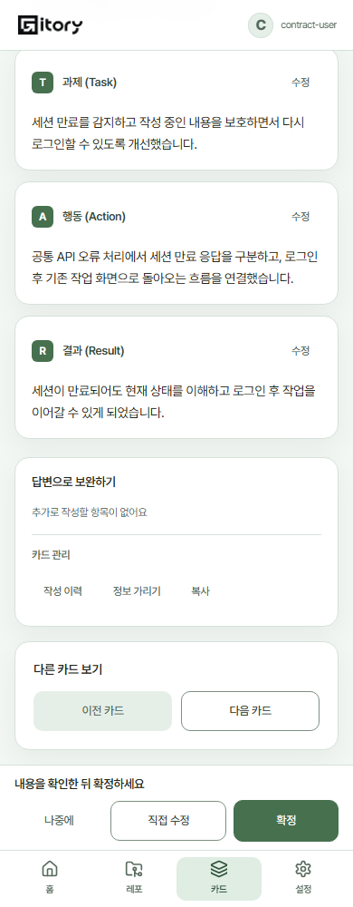

# 카드 초안 진행·연속 검토 (#326, #327)

## 범위와 설계
최신 develop에서 두 이슈만 분리한다. 초안 생성은 REASON.done/total을 카드 수로 표시하고, 분석 단계 이름·고정 S/A·근거 없는 남은 시간 추정을 제거한다. 총량 미확정은 스피너로 표시한다. JobLiveness와 완료 알림·후보 보드·홈 이동은 유지한다.

상세 읽기 화면에 '다른 카드 보기' 이전/다음 버튼을 넣는다. PC는 오른쪽 영역을 본문 높이만큼 늘리고 하단에 정렬한다. 모바일은 본문 뒤에 배치해 하단 고정 버튼에 가리지 않게 한다. 편집·정보 가리기 중에는 내비게이션을 노출하지 않는다.

경험 카드 목록에서 진입하면 현재 필터/정렬로 보이는 id 순서만 Router state로 전달한다. 이동 시 현재 서버 목록에 남은 카드만 사용한다. 직접 진입하면 목록과 같은 최신순 함수를 사용한다. 첫/끝/현재 카드 없음은 해당 버튼을 비활성으로 두며 오류를 빈 목록으로 오인하지 않는다. 추가 API나 서버 계약은 만들지 않는다.

## 구현·검증 계획
1. DraftProgress와 카드 목록 공통 정렬 함수를 단위 테스트 후 구현한다.
2. CardNavigation과 목록 진입 순서 연결을 검증한다. 카드 전환 후 이전 확정 배너·대화상자 상태를 지우고 읽기 시작 위치로 돌아간다.
3. PC·모바일에서 하단 정렬·탐색·버튼 크기·가로 넘침을 검사한다. 미확정 총량은 진행률을 만들어내지 않는다.
4. 기존 저장·가리기·Job 폴링 회귀 검사, 타입 검사와 운영 빌드, PR 생성·리뷰 요청. 테스트 서버는 검사 뒤 종료한다.

## UI 실측 및 리뷰 이미지
- 2026-10-20, PR #328 코드에서 1440×1000 / 390×1000 / 320×1000 화면을 재확인했다. 운영 개인정보 대신 격리된 HTTP 계약 응답으로 카드와 진행 중 Job을 재현했다.
- PC의 STAR 본문과 탐색 영역 하단 오차는 2px 이내다. 탐색 버튼은 최소 44×44px이며 모바일 최하단에서도 고정 행동 영역에 가리지 않는 것을 실제 hit test로 확인했다.
- 세 폭에서 가로 넘침이 없고, 이전/다음 키보드 실행과 경계 버튼 비활성 상태를 확인했다. REASON 10/40은 25%, total=null은 퍼센트 없이 표시한다. 브라우저 실행 오류는 없었다.
- 아래 이미지는 실제 브라우저 캡처다. 모바일 카드 상세는 하단으로 스크롤한 뷰포트로, 고정 메뉴와 탐색 버튼의 관계를 보여 준다. 실제 운영 백엔드 처리 성능이나 OAuth 검증 결과를 의미하지 않는다.

| 화면 | PC 1440px | 모바일 390px |
| --- | --- | --- |
| 초안 생성 |  |  |
| 카드 상세 |  |  |

## 리뷰 보완: 모바일 탐색 박스 하단 겹침
- 320/390px 작성 중 카드의 최하단에서 탐색 박스와 하단 행동 줄의 간격이 -8px임을 회귀 테스트로 재현했다. 기존 검사는 버튼 중심의 hit test여서 박스 끝부분의 겹침을 놓쳤다.
- 모바일의 `main--footer`는 실제 하단 padding이 0이지만 `--main-pb`는 24px이다. StickyFooter의 음수 margin-bottom과 본문 gap 16px이 만나 8px 겹쳤다.
- 공통 셸/다른 페이지는 유지하고, 모바일 작성 화면의 `card-review-aside`에 동일한 하단 여백 변수를 적용해 상쇄한다. 결과적으로 탐색 박스와 하단 행동 줄 사이에 16px 간격을 확보한다. PC 정렬과 확정 카드 화면에는 적용하지 않는다.
- 회귀 검사는 모바일 최하단에서 버튼뿐 아니라 탐색 박스 전체와 행동 줄의 실제 경계 간격을 측정한다.
