# 모바일 공통 푸터와 기능 회귀 점검

## 승인된 범위와 설계
사용자 요청: 앞서 점검한 하단 겹침 5곳과 좁은 화면의 버튼 줄바꿈 2곳을 수정한다. PC 동작과 백엔드 계약을 보존하고, 화면별 주요 기능을 실제로 사용해 추가 문제를 찾는다. PR에 화면 캡처·검증 결과를 넣고 개인 배포본에도 적용한다.

최신 develop f25040d에서 별도 브랜치를 시작한다. 기존 #261 UX, #300 매칭, #301 자소서 PR을 섞지 않는다. 공통 푸터는 모바일에서 main--footer의 하단 여백 변수와 실제 padding을 일치시킨다. #328의 카드 탐색 전용 보정은 제거해 공통 규칙 하나로 관리한다. PC 스타일은 유지한다. 분석 시작 버튼과 가리기 프리셋의 공간 배분만 조정하고 문구·API·저장 로직은 바꾸지 않는다.

## 실행 계획
1. 공통 푸터의 마지막 콘텐츠/행동 줄 간격, 화면 하단 메뉴, 가로 넘침을 320/390/767/1440px에서 검사한다. 수정 전 실패를 확인한다. 기존 카드 탐색 검사를 함께 유지한다.
2. 모바일 여백 변수 불일치를 고치고 개별 보정을 제거한다. 분석 시작 버튼의 축소를 방지하고 가리기 프리셋은 줄 전체를 기준으로 자연스럽게 흐르게 만든다.
3. 저장·취소·확정·가리기·인터뷰·후보 선택/펼침/생성·레포 선택·필터·모달·테마 기능을 브라우저에서 실행한다. 실제 계정 대신 격리된 샘플/HTTP 계약 응답을 쓰며, 발견한 결함은 재현과 영향 범위를 확인해 수정한다.
4. 타입/단위 검사, 운영 빌드 브라우저 회귀와 HTTP 계약 검사를 수행한다. 모바일 라이트/다크·짧은 화면과 PC를 캡처해 직접 검토한다. 사용하지 않는 테스트 서버는 종료한다.
5. README/트러블슈팅을 갱신하고 템플릿을 따른 PR·리뷰어·이미지를 등록한다. CI 완료까지 확인하고 Vercel 운영 배포 후 실제 URL을 점검한다.

## 회귀 위험과 한계
- 이전 #328 보정과 공통 수정이 겹치면 카드 탐색만 여백이 과해질 수 있어 보정을 함께 제거한다.
- 후보 목록은 하나의 record-list 구조를 유지한다. 저장 실패 시 입력 보호, UUID 재전송, 서버 임시 저장, 근거 캐시 정책을 변경하지 않는다.
- Chromium 모바일 에뮬레이션은 실제 iOS 키보드·노치 safe-area를 모두 증명하지 않는다. 검증한 화면 폭·높이와 샘플 모드를 명시한다.

## 구현과 실제 검증
- 모바일 공통 여백 변수 0과 실제 padding 0을 일치시켜 콘텐츠 간격 16px을 확보했다. CardReviewFlow의 별도 보정은 제거했다. 레포 문맥의 버튼 축소를 막고, 가리기 프리셋은 44px 터치 높이와 버튼 단위 줄바꿈을 사용한다.
- 수정 전에는 모바일 경계 검사 3개가 -8px로 실패하고 320px 분석 버튼이 2줄로 실패했다. 수정 후 320/390/767/768/1024/1440px, 높이 480px를 포함한 검사와 기존 카드 탐색 검사가 통과했다.
- `npm run e2e:static -- --workers=2`: 운영 빌드의 전체 브라우저 검사 **121개 통과**. 후보 추가·제외·복구·검색·필터·커밋 선택, 분석·복구·부분 결과·빈 후보, 카드 생성·초안·직접 작성·수정·가리기·인터뷰·확정·이력·복사, 저장 실패·이탈 보호, IME·키보드·대비·모달·반응형을 포함한다.
- `npm run e2e:mobile -- --workers=2`: 기존 주요 여정을 390×844 터치 환경으로 반복한 **53개 통과**. 일부 검사는 자체적으로 320/1440 등 뷰포트를 바꾼다.
- Node 22 프론트 CI에도 `e2e:mobile` 단계를 추가해 모바일 기능 검사를 반복 가능하게 유지한다. Node 24는 기존 전체/HTTP 검사를 유지한다.
- 별도 브라우저 조작으로 테마 변경·새로고침 유지·보관 정보 펼치기, 샘플 연결 해제 취소/확정·카드 유지, 로그아웃, 회상 선택 답변·후보 추가·다음 디렉터리·건너뛰기를 확인했다. 추가 기능 결함은 재현하지 못했다.
- 로컬 전체 단위 검사는 Windows에서 수집이 오래 진행돼 중단했으며 통과로 기록하지 않는다. 전체 단위 검사는 PR의 Node 22/24 CI 결과로 확인한다. 애플리케이션 재시도/타임아웃은 변경하지 않았다.
- 별도 코드 검토에서 중요한 결함은 발견되지 않았다. HTTP 계약 검사/최신 CI/배포 결과는 PR에서 기록한다.

## 화면 캡처
격리된 샘플 응답을 쓰는 PR 코드의 실제 브라우저 화면이다. 하단 가림을 확인할 화면은 맨 아래까지 스크롤했다. 분석 시작과 가리기 프리셋은 상단을 캡처했다.

| 화면 | 모바일 390px | PC 1440px |
| --- | --- | --- |
| 레포 선택 | 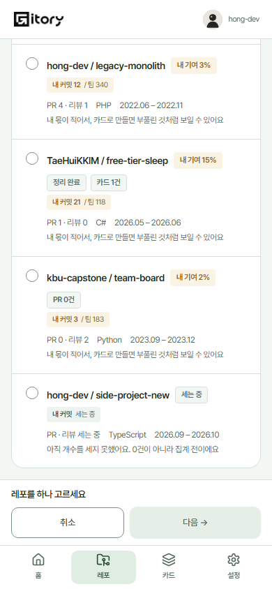 | 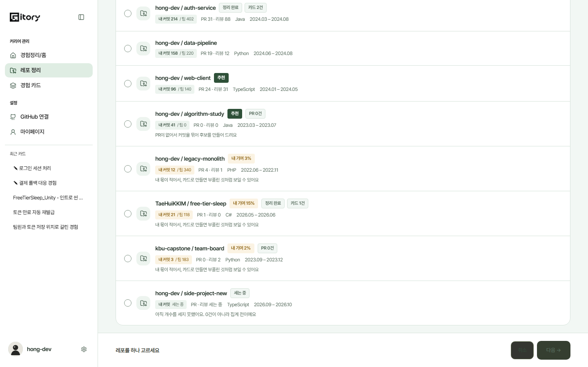 |
| 후보 보드 | 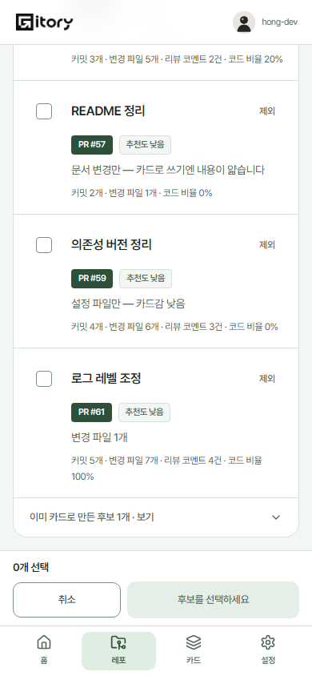 | 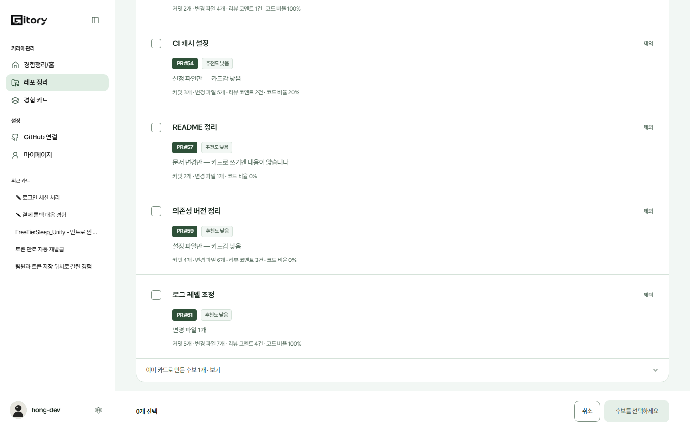 |
| 직접 작성 | 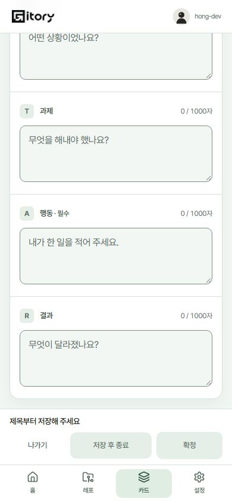 | 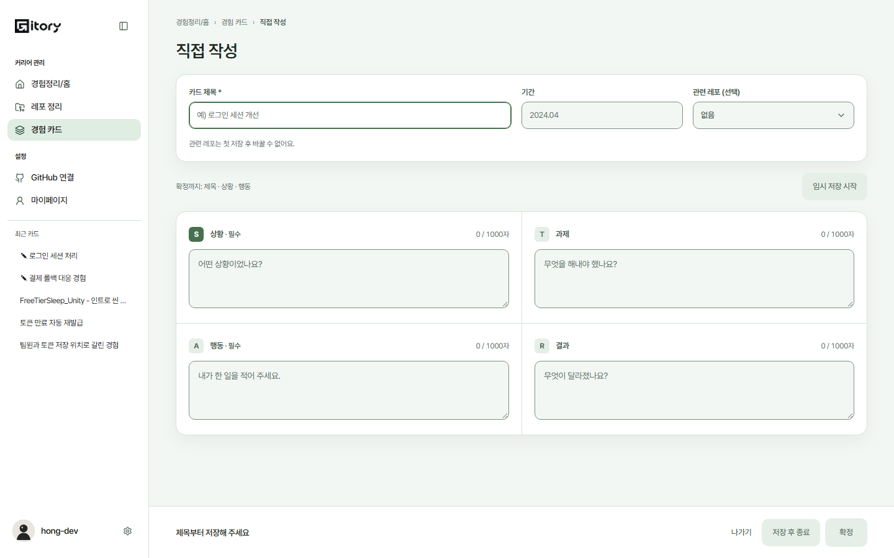 |
| 직접 수정 | 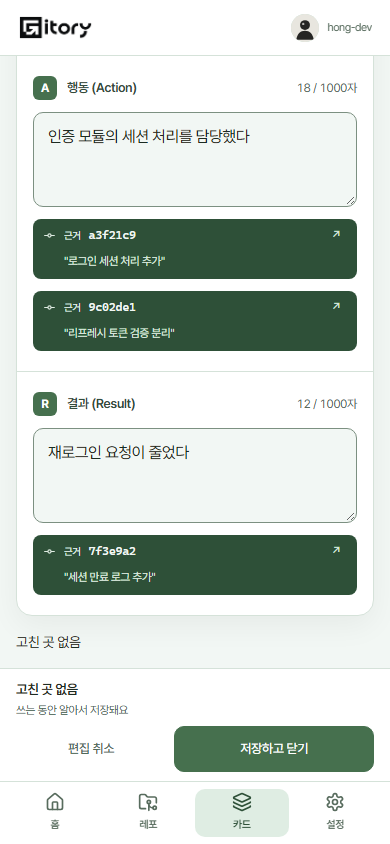 | 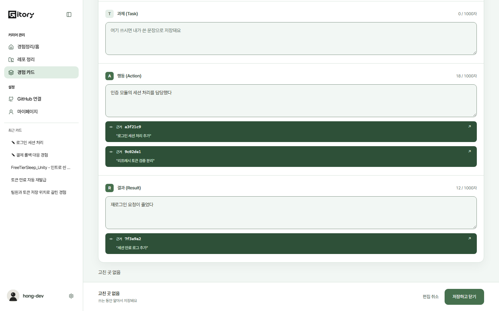 |
| 정보 가리기 | 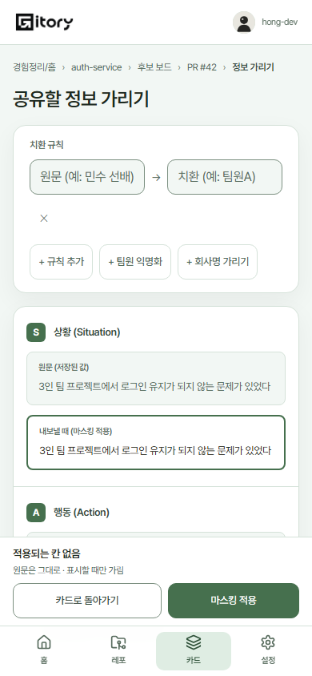 | 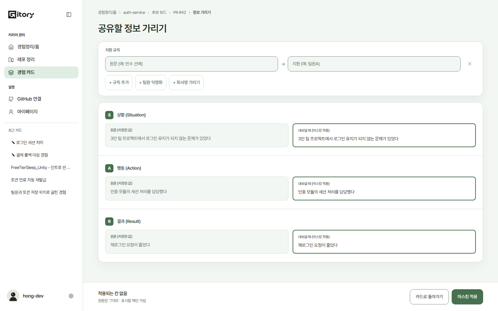 |
| 분석 시작 | 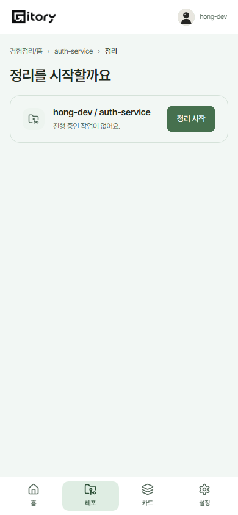 | 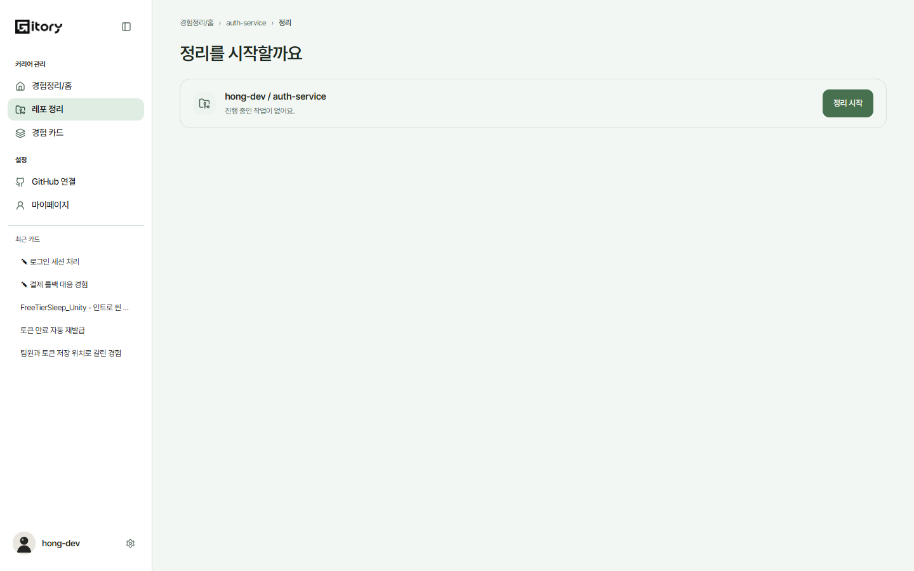 |
| 카드 탐색 | 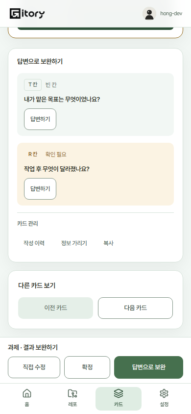 | 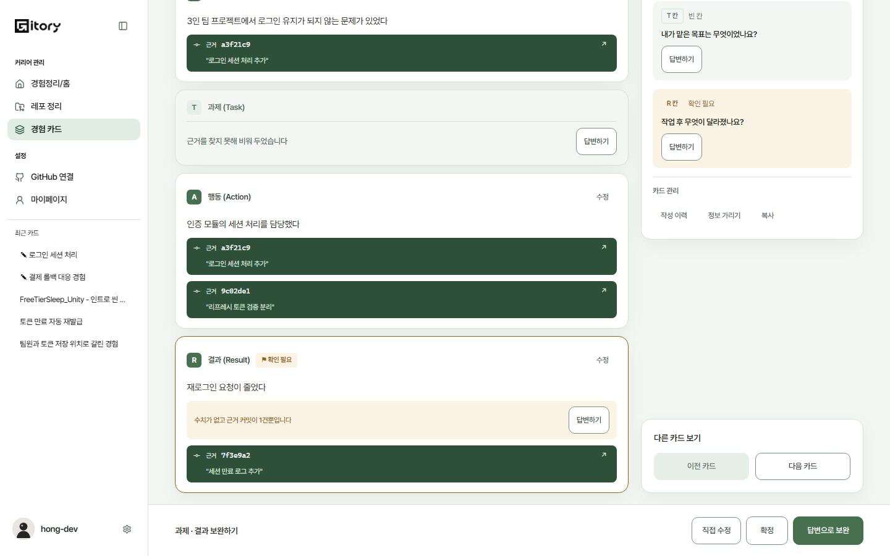 |

320px와 390px 다크 캡처도 같은 폴더에 보관한다. [캡처 경로·크기 목록](screenshots/mobile-footer/capture.json).

## 기존 PR과의 관계
기존 UX #261과 공유하는 스타일/가리기 파일은 최소 수정만 한다. 해당 PR에 있는 회상 입력 보호·샘플 설정 정리는 이 PR에서 복제하지 않는다. 매칭 #300과 자소서 #301의 기능/API는 건드리지 않는다. 개인 Vercel 저장소는 기존 UX·매칭을 유지한 상태에 필요한 규칙만 이식해 별도로 검증한다.
