# 2026-10-25 기다릴 때, 막혔을 때, 처음 쓸 때 화면이 말을 걸게 하기

10/25 기술 멘토링 피드백(#436 AI 진행 표시, #438 GitHub 다시 연결, #439 새 경험 정리 문구, #437 근거 요약의 화면 쪽)과 팀 UX 점검 목록을 한 번에 반영했다. 기능, API 필드, enum 은 바꾸지 않고 표시와 안내만 고쳤다. #446(홈 검색 문구, 로그아웃 색, 매칭 등급 색) 위에 쌓았다.

## 무엇을 바꿨나

| 문제 | 바꾼 것 | 위치 |
| --- | --- | --- |
| 버튼을 누르면 글자가 사라지고 회색 상자만 남음 | 로딩 중에도 글자와 버튼 색을 유지하고 앞에 스피너 | `ui.css` `.btn--loading` |
| AI 를 기다리는 동안 회색 상자만 보임 | 무엇을 하는 중인지 한 문장 + 움직이는 점. 10초가 넘으면 기다리는 이유를 덧붙임 | `AiWait` (되묻기 질문·답변, 분석 시작, 매칭 불러오기) |
| 실제 레포에선 칸마다 근거 커밋이 7개씩 붙어 근거 띠가 문장보다 화면을 더 차지함 | 칸마다 "근거 커밋 N개 확인하기" 버튼 하나. 누르면 팝업에 그 칸의 문장과 근거 전부, 거기서 "GitHub에서 보기"로 diff. 인쇄에는 근거를 그대로 찍음 | `EvidenceList` |
| 근거 첫 줄이 커밋 메시지뿐이라 "fix" 같은 커밋은 뜻이 안 통함(운영은 메시지마저 비어 있었음) | 백엔드 #455·#456 의 `summary`·`committedAt`·`changedFiles` 를 선택 필드로 받아 첫 줄은 요약 ?? 커밋 메시지, 요약이 있으면 메시지는 둘째 줄, sha 옆에 날짜와 파일 수. 필드가 없는 이전 서버·이전 카드도 그대로 읽음 | `schemas.ts`, `EvidenceStrip` |
| 확정 카드 화면에 버튼 4개와 출처 표 6줄 | 위에는 복사, 수정하기만. 작성 이력, 인쇄는 오른쪽 카드 관리로, 출처는 두 줄로(확정일은 제목 아래 이미 있음) | `CardPage` |
| 근거에 커밋 해시가 굵게 먼저 나옴 | 커밋 메시지를 첫 줄에, sha 7자리와 "GitHub에서 보기"는 둘째 줄에 작게 | `EvidenceStrip` |
| 링크 없는 근거가 `#` 으로 새 탭을 엶 | 링크가 없으면 누를 수 없는 띠로 | `EvidenceStrip` |
| 오류 화면에 "API 계약", JSON, HTTP 코드 | 사과와 할 일(다시 시도, 홈으로)만. 원인은 "문의할 때 보낼 정보"로 접음 | `ErrorBoundary` |
| GitHub 연결이 끊겨도 분석을 눌러 실패해야 앎 | 앱 위에 "GitHub 연결이 끊겼어요 [다시 연결]" 띠. 분석 시작 버튼은 다시 연결로 바뀜 | `GithubBanner`, `AnalyzePage` |
| 403 `GITHUB_UNAUTHORIZED` 가 일반 문구만 보임 | "GitHub 연결을 다시 해 주세요" + [GitHub 다시 연결]. 다시 연결하면 보던 화면으로 돌아옴 | `errorView`, `QueryFailure`, 전역 토스트 |
| 작업 상태 화면 실패 때 제목만 보임 | 이유(`jobErrorHint`)와 다시 연결, 직접 쓰기 행동 | `JobStatusPage` |
| 매칭 새로고침, 카드 관리, 수정, 제외가 글자처럼 보임 | 아이콘 + 옅은 배경의 고스트 버튼(`variant="ghost"`). 카드 관리는 세로 목록 | `Button`, 각 화면 |
| 로그아웃이 마이페이지 구석에 있음 | 사이드바·모바일 상단 프로필을 누르면 마이페이지, 테마 전환, 빨간 로그아웃 | `ProfileMenu` |
| 홈 "새 경험 정리"가 어색함(제목 중복, 전체 폭 입력칸, 떠 있는 카드 검색) | "새 경험 카드 만들기" 상자 하나에 설명, 레포 검색, 모든 레포 보기, 직접 작성. 카드 검색은 "최근 경험 카드" 제목 줄로 | `HomePage` |
| 카드 목록을 못 불러오면 홈이 첫 방문 문구로 바뀜 | 목록을 모를 때는 첫 방문자로 단정하지 않음 | `HomePage` |
| 메뉴 이름이 PC "경험정리/홈", 모바일 "홈" | "홈"으로 통일(경로 표시 포함) | `AppShell`, 각 화면 |
| 최근 카드 앞 `✎` 때문에 제목 시작선이 들쭉날쭉 | 고정 폭 상태 점(채움 = 작성 중) | `AppShell` |
| 후보, 확정, 등급, 빈 칸의 뜻을 처음엔 모름 | 후보 보드 한 줄 설명, 매칭 등급 뜻, 확정 버튼 위 설명, 빈 칸 아래 "답하면 채워 드려요" | 각 화면 |
| `⚑`, `v1` 같은 기호 | "확인 필요" 글자, 되묻기 화면의 버전 배지 제거 | `StarBlock`, `InterviewPage` |
| 녹색 한 가지라 심심함 | 포인트 색 `--accent-point`(라이트 #4F7F24, 다크 #A8C47C)를 주 버튼, 강조 단어, 지금 메뉴 막대에만. 첫 방문 홈 입력칸 뒤에 옅은 빛 | `tokens.css`, `guidance.css` |
| 다크에서 비활성 보내기 버튼, STAR 빈 칸 점선이 안 보임 | 테두리 강화 | `guidance.css` |
| 화면 전환, 목록 등장 효과가 없음 | 0.15초 표준 이징으로 페이드, 카드는 40ms씩 차례로, 마우스를 올린 카드만 2px 뜸. "움직임 줄이기"면 끔 | `guidance.css` |
| 가운뎃점(·) 나열 문구 | 쉼표, 띄어쓰기, 문장으로(테스트·다른 PR 과 겹치는 문구는 그대로 둠) | 각 화면 |

## 판단

- 들어오는 애니메이션은 위치를 옮기지 않고 투명도만 바꾼다. 처음엔 TIO 처럼 4~6px 올라오게 했는데, 그 사이 스티키 푸터 위치와 44px 버튼 크기를 재는 E2E 가 흔들렸다. 사용자에게도 측정 중 흔들리는 화면은 같은 문제라 페이드로 바꿨다.
- 로딩 버튼의 이름(접근성 이름)은 바꾸지 않는다. "저장하는 중"으로 바꾸면 스크린리더와 기존 테스트가 같은 버튼을 다른 것으로 본다. 진행 문장은 `AiWait` 가 따로 말한다.
- GitHub 연결 끊김은 막지 않고 알리기만 한다. 이미 만든 카드는 연결 없이 볼 수 있다. 새 정리만 연결이 필요하다.
- 진행률은 여전히 지어내지 않는다(`jobView.ts` 원칙 유지). 모르는 동안은 문장과 움직임으로 살아 있음을 보인다.

- 근거를 기본으로 숨긴 이유: 팀 논의(10/25)에서 "화면에 몇 개 보이고 더 보기"와 "버튼만 두고 팝업에서 정리해 보여 주기"가 나왔고, 정보가 많다는 피드백에 맞춰 팝업으로 정했다. 근거가 있다는 사실(개수)은 버튼에 늘 보인다.

## 목 시나리오

| 주소 | 보이는 것 |
| --- | --- |
| `/?demoScenario=github-disconnected` | 연결 끊김 띠, 분석 시작 대신 다시 연결 |
| `/repos/r_web/run?demoScenario=github-unauthorized` | 분석 요청 403 → 다시 연결 안내 |
| `/cards/card_01/interview?demoScenario=slow` | 칸을 고르면 질문 만드는 중 문장 |

## 개선 전/후

| 장면 | 비교 |
| --- | --- |
| 근거 많은 카드(실제 레포 → 버튼 → 팝업) | 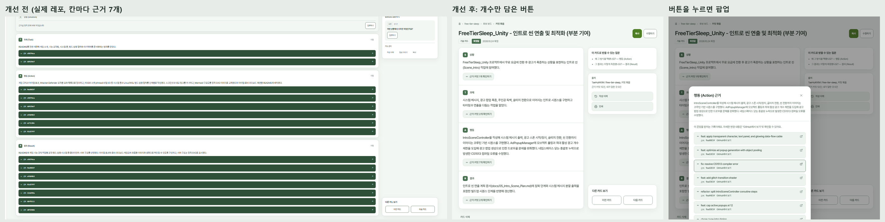 |
| 근거 요약·날짜·파일 수 | 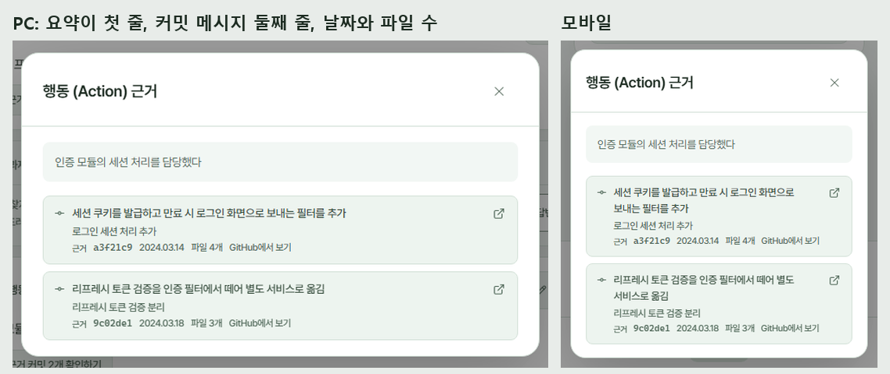 |
| 분석 시작 버튼 로딩 | 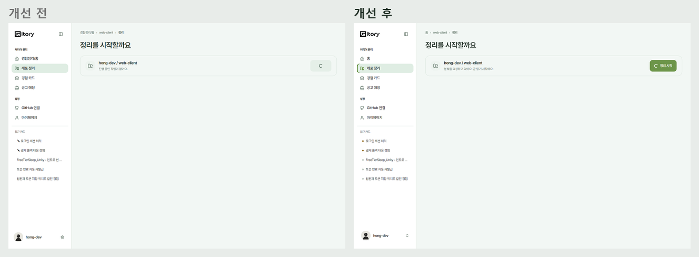 |
| 분석 시작 직후 | 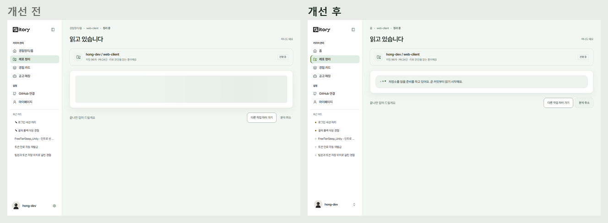 |
| 되묻기 질문 만드는 중 | 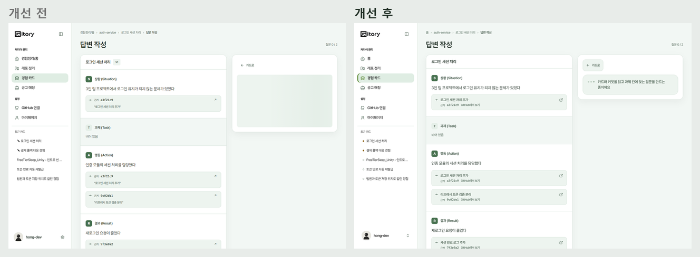 |
| 카드 상세(근거, 카드 관리, 빈 칸 안내) | 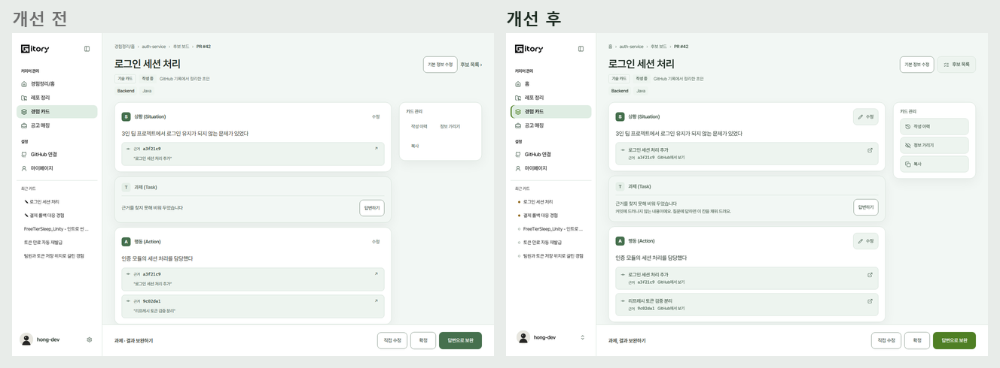 |
| GitHub 연결 끊김(홈) | 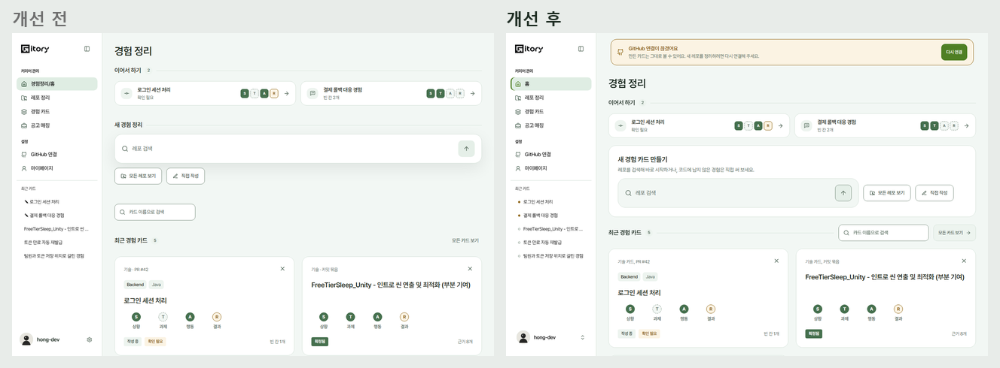 |
| GitHub 연결 끊김(분석 시작) | 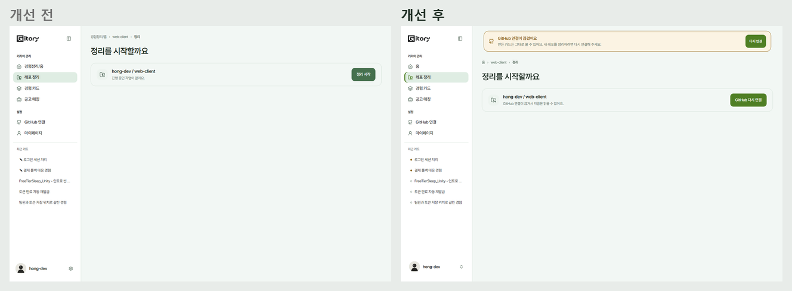 |
| 분석 요청 403 | 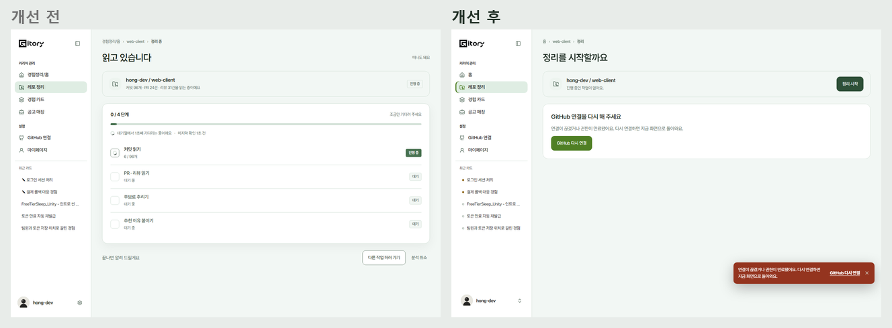 |
| 작업 상태 화면 실패 | 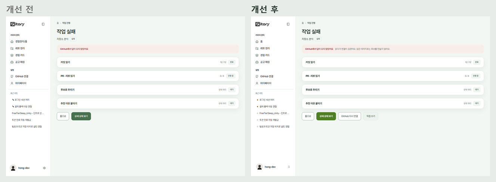 |
| 공고 매칭 | 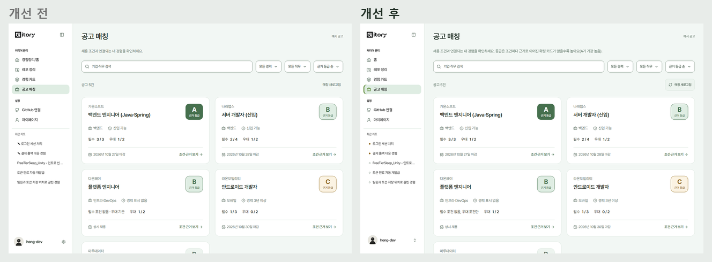 |
| 프로필 메뉴(PC) | 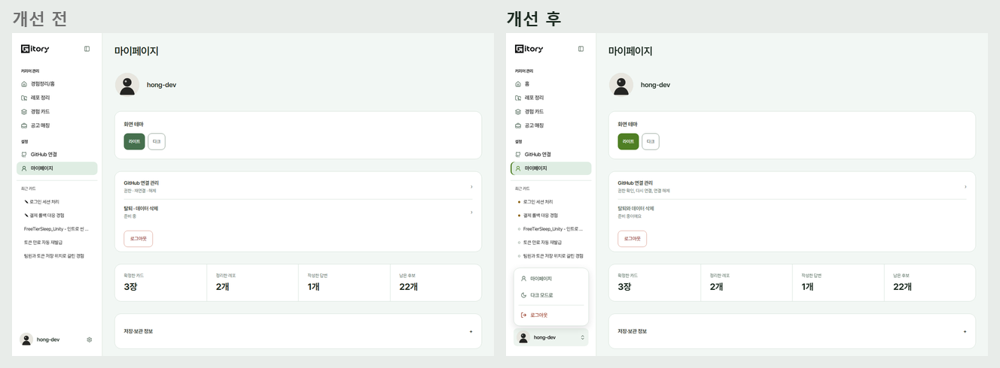 |
| 프로필 메뉴(모바일) | 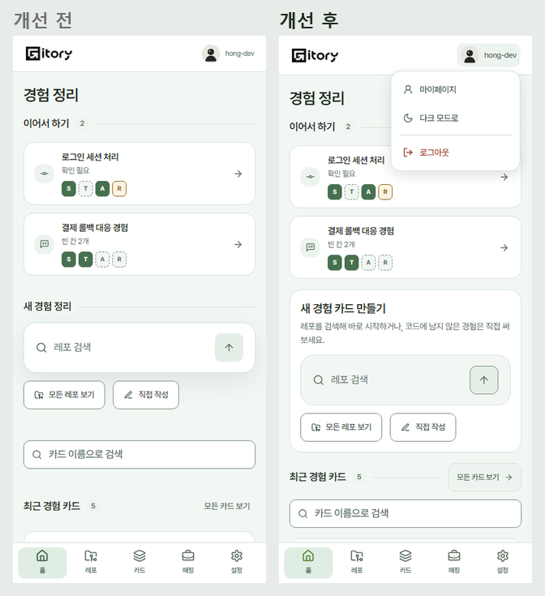 |
| 다시 온 사용자 홈 | 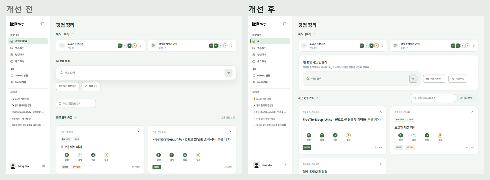 |
| 처음 온 사용자 홈 | 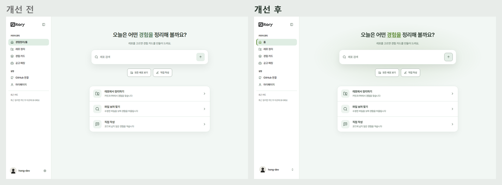 |
| 후보 보드 | 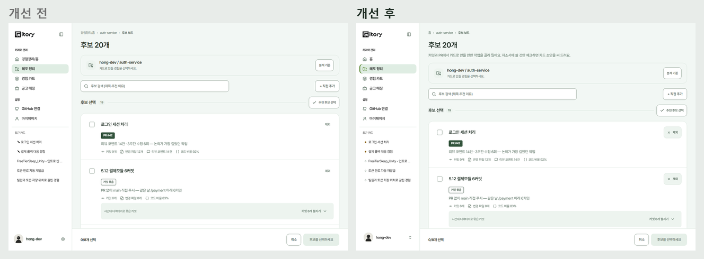 |
| 되묻기 화면 | 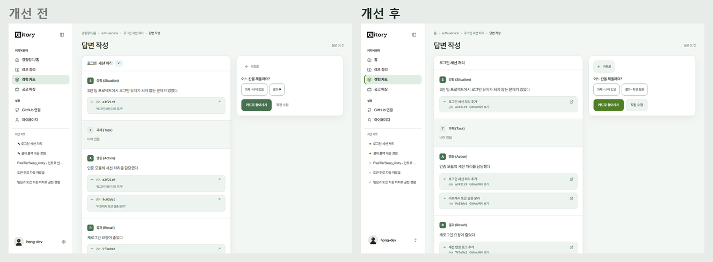 |
| 홈 다크 | 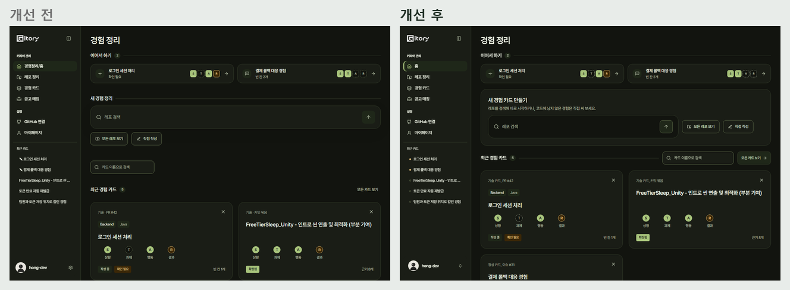 |
| 카드 상세 다크 | 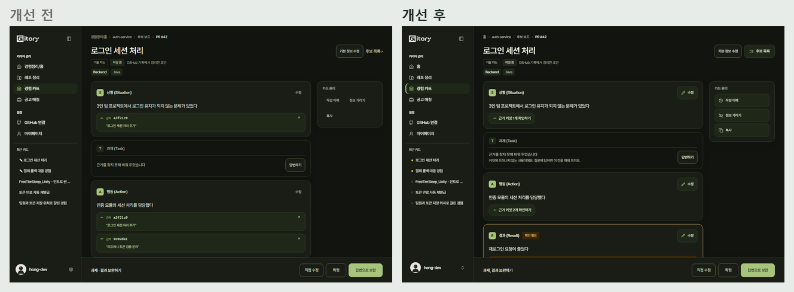 |

"개선 전"의 연결 끊김, 403 장면은 같은 주소로 찍었다. 개선 전에는 그 시나리오가 없어서 아무 안내 없이 분석이 시작되는 모습이 그대로 개선 전 상태다.

## 검증

- 타입체크, 단위 381개(새 `guidance-ux.test.tsx` 9개 포함), 프로덕션 빌드 E2E 170개, 모바일 E2E 53개 통과(Node 22).
- 의도해서 바꾼 값 3곳의 E2E 기대값을 갱신했다: 주 버튼 색(`theme-contrast`), 카드 종류 표기 "기술 카드"(`card-workflow`), 홈 새 카드 상자 경계(`ui-controls`).

## 백엔드·AI 에 부탁한 것

- 분석 도중 토큰이 만료되면 지금은 `GITHUB_UNAVAILABLE` 로 와서 일시 장애와 구분이 안 된다. 작업 오류 코드에 연결 문제를 따로 달라고 요청했다.
- `/me` 의 `github.connected` 가 토큰이 취소·만료된 경우도 반영하는지 확인을 부탁했다(띠가 이 값을 본다).
- #437: 근거 커밋의 한 줄 요약(커밋 메시지가 "fix" 같을 때도 뜻이 통하게)과 커밋 날짜·바뀐 파일 수.
