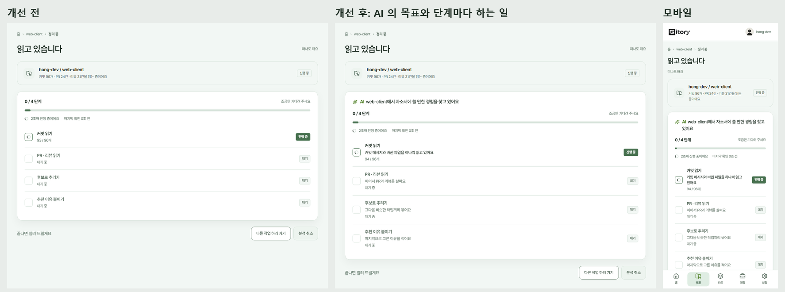

# 2026-10-26 분석 화면에 AI 가 하는 일 보여 주기

10/25 멘토링 "에이전트가 스스로 판단하고 움직이는 장면이 잘 드러나도록"을 분석 화면부터 반영했다. 되묻기 화면(#430)은 되묻기 자동 진행 PR(#424)과 같은 파일이라 그 PR 머지 뒤에 한다. #452 위에 쌓았다.

## 무엇을 바꿨나

| 위치 | 바꾼 것 |
| --- | --- |
| 분석 진행 카드 맨 위 | "AI web-client에서 자소서에 쓸 만한 경험을 찾고 있어요". 끝나면 "커밋 96개를 읽고 카드가 될 만한 작업 12개를 골랐어요"(서버 숫자 그대로) |
| 단계마다 | 단계 이름 아래 AI 가 하는 일을 한 문장으로. 지금 하는 단계는 현재형("커밋 메시지와 바뀐 파일을 하나씩 읽고 있어요"), 끝난 단계는 과거형, 남은 단계는 예고, 건너뛴 단계는 이유 |
| 작업 상태 화면(`/jobs/:id`) | 같은 단계 문장 |

숫자는 단계 줄이 서버 값 그대로 따로 보여 주고, 문장에는 넣지 않는다(지어낸 수치 없음). 문장은 `src/lib/agentNarration.ts` 한 곳에 있다.

## 개선 전/후

## 검증

- `agent-narration.test.ts` 3개(현재·과거·예고, 건너뜀, 끝난 뒤 요약), 기존 분석 화면 테스트(`mentor-feedback-ux`) 그대로 통과.
