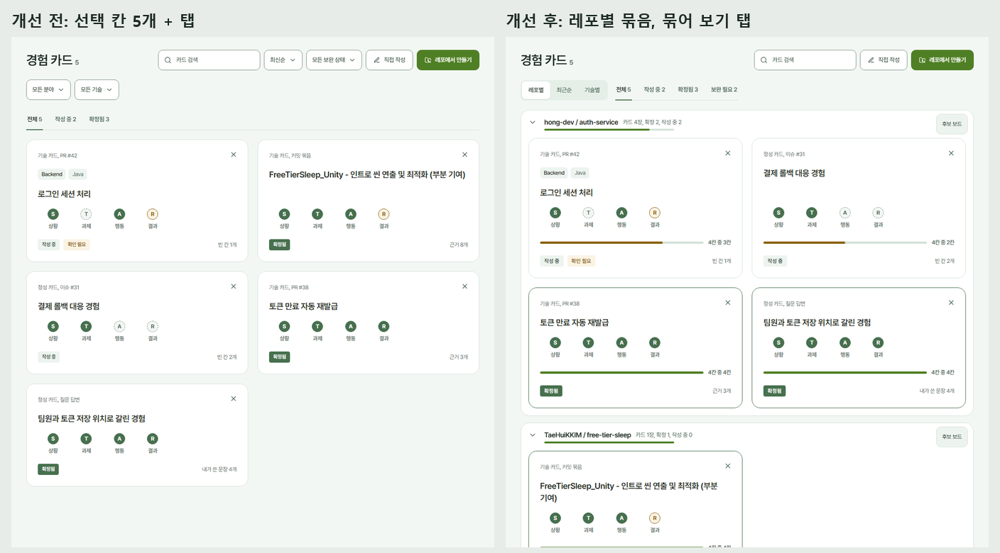
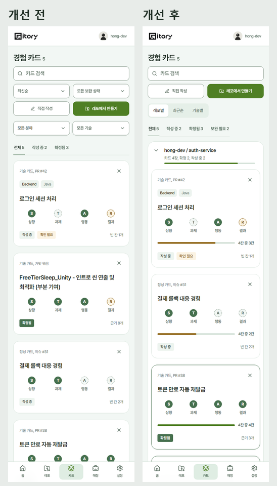
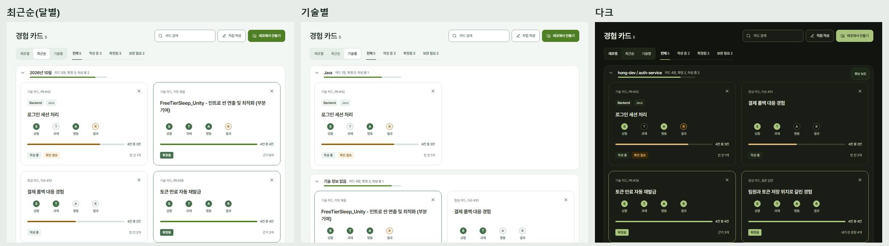

# 2026-10-26 경험 카드 목록을 레포별로 묶어 보기

팀 피드백(10/26)을 반영해 경험 카드 목록을 필터 화면이 아니라 둘러보는 화면으로 바꿨다. #452 위에 쌓았다.

## 무엇을 바꿨나

| 문제 | 바꾼 것 |
| --- | --- |
| 정렬, 보완 상태, 분야, 기술 선택 칸 4개와 상태 탭이 한 화면에 있어 필터 화면처럼 보임 | 선택 칸을 모두 없애고 "묶어 보기"(레포별, 최근순, 기술별) 하나와 상태 탭만 남김 |
| 어느 레포에서 나온 카드인지 한눈에 안 보임 | 레포별로 묶고, 묶음 머리에 레포 이름, 카드 수, 확정·작성 중 개수, 채운 칸 막대, 후보 보드 링크. 누르면 접고 펼침(기억함) |
| 기술 필터를 없애면 기술로 찾을 수 없음 | "기술별" 보기로 묶음. 여러 기술이면 여러 묶음에, 기술이 없으면 "기술 정보 없음"(지어내지 않음) |
| 빈칸 있음·확인 필요 필터가 따로 있음 | 상태 탭에 "보완 필요" 하나로 합침(작성 중 카드 중 빈칸이나 확인 필요가 있는 것) |
| 덜 만든 카드와 다 만든 카드가 구분이 안 됨 | 카드마다 "4칸 중 3칸"과 막대. 다 채우면 포인트 색, 확정 카드는 테두리 강조 |
| "확정됨" 같은 작은 배지 글자가 번져 보임 | 배지 자간을 0으로, 글자를 반 픽셀 키움 |

## 판단

- 레포 정보는 카드 목록 응답에 아직 없다. 백엔드에 `repo: { id, owner, name } | null` 을 요청했다(#457). 필드가 없으면(이전 서버) 레포별 보기를 숨기고 최근순으로 보여서, 백엔드와 배포 순서가 달라도 깨지지 않는다. 목 데모는 이미 `repo` 를 싣는다.
- 상세의 이전/다음 카드는 화면에 보이는 순서를 따른다(기술별에서 한 카드가 여러 번 보여도 한 번만).
- 고른 보기와 접은 묶음은 브라우저에 기억한다(`gitory.cards.view`, `gitory.cards.folded`).

## 개선 전/후

| 장면 | 비교 |
| --- | --- |
| PC |  |
| 모바일 |  |
| 최근순, 기술별, 다크 |  |

## 검증

- 묶음 규칙 단위 테스트(`card-groups.test.ts`) 5개.
- 없앤 선택 칸을 쓰던 E2E 를 새 구조로 옮겼다: 카드 태그(기술별 묶음), 이전/다음 순서(최근순), 보완 필터(보완 필요 탭), 같은 폭 카드(모든 묶음), 선택 메뉴 스타일(레포 고르기의 정렬 칸).
