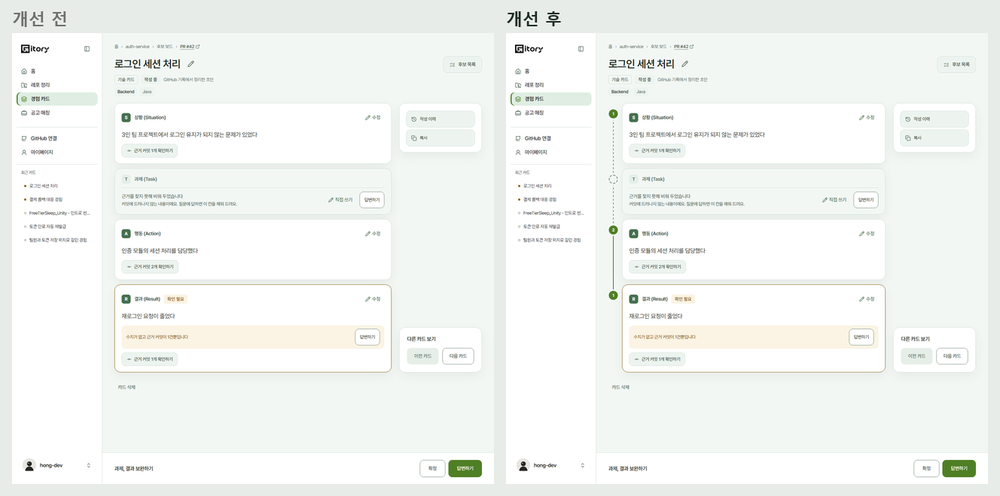
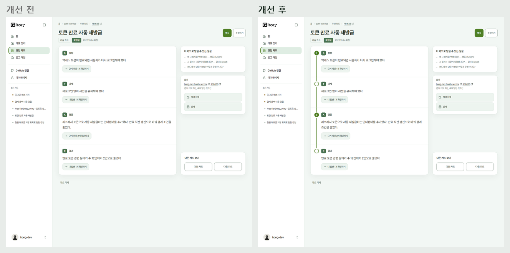
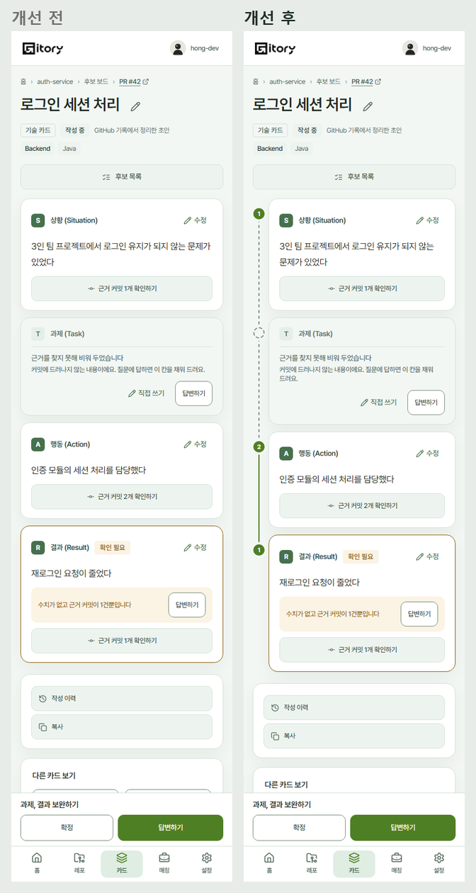
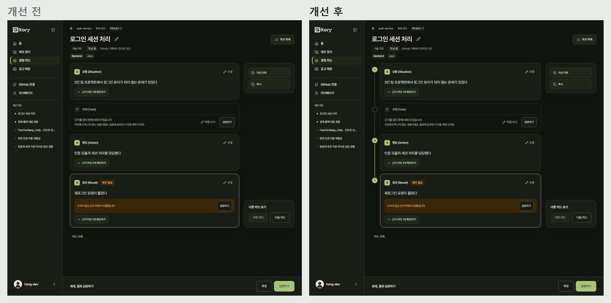

# 2026-10-27 카드에 커밋 레일 세우기

`frontend-design` 점검에서 "대담함은 한 곳에만 쓴다"는 기준으로 고른 자리다. Gitory 가 다른 이력서 도구와 다른 점은 **문장마다 실제 커밋이 받친다**는 것인데, 지금까지 카드 화면에서는 그게 칸마다 똑같은 "근거 커밋 N개 확인하기" 버튼으로만 보였다. 디자인이 크게 바뀌는 작업이라 #461 위에 따로 PR 로 올려 반영 여부를 따로 정할 수 있게 했다.

## 무엇을 바꿨나

STAR 네 칸 왼쪽에 세로 선(레일)을 세우고, 칸마다 점 하나를 찍는다.

| 칸 상태 | 점 | 선 |
| --- | --- | --- |
| 근거 커밋이 있음 | 채운 점, 안에 커밋 수 | 실선 |
| 커밋 없이 내가 답한 내용 | 빈 고리 | 실선 |
| 비어 있음 | 점선 고리 | 그 칸으로 오가는 선이 점선 |

- 카드를 한눈에 훑으면 "어디가 커밋으로 받쳐지고 어디가 비었는지"가 보인다. 빈 칸으로 가는 선이 끊겨 보여서 채울 곳이 먼저 눈에 들어온다.
- 작성 중 카드는 칸 상자 바깥 왼쪽에, 확정 카드는 한 상자 안 줄 왼쪽에 놓는다.
- 폰에서는 레일 폭과 점 크기를 줄이고, 인쇄할 때는 숨긴다.
- 점 안 숫자는 장식이라 화면 읽기 프로그램에는 읽히지 않는다(같은 정보가 "근거 커밋 N개 확인하기" 버튼에 있다).

## 개선 전/후

| 화면 | 비교 |
| --- | --- |
| 작성 중 카드(빈 칸 점선) |  |
| 확정 카드(내 답변은 빈 고리) |  |
| 폰 |  |
| 다크 |  |

## 검증

- 단위 397개, 정적 E2E 170개, 모바일 E2E 53개 통과.
