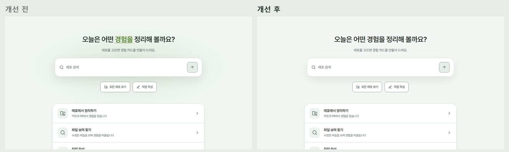
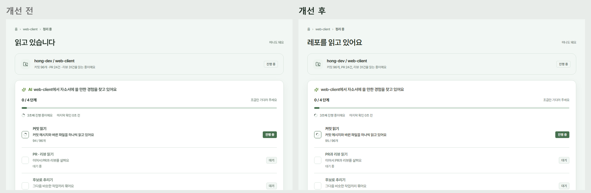
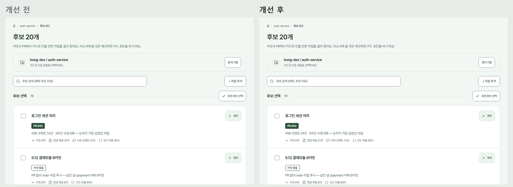
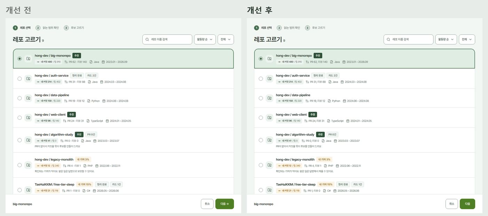

# 2026-10-27 생성된 화면처럼 보이는 기본값 걷어 내기

`frontend-design` 스킬의 점검 기준으로 Gitory 를 다시 봤다. 기능은 그대로 두고 "AI 가 만든 기본값"으로 읽히는 네 가지를 걷어 냈다. #458·#459 위에 쌓았다.

## 무엇을 바꿨나

| 기준 | 지금까지 | 바꾼 것 |
| --- | --- | --- |
| 사람이 하지 않은 움직임은 아껴 쓴다 | 화면마다 섹션이 차례로 페이드, 모든 카드가 hover 에 떠오름, 첫 방문 홈 입력칸 뒤 그라데이션 빛 | 모두 뺐다. 남긴 움직임은 사람의 행동에 대한 답뿐: 메뉴 열림, 토스트, 버튼 눌림, 기다리는 동안 도는 표시. 카드는 테두리 색만 바뀜 |
| 제목에서 한 단어만 강조하지 않는다 | "오늘은 어떤 **경험을** 정리해 볼까요?"(색과 밑줄), 분석 화면 "**AI** …"(초록 굵게) | 강조 없이 문장 그대로. `.hl` 포인트 색 규칙 제거 |
| 가운뎃점으로 잇기, 버튼 끝 화살표 | UI 문구 50여 곳의 `A · B`, `A·B`, "다음 →", "카드 보기 →" | 쉼표, "와/과", 괄호, 줄바꿈으로. 목록 앞 점은 글머리표(•)로. 버튼 글자 끝 화살표 제거(경로 구분 ›, 가리기 규칙의 바꾸기 →, 줄 링크 ›는 의미가 있어 둠) |
| 같은 행동은 끝까지 같은 이름 | "레포" 48곳·"저장소" 21곳, "답변하기/답변으로 보완/답변 작성", "정리/분석" | "레포", "답변하기", "정리"로 통일. "분석 도우미"는 "AI", "읽고 있습니다"는 "레포를 읽고 있어요" |

## 남은 것

- 후보 추천 이유처럼 **서버·AI 가 만드는 문장**에는 아직 가운뎃점이 있다(예: "리뷰 코멘트 14건 · 3주간 수정 6회"). 프론트에서 바꾸지 않고 AI 프롬프트 쪽에 요청한다.
- 다른 열린 PR(#423·#424)의 `interview-retry.test.tsx` 는 "· 비어 있음" 문구를 기대한다. 이 PR 은 같은 파일에서 "(비어 있음)"으로 맞췄으니, 먼저 머지되는 쪽에 맞춰 다른 쪽을 고친다.

## 개선 전/후

움직임은 정지 화면에 담기지 않아 표로만 적는다.

| 화면 | 비교 |
| --- | --- |
| 첫 방문 홈(강조 단어, 배경 빛) |  |
| 분석 진행(AI 강조, 용어) |  |
| 후보 보드(정리 기준, 검색 문구) |  |
| 레포 고르기(다음 버튼, 용어) |  |

## 검증

- 바뀐 문구를 기대하던 단위·E2E 테스트의 기대값을 새 문구로 옮겼다.
