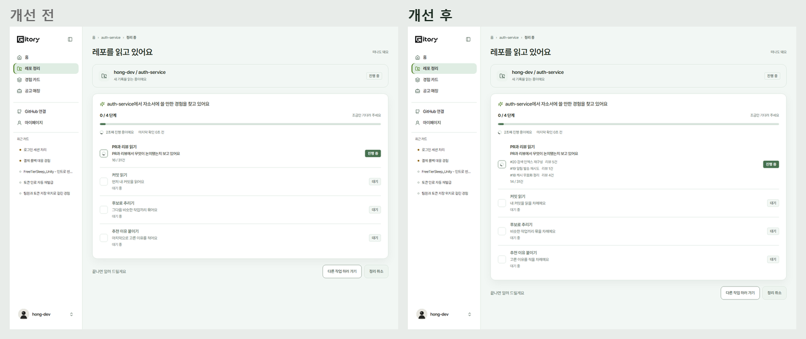
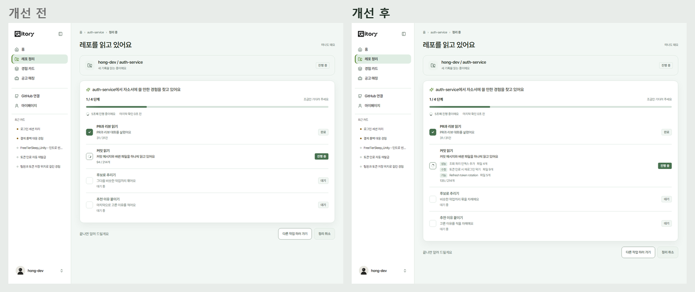
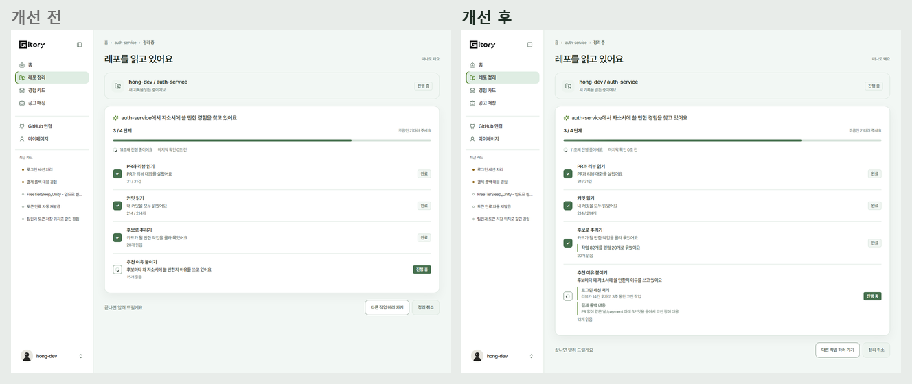
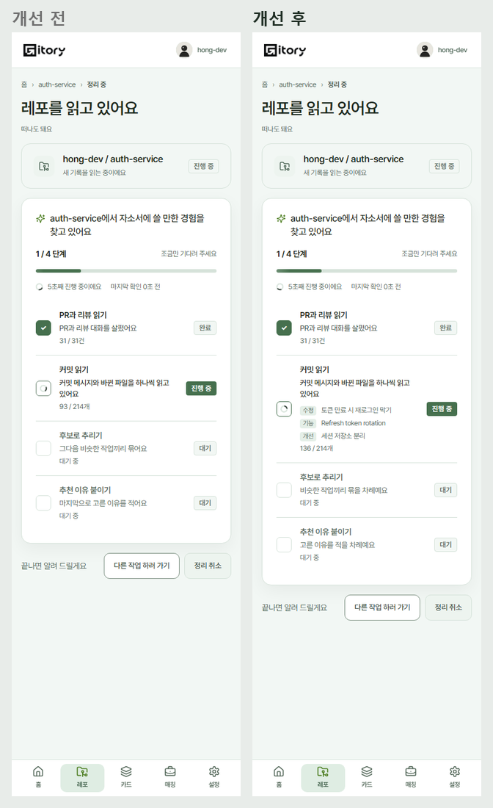

# 2026-10-29 분석 화면에 AI 가 읽고 판단한 줄 (#519)

#459 는 단계마다 "AI 가 지금 하는 일"을 한 문장으로 보여 줬지만, 실제로 무엇을 읽는지는 숫자(138 / 214개)뿐이었다. 백엔드 #496 이 Job 상세에 `activity`(방금 읽은 PR, 커밋과 판단 결과)를 실어 주므로, 그 줄을 단계 아래에 붙였다. #461 위에 쌓았다.

## 무엇을 보이나

| `kind` | 어디에 | 화면 |
| --- | --- | --- |
| `PULL_REQUEST` | PR과 리뷰 읽기 | `#31 로그인 리팩터링` 리뷰 4건 |
| `COMMIT` | 커밋 읽기 | [수정] 토큰 만료 처리 파일 3개. 뺀 커밋은 취소선과 이유(봇 커밋, 머지 커밋, 잠금 파일만, 내 커밋 아님) |
| `GROUPED` | 후보로 추리기 | 작업 12개를 경험 4개로 묶었어요 |
| `DESCRIBED` | 추천 이유 붙이기 | 경험 제목과 고른 이유 |

- **읽기 줄**은 지금 읽는 단계에서만 최근 3줄. 맨 아래가 가장 최근이다. 단계가 끝나면 접고 숫자만 남긴다.
- **판단 줄**은 왼쪽 포인트 선으로 모두 남는다. 고른 이유는 AI 한 번에 8개씩 한꺼번에 오므로 `seq` 순서로 하나씩 드러낸다(남은 줄이 많을수록 빨리, 0.15~0.6초 간격).
- 분석이 끝나도 아직 드러내지 않은 이유가 있으면 **다 보여 준 뒤** 후보 보드로 넘어간다.
- 폴링마다 같은 줄이 다시 와도 `seq` 로 걸러 한 번만 그린다. 서버가 읽기 줄을 단계마다 20줄만 주므로 화면이 지난 줄을 들고 있는다.
- 문장은 화면이 만든다. 값이 비면 그 칸을 지어내지 않고(리뷰 0건은 안 씀), 모르는 `kind` 는 그리지 않는다. `activity` 가 없는 이전 서버에서는 #459 화면 그대로다.
- 폴링 간격은 서버 `pollAfterMs`(Job 상세 1초)를 그대로 쓴다. Mock 도 상세 1초, 진행 중 목록 2초로 맞췄다.
- 기다리는 단계 문장에서 "먼저", "이어서"를 뺐다. 분석은 PR 부터, 카드 초안은 커밋부터 읽어 순서가 Job 마다 다르다.
- 화면 읽기 프로그램에는 줄마다 알리지 않는다(1초에 여러 줄이라 시끄럽다). 맨 위 한 줄이 계속 알린다.

## 개선 전/후

| 단계 | 비교 |
| --- | --- |
| PR 읽기 |  |
| 커밋 읽기 |  |
| 추천 이유 |  |
| 폰 |  |

## 검증

- `src/test/agent-activity-519.test.tsx`: 종류별 문장, 뺀 커밋 이유, 빈 값과 모르는 종류, 최근 3줄, 차례로 드러내기와 다 보인 뒤 이동, 같은 `seq` 한 번만, Mock 의 `seq`, 20줄, 1초.
