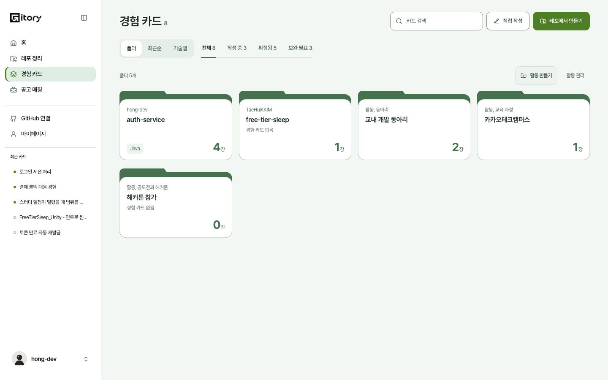
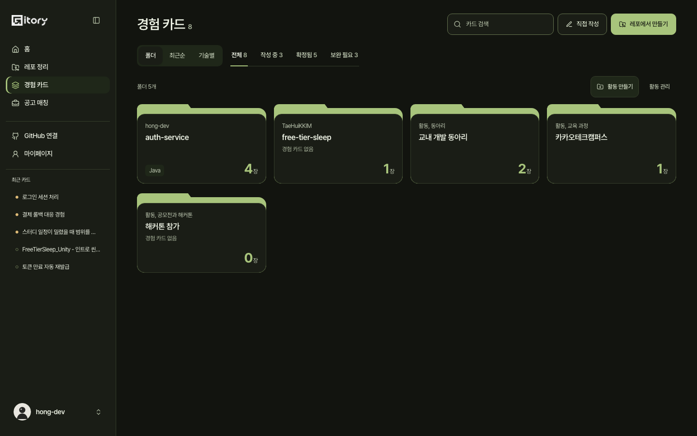
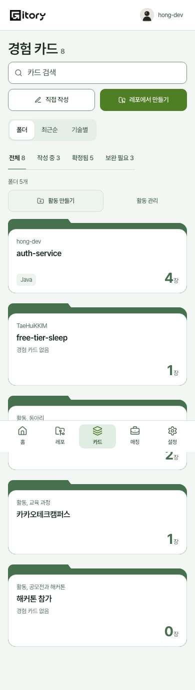
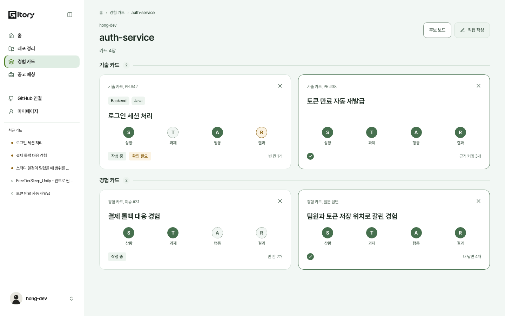
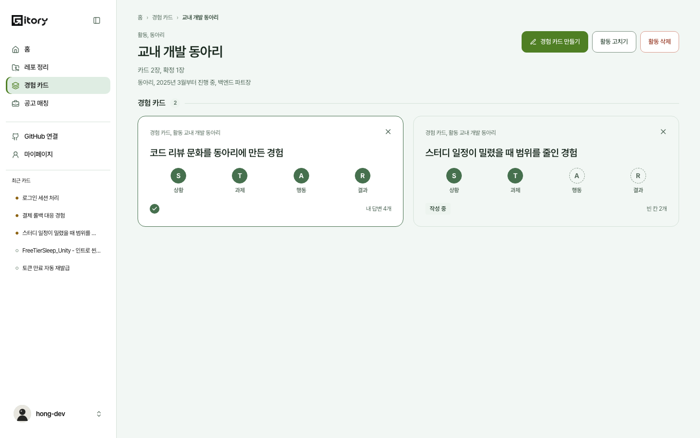

# 2026-10-31 활동 화면과 경험 카드 폴더 보기 (#522)

BE #477(활동 API, 계약 #475 1·2절)이 머지됐는데 화면이 없었다. 같은 이슈에 10/29 회의 결정(경험 카드를 레포·활동별 폴더로 나누고, 제목만 보고 누르면 폴더 안으로 들어가게)이 더해져 둘을 한 번에 했다. 문항 유형(`themes`)은 같은 이슈의 다른 몫이라 이 문서의 범위가 아니다.

## 무엇이 생겼나

| 화면 | 주소 | 하는 일 |
| --- | --- | --- |
| 경험 카드 목록, 폴더 보기(기본) | `/cards` | 레포·활동마다 닫힌 폴더 하나. 누르면 폴더 안으로 |
| 레포 폴더 안 | `/cards/repo/:repoId` | 소유자, 레포 이름, 카드 수, 후보 보드 버튼, 기술 카드와 경험 카드 두 구역 |
| 활동 폴더 안 | `/cards/activity/:activityId` | 활동 정보(종류, 기간, 역할), 경험 카드 만들기, 활동 고치기, 활동 삭제 |
| 직접 쓴 카드 폴더 안 | `/cards/direct` | 레포도 활동도 없는 카드 |
| 활동 관리 | `/activities` | 활동 목록, 고치기와 삭제 |
| 활동 만들기·고치기 | `/activities/new`, `/activities/:activityId/edit` | 이름, 종류, 시작·끝난 달(진행 중), 역할 |
| 활동 안에서 카드 만들기 | `/cards/new?activity=:id` (레포 폴더는 `?repo=:id`) | 직접 작성 화면에 어디에 쓸지가 미리 골라져 있다 |

카드 상세는 활동 안의 카드에서 경로(breadcrumb)와 출처에 활동 이름을 보이고, 이름을 누르면 그 활동 폴더로 간다. 카드 목록 타일의 첫 줄에는 `정성 카드, 활동 교내 개발 동아리`처럼 활동 이름이 붙는다(최근순·기술별 보기에서도 활동 카드를 알아볼 수 있게).

## 폴더 앞판

시안(성준 님, 이슈 댓글)을 베끼지 않고 앱의 토큰과 규칙에 맞췄다.

- 한 폴더 = 링크 하나. 키보드로 열고, 접근성 이름에 소유자·이름·장 수·`경험 카드 없음`·기술이 모두 들어간다(`folderLabel`). 뒤판과 탭은 장식이라 접근성 트리에서 뺀다.
- 색은 토큰만. 뒤판·탭 `--bg-ink-solid`, 앞판 `--bg-surface` + `--border-default`, 숫자 `--text-accent`. 올리거나 키보드로 닿으면 뒤판 `--bg-ink-hover`, 앞판 테두리 `--border-selected`로 **색만** 바뀐다. 다크 모드는 같은 토큰이고, 폴더는 모두 같은 색 하나다.
- 첫 줄은 레포면 소유자, 활동이면 `활동, 종류`. 이름은 두 줄까지. 탭에는 글이 없다.
- 오른쪽 아래 큰 숫자는 서버가 준 카드를 센 전체 장 수다(기술 카드와 경험 카드 합). 왼쪽 아래는 가장 많은 카드에 붙은 기술 둘이고, 카드에 태그가 없으면 비어 있다(지어내지 않는다).
- `경험 카드 없음`은 정성 카드(경험 카드)가 한 장도 없는 레포·활동 폴더에만 연한 글씨로 적는다. 시안에서도 `2장`이면서 `경험 카드 없음`인 레포가 있어, 이 글은 "전체 0장"이 아니라 "경험 카드를 더 쓸 곳"이라는 뜻으로 읽었다.
- 격자는 `repeat(auto-fill, minmax(min(240px, 100%), 1fr))`. 1440에서는 4열, 390과 320에서는 한 줄에 폴더 하나.
- 후보 보드 버튼은 앞판에서 폴더 안으로 옮겼다. 활동 폴더에는 없다(레포만).

## 판단

| 질문 | 정한 것과 이유 |
| --- | --- |
| 레포도 활동도 없는 카드(직접 작성)는? | `직접 쓴 카드` 폴더 하나에 모은다. 카드를 폴더 밖에 흘리지 않으려는 것이고, 이름은 이전 '레포별' 묶음의 이름을 그대로 썼다. 카드가 있을 때만 만들고 맨 아래에 둔다. 앞판 첫 줄은 `레포와 활동 없이 쓴 카드`. 이 폴더에는 `경험 카드 없음`을 달지 않는다(레포·활동처럼 더 쓸 곳이 아니라서) |
| 카드가 한 장도 없는 레포는? | 폴더를 만들지 않는다. 레포 화면(`/repos`)과 후보 보드가 맡는다. 활동은 카드가 없어도 폴더를 만든다(그래야 그 안에서 첫 카드를 만든다) |
| `activity` 가 생략된 이전 서버는? | 레포 없는 카드를 활동 밖으로 본다. 그 서버에는 활동 자체가 없다. 레포 정보(`repo`)가 아예 없으면 지금처럼 폴더 보기를 숨기고 최근순으로 본다 |
| 레포와 활동이 함께 온 카드는? | 계약상 없다. 오면 레포에만 센다(두 폴더에 겹쳐 세지 않는다) |
| 활동 목록만 못 읽으면? | 카드에 적힌 활동으로 폴더를 만들고, 카드가 없는 활동이 빠질 수 있다고 알린 뒤 다시 불러오게 한다 |
| 검색·상태 탭은? | 맞는 카드가 있는 폴더만 남기고 숫자는 `맞는 카드 N장`으로 밝힌다(전체 장 수로 오해하지 않게). `경험 카드 없음`은 거르지 않은 폴더의 사실이라 거른 보기에서는 붙이지 않는다 |
| 접던 레포별 묶음은? | 폴더 보기로 대체했다. 예전에 고른 `repo` 보기는 폴더로 읽는다. 최근순, 기술별은 그대로다 |
| 실서버에 `/api/activities` 가 있나? | `docs/openapi/backend.json`(develop)에 `GET·POST /api/activities`, `PATCH·DELETE /api/activities/{id}`, 카드의 `activity`, `POST /api/cards/manual/draft`의 `activityId` 가 있다. main 의 openapi 에는 아직 없다(develop → main #485 전). 환경변수로 막지 않았다: 인적사항을 막았다가 운영에서 화면이 닫힌 채 남았던 일(#600)을 되풀이하지 않으려는 것이다. 대신 활동 목록이 실패해도 카드 목록은 열린다 |
| 활동 삭제 확인의 장 수는? | 서버가 준 `cardCount`·`confirmedCount` 그대로이고, 대화상자를 열 때 한 번 다시 읽어 그 사이 늘었는지 반영한다. 확정 카드가 함께 지워지고 자소서·매칭에 쓰였을 수 있다고 따로 말한다 |
| 활동 만들기 중복은? | 열 때 만든 Idempotency-Key 하나를 쓴다. 응답을 못 받고 다시 눌러도 활동은 하나만 생긴다(같은 키는 처음 만든 활동을 돌려준다) |
| 활동 고치기는? | 바뀐 칸만 보낸다. 서버는 바꿀 값이 없으면 400 이라 저장 버튼이 잠긴다. 진행 중으로 바꾸거나 역할을 지울 때는 빈 글을 보낸다 |

## 카드 종류 이름은 팀이 정한다

시안과 계약(2026-10-28-EXPERIENCE_CARDS.md)은 직접 쓴 정성 카드를 `경험 카드`, 코드에서 나온 카드를 `기술 카드`로 부른다. 코드의 `cardKindLabel` 은 `정성 카드`이고, 폴더 안 구역 이름(`경험 카드`)과 그 안 타일 이름(`정성 카드`)이 한 화면에서 어긋나는 것을 알고 있다. 이름을 `경험 카드` 로 바꿀지는 팀이 회의에서 정하기로 해서 이 문서의 이전 판이 바꿨던 것을 되돌렸다. 정해지면 `lib/labels.ts` 의 `cardKindLabel`, `cardKindShort` 두 줄과 시험 두 곳(`activities-pages-522.test.tsx` 의 타일 이름과 배지, `match-link-422.test.tsx`)만 바꾸면 된다. 용어집(2026-10-29-TERMINOLOGY.md 1.1)의 '정성 카드' 행과 `CandidateBoardPage` 의 "경험 카드로 생성됩니다"도 그때 같이 맞춘다.

## 남긴 것

- `InterviewTurn.sourceType` 의 `ACTIVITY`(계약 4절)는 openapi 에 아직 없어 FE 열거에 더하지 않았다. BE 가 켜면 `InterviewSourceType` 에 더해야 활동 카드의 되묻기가 깨지지 않는다.
- 카드를 다른 활동·레포로 옮기는 기능은 계약에 없다.
- `/activities` 를 열면 사이드바 `경험 카드` 메뉴는 강조되지 않는다(폴더 화면은 `/cards/...` 아래라 강조된다). AppShell 은 다른 PR 이 고치는 중이라 건드리지 않았다.

## 검증

단위(`card-folders-522`, `activities-522`, `activities-pages-522`)와 E2E(`activities-folders-522.spec.ts`)가 폴더 묶기, 활동 입력 검사와 요청, 삭제 확인의 N·M, 빈 폴더, 목 서버 계약, 활동 만들기에서 지우기까지의 흐름, 1440·390·320 라이트·다크 격자와 대비를 본다. 화면은 `screenshots/2026-10-31-folders/`.

| 장면 | 화면 |
| --- | --- |
| 폴더 보기 1440 |  |
| 폴더 보기 다크 |  |
| 폴더 보기 390 |  |
| 레포 폴더 안 |  |
| 활동 폴더 안 |  |
