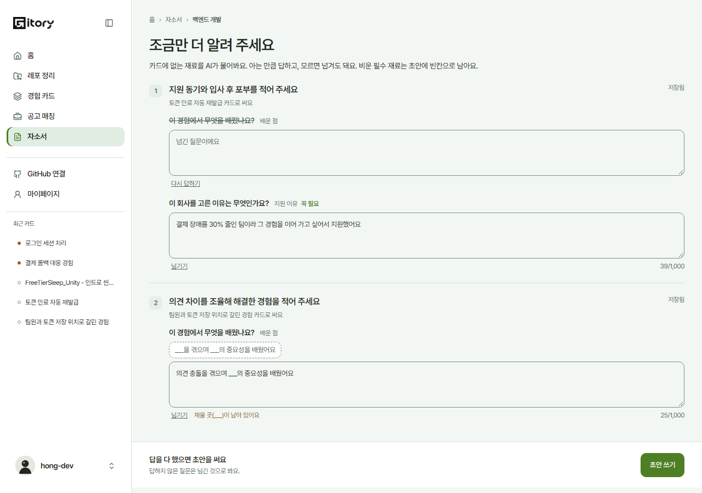
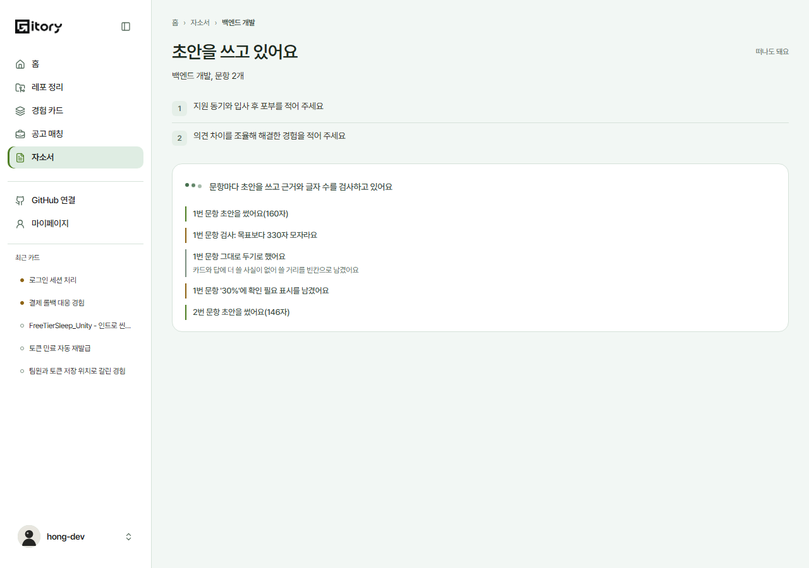
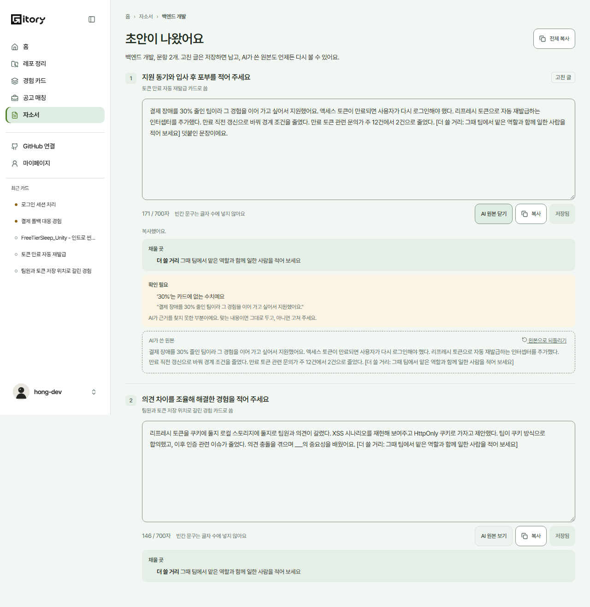
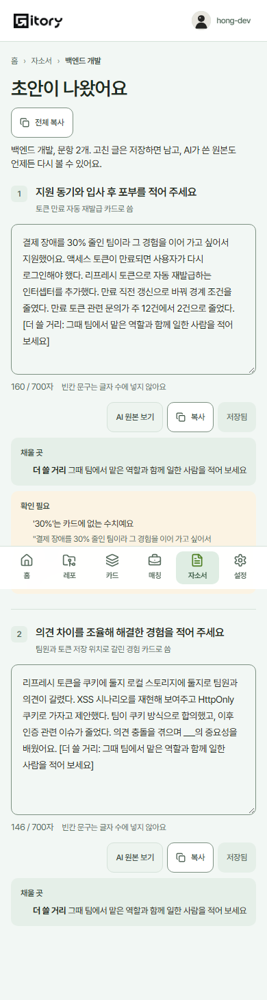
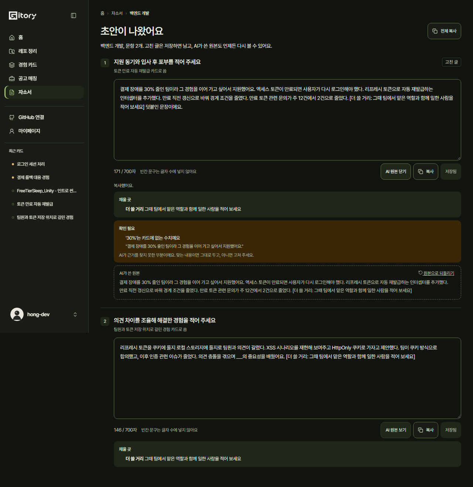

# 2026-10-31 자소서 ④ 질문 ⑤ 쓰기 기다림 ⑥ 초안 고치기, 복사 (#518)

[자소서 계약](2026-10-28-COVER_LETTER.md)의 ④~⑥ 을 #517 화면(`/cover-letters/:id`)에 이어 붙였다. 단계는 응답의 `stage` 가 정한다: `ASKING` → `ASKED` → `DRAFTING` → `DRAFTED`.

## ④ 질문 (`ASKING` 기다림, `ASKED`)
- 문항마다 AI 질문(최대 4개). 항목 이름과 **꼭 필요**(`required`) 표시. 비우면 초안에 그 자리 빈칸이 남는다고 미리 말한다.
- **답 틀**(`templates`): 누르면 칸에 넣고 첫 `___` 를 골라 둔다. 채우지 않은 `___` 가 남으면 그 칸 아래에 알린다.
- **넘기기 / 다시 답하기**. 넘긴 칸은 비활성.
- **지난 답**(`question: null`, `answer.reused`)은 "배운 점 (지난번에 답한 내용)" 제목으로 미리 채워 두고 고칠 수 있다.
- **저장**: 칸을 벗어나면 그 문항 답 전체를 `PUT …/answers` 로 저장하고(문항 옆에 저장 중, 저장됨), "초안 쓰기" 전에 남은 것을 모두 저장한다. 보내지 않은 항목은 답이 없는 것으로 남으므로, **손대지 않은 지난 답도 같은 글 그대로 다시 보낸다**(그래야 `reused` 가 유지된다). 넘긴 것은 `text: null`, 비운 것은 보내지 않는다.
- 아래 고정 줄: 비운 필수 재료 수와 "초안 쓰기"(`POST …/drafts`).

## ⑤ 쓰기 기다림 (`DRAFTING`)
`steps.draft` 를 문장으로 쌓는다. 쓰기(포인트 선), 검사 통과와 판단(옅은 선), 걸림과 고치기(주의 선)를 선 색으로 나눈다.

| `kind` | 문장 |
| --- | --- |
| `WROTE` / `REWROTE` | 1번 문항 초안을 썼어요(642자) / 고쳐서 다시 썼어요(598자) |
| `CHECK_PASSED` / `CHECK_FAILED` | 근거와 글자 수 검사를 통과했어요 / 검사: '30%'는 카드에 없는 수치예요 |
| `DECIDED` | 고치기로 했어요 / 그대로 두기로 했어요 + 이유 |
| `REVERTED`, `MARKED`, `SKELETON` | 앞 초안으로 돌렸어요, '30%'에 확인 필요 표시를 남겼어요, 뼈대를 만들었어요 |
| `REVIEWED`, `SENT_BACK` | 모든 문항을 함께 읽고 2문장을 다시 보게 했어요, 3번째 문장을 다시 쓰게 했어요 + 이유 |

모르는 `kind` 는 건너뛴다.

## ⑥ 초안 (`DRAFTED`)
- 문항마다 편집 칸. **글자 수는 화면이 바로 센다**: 서버 `DraftText` 와 같은 기준(`src/lib/draftText.ts`) — 항목 빈칸 문구 7개와 `[더 쓸 거리: …]` 는 빼고 코드 포인트로(이모지 한 글자). 넘으면 "N자 넘음".
- **채울 곳**: 글에 남은 항목 빈칸(`[배운 점: 배운 점을 적어 주세요]` 등, 서버 문구와 글자 그대로)과 AI 가 넣은 더 쓸 거리.
- **확인 필요**(`marks`): 이유와 그 AI 원본 문장. 원본 기준이라 고친 뒤에도 어디를 봐야 하는지 보인다.
- **저장**(`PATCH`, 칸을 벗어나도 저장), **복사**(빈칸이 남아 있으면 그 수를 함께 알림, 클립보드가 막히면 글을 선택해 둠), **AI 원본 보기**와 원본으로 되돌리기, **전체 복사**(문항 번호와 문항을 붙여서). 고친 글에는 "고친 글" 표시.
- `source: SKELETON` 이면 뼈대라고 알린다.

## Mock
- 질문 4초, 초안 8초. 카드에 결과가 없으면 결과를, 배운 점, 지원 동기면 지원 이유를 묻는다. 같은 카드로 받은 답은 기억해서 다음 자소서에서 미리 채운다(#585 동작).
- 초안은 카드 문장과 답으로 쓰고, 필수 재료가 비면 서버와 같은 빈칸 문구를 넣는다. 짧으면 더 쓸 거리, 카드에 없는 수치가 있으면 확인 필요 표시를 남긴다.

## 지표
`cover_letter_drafts_started`(비운 필수 수), `cover_letter_edited`(문항 번호), `cover_letter_copied`(문항/전체, 남은 빈칸 수). 글은 싣지 않는다.

## 화면
| | |
| --- | --- |
| ④ 질문 |  |
| ⑤ 쓰기 기다림 |  |
| ⑥ 초안 |  |
| 폰 |  |
| 다크 |  |

## 검증
- `src/test/cover-letter-518.test.tsx` 8개: 글자 세기와 빈칸(서버 기준), ⑤ 문장, 답 보내기 규칙(넘김, 비움, 지난 답), Mock(답 저장 400, 409, 초안과 빈칸, 고치기 다시 세기, 지난 답 기억), ④ ⑥ 화면.
