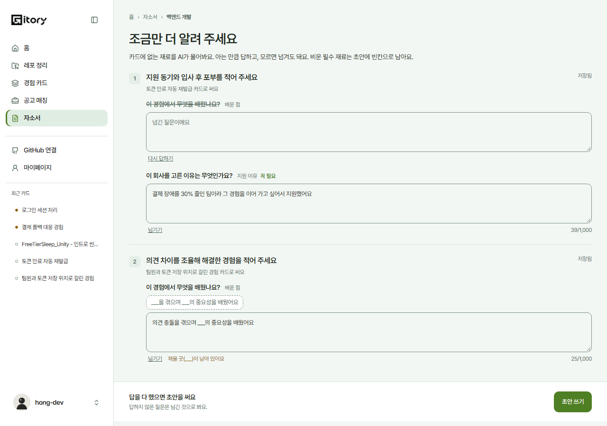
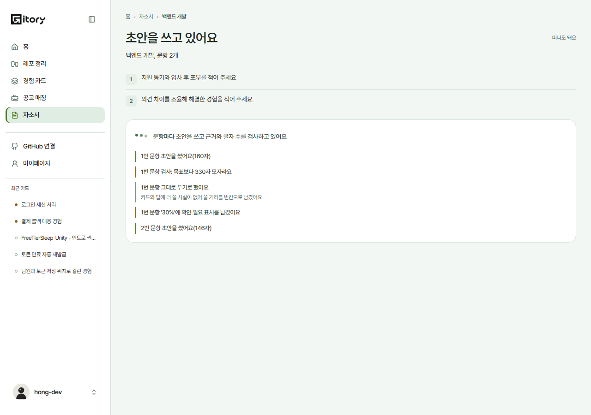
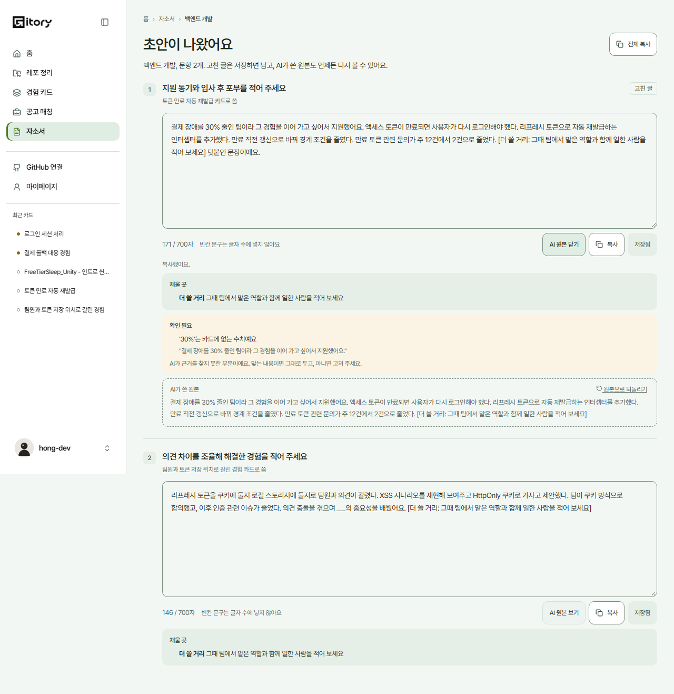
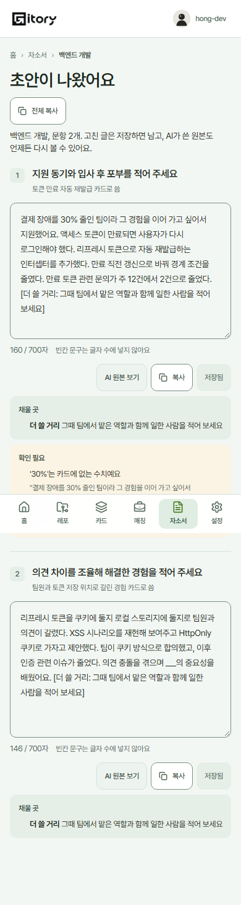
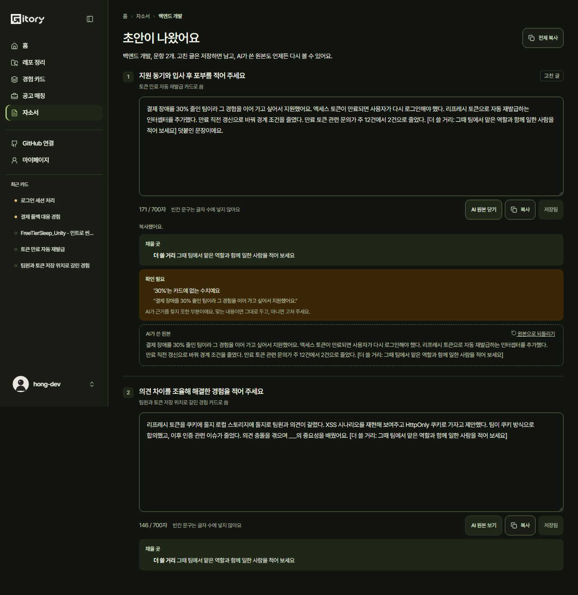

# 2026-10-31 자소서 ④ 질문 ⑤ 쓰기 기다림 ⑥ 초안 고치기, 복사 (#518)

[자소서 계약](2026-10-28-COVER_LETTER.md)의 ④~⑥ 을 #517 화면(`/cover-letters/:id`)에 이어 붙였다. 단계는 응답의 `stage` 가 정한다: `ASKING` → `ASKED` → `DRAFTING` → `DRAFTED`.

## ④ 질문 (`ASKING` 기다림, `ASKED`)
- **`ASKING` (#745)**: '더 물어볼 것을 고르고 있어요' + '보통 1~2분 걸려요 · 떠나도 돼요'. ②와 같은 종이에 문항마다 '○○ 카드로 써요'(카드가 없으면 '카드 없이 질문으로 재료를 모아요') 한 줄과 상태 한 줄('물어볼 것을 고르는 중' → '✓ 물어볼 것을 골랐어요'), 종이 뼈대 세 줄. 예전의 카드 목록 · 재료 점검 · 점 세 개 상자는 없앴다.
- 문항마다 질문(최대 4개). 항목 이름과 **꼭 필요**(`required`) 표시. 비우면 초안에 그 자리 빈칸이 남는다고 미리 말한다.
- **예시 한 줄 (#745)**: 질문 아래 '예: …' 한 줄(`ITEM_EXAMPLE`, #724 문장 그대로), 답 칸은 이 줄을 설명(`aria-describedby`)으로 읽는다. 점선 답 틀(`templates`) 칩은 없앴다 — 예전에 넣어 둔 `___` 가 남은 답에는 그 칸 아래 알림이 그대로 있다.
- 답 칸 아래 '넘기기'(누르는 자리 44px)와 '100자쯤 쓰면 글이 좋아져요 · n/1,000'(100자를 넘으면 '충분해요').
- **넘기기 / 다시 답하기**. 넘긴 칸은 비활성.
- **지난 답**(`question: null`, `answer.reused`)은 "배운 점 (지난번에 답한 내용)" 제목으로 미리 채워 두고 고칠 수 있다.
- **저장**: 칸을 벗어나면 그 문항 답 전체를 `PUT …/answers` 로 저장하고(문항 옆에 저장 중, 저장됨), "초안 쓰기" 전에 남은 것을 모두 저장한다. 보내지 않은 항목은 답이 없는 것으로 남으므로, **손대지 않은 지난 답도 같은 글 그대로 다시 보낸다**(그래야 `reused` 가 유지된다). 넘긴 것은 `text: null`, 비운 것은 보내지 않는다.
- 아래 고정 줄: '답을 다 했으면 초안을 써요 · 답하지 않은 질문은 넘긴 것으로 봐요'(비운 필수 재료가 있으면 그 수)와 "초안 쓰기"(`POST …/drafts`).

## ⑤ 쓰기 기다림 (`DRAFTING`)
**상태 한 줄 (#745)**: 종이 위 문항마다 '○○ 카드로 써요' 한 줄과 상태 한 줄 — '차례를 기다리는 중'(빈 동그라미) → '쓰는 중' → '검사 중'(다시 쓰면 '다시 쓰는 중') → '✓ 다 썼어요'. 예전 점검표 칩 다섯 개('근거 검사 전' …)와 '0 / 700자'는 없앴다. 글이 아직 없는 문항은 종이 뼈대 세 줄, 글은 지금처럼 문장마다 따라 쳐진다. 제목 아래 '보통 1~2분 걸려요 · 떠나도 돼요'.

`steps.draft` 를 문장으로 쌓는다. 쓰기(포인트 선), 검사 통과와 판단(옅은 선), 걸림과 고치기(주의 선)를 선 색으로 나눈다.

| `kind` | 문장 |
| --- | --- |
| `WROTE` / `REWROTE` | 1번 문항 초안을 썼어요(642자) / 고쳐서 다시 썼어요(598자) |
| `CHECK_PASSED` / `CHECK_FAILED` | 근거와 글자 수 검사를 통과했어요 / 검사: '30%'는 카드에 없는 수치예요 |
| `DECIDED` | 고치기로 했어요 / 그대로 두기로 했어요 + 이유 |
| `REVERTED`, `MARKED`, `SKELETON` | 앞 초안으로 돌렸어요, '30%'에 확인 필요 표시를 남겼어요, 뼈대를 만들었어요 |
| `REVIEWED`, `SENT_BACK` | 모든 문항을 함께 읽고 2문장을 다시 보게 했어요, 3번째 문장을 다시 쓰게 했어요 + 이유 |

모르는 `kind` 는 건너뛴다.

## ⑥ 초안 (`DRAFTED`)
- 문항마다 편집 칸. **글자 수는 화면이 바로 센다**: 서버 `DraftText` 와 같은 기준(`src/lib/draftText.ts`) — 항목 빈칸 문구 7개와 `[더 쓸 거리: …]` 는 빼고 코드 포인트로(이모지 한 글자). 넘으면 "N자 넘음".
- **채울 곳**: 글에 남은 항목 빈칸(`[배운 점: 배운 점을 적어 주세요]` 등, 서버 문구와 글자 그대로)과 AI 가 넣은 더 쓸 거리.
- **확인 필요**(`marks`): 이유와 그 AI 원본 문장. 원본 기준이라 고친 뒤에도 어디를 봐야 하는지 보인다.
- **저장**(`PATCH`, 칸을 벗어나도 저장), **복사**(빈칸이 남아 있으면 그 수를 함께 알림, 클립보드가 막히면 글을 선택해 둠), **AI 원본 보기**와 원본으로 되돌리기, **전체 복사**(문항 번호와 문항을 붙여서). 고친 글에는 "고친 글" 표시.
- `source: SKELETON` 이면 뼈대라고 알린다.

## ⑥ 옆 패널 (#727)
- 종이 오른쪽 440px(좁으면 화면 폭의 40%) 패널. 탭 셋 중 하나만 보인다: **채우기**(#733) · **진단·첨삭**(처음 열리는 탭) · **짐작 확인**(개수 배지). 맨 위 머리줄은 화면 위쪽 35~45% 띠에 걸린 문항 또는 글상자에 들어간 문항을 따라 'Q2에 적용' 으로 바뀌고, 첨삭을 받는 동안은 'Q2 첨삭 중' 으로 묶인다. 패널 높이는 화면 아래에서 끝나게 맞춰 '적용하기' 줄이 늘 보인다.
- **진단·첨삭**: 첫 화면은 한 줄 + '첨삭 받기' + '살펴볼 곳 n'(짐작이 아닌 확인 필요 표시의 이유 한 줄씩, 셋 넘으면 '더 보기', 누르면 종이의 그 문장을 칠함, 없으면 '걸린 곳이 없어요'). '첨삭 받기' → '살펴보는 중 → 고치는 중'(요청은 하나, 0.6초 뒤 둘째 단계로) → 종합 평가 · 첨삭 포인트(아쉬운 점 N | 잘한 점 N, 첫 포인트 펼침) · 고친 글(바뀐 문장 점선 밑줄, 포인트를 누르면 그 문장 연한 파랑 + 패널만 그 자리로) → 아래 고정 줄 '다시 받기' / '적용하기'. 종이는 적용 전까지 그대로이고, 저장하지 않은 고친 글이 있으면 먼저 저장하고 첨삭을 부른다. 적용하면 종이 글이 바뀌고 문항 아래에 'n판 · 원본 보기', 패널은 '적용했어요 · 다시 받기'. 결과는 그 문항에 남아 다른 문항에 갔다 와도 보인다. 실패는 탭 안에 한 줄로 알린다.
- **짐작 확인**: 확인하지 않은 짐작 문장(INFERRED) 목록(보고 있는 문항 것 먼저, 셋 넘으면 '더 보기'). 줄을 누르면 종이의 그 문장으로, 확인(표시만 지움) · 고치기(글상자에서 그 문장 고르기) · 빼기(뺀 글 바로 저장). #719 의 여백 메모는 ⑥ 에서 없앴고, 종이에는 칠하기와 칩(근거 통과 · 겹침 n · 짐작 n)만 남는다.
- **채우기**(#733): 자소서 하나에 대화 하나. AI 말은 왼쪽(문항 꼬리표 'Q1 · 행동', 질문 끝의 예시는 흐리게), 내 말은 오른쪽, 끝난 말(`DONE`)은 가운데 흐린 한 줄이고, 새 말풍선은 아래에서 0.2초 동안 올라온다(움직임 줄이기면 없음). 대화가 비어 있으면 'Qn 얘기하기' 큰 버튼. 보내기(Enter, Shift+Enter 는 줄바꿈, 500자) → 내 말풍선 → '생각하는 중' → AI 말풍선. `FILLED` 면 '다시 쓰는 중'(0.6초) → 종이 글이 서버가 다시 쓴 글로 바뀜 → 'Qn에 넣었어요 → 보기'(종이의 그 문항으로 가서 새 문장을 파랑으로 잠깐 칠함). 범위 밖 말(`OFF_TOPIC`)은 돌려보내는 AI 말풍선이고 입력은 열린 채다. '넘기기'는 `turns/skip`. 보고 있는 문항이 대화 중인 문항과 다르면 입력 칸 위에 'Qn 얘기하기' 링크만 생긴다(화제를 스스로 바꾸지 않음). 429·503 은 말풍선 자리에 '잠시 뒤 다시 보내 주세요' + '다시 보내기', 쓴 말은 입력 칸으로 돌아온다. 소리로는 AI 말만 읽는다(aria-live polite). 저장하지 않은 고친 글이 있으면 먼저 저장하고 보낸다.
- **알림 줄**: 다른 문항과 겹친다는 표시(REPEATED)가 남은 문항('→ Qn 보기'), 필수 재료 빈칸이 남은 문항('→ Qn에 넣기', 누르면 채우기 탭에서 그 문항 이야기를 연다)이 있을 때만 패널 맨 위(폰은 종이 위)에 나온다. '닫기'.
- 보고 있는 문항: 글상자에 들어가 있으면 띠(화면 위 35~45%)에 다른 문항이 걸려도 그 글상자 문항이다. 공고 조건이 어느 문항에도 없다는 알림은 응답에 공고 조건이 없어 이번에는 만들지 않았다.
- 860px 아래: 아래 막대 세 칸(767px 아래는 앱 메뉴 막대 위). 누르면 반 높이 시트로 열리고 Esc · 닫기로 닫는다.
- 문구는 '추론' 대신 '짐작'('짐작 · 확인 필요').

## Mock
- 질문 4초, 초안 8초. 카드에 결과가 없으면 결과를, 배운 점, 지원 동기면 지원 이유를 묻는다. 같은 카드로 받은 답은 기억해서 다음 자소서에서 미리 채운다(#585 동작).
- 초안은 카드 문장과 답으로 쓰고, 필수 재료가 비면 서버와 같은 빈칸 문구를 넣는다. 짧으면 더 쓸 거리, 카드에 없는 수치가 있으면 확인 필요 표시를 남긴다.
- 채우기(#733)는 데모에서 요청마다 0.8초 걸리고 결정적이다: 열면 그 문항의 첫 빈칸(항목 빈칸 → 더 쓸 거리 → 답이 없는 결과·배운 점)을 세 줄로 묻고, 15자 안쪽 답은 꼬리 질문 한 번, '무시하고'가 든 말은 `OFF_TOPIC`, 그 밖은 답을 재료로 저장하고 그 빈칸 자리를 '~습니다' 문장으로 바꾼다(`FILLED`). 문항당 질문 둘 뒤에는 `DONE`, 넘기기도 `DONE` 한 줄.
- 첨삭(#727)은 데모에서 1.2초 걸리고 결정적이다: 가장 긴 문장을 쉼표에서 둘로 나누고 결과 문장 하나를 보탠다(끝의 빈칸 앞). 포인트는 아쉬운 점 2 · 잘한 점 1, 표시는 바뀌지 않은 문장에만 옮긴다.

## 지표
`cover_letter_drafts_started`(비운 필수 수), `cover_letter_edited`(문항 번호), `cover_letter_copied`(문항/전체, 남은 빈칸 수). 글은 싣지 않는다.

## 화면
| | |
| --- | --- |
| ④ 질문 |  |
| ⑤ 쓰기 기다림 |  |
| ⑥ 초안 |  |
| 폰 |  |
| 다크 |  |

## 검증
- `src/test/cover-letter-733.test.tsx` 14개: 대화 응답 읽기, Mock(질문 · 꼬리 질문 · FILLED · DONE · 400/409), 지난 대화와 꼬리표, 새로고침 뒤 FILLED 말의 '넣었어요', Enter 보내기와 소리 읽기, Shift+Enter, 얇은 답, FILLED 로 종이가 바뀌고 '→ 보기', OFF_TOPIC, 넘기기, 'Q2 얘기하기', 알림 줄 '→ Q1에 넣기', 503·429. e2e `e2e/cover-letter-fill-733.spec.ts`(초안 → 채우기 → 보내기 → 종이 빈칸 자리가 다시 쓴 문장으로 → 'Q1에 넣었어요').
- `src/test/cover-letter-727.test.tsx` 13개: 옛 응답 읽기, Mock(첨삭 모양 · 적용 · 409), 살펴볼 곳, 첨삭 받기 · 포인트 칠하기 · 적용 · 다시 받기 · 먼저 저장 · 머리줄, 짐작 확인 탭, 알림 줄, 860px 아래 막대. e2e `e2e/cover-letter-polish-727.spec.ts`(초안 → 첨삭 받기 → 포인트 → 적용 → 2판).
- `src/test/cover-letter-518.test.tsx` 8개: 글자 세기와 빈칸(서버 기준), ⑤ 문장, 답 보내기 규칙(넘김, 비움, 지난 답), Mock(답 저장 400, 409, 초안과 빈칸, 고치기 다시 세기, 지난 답 기억), ④ ⑥ 화면.
