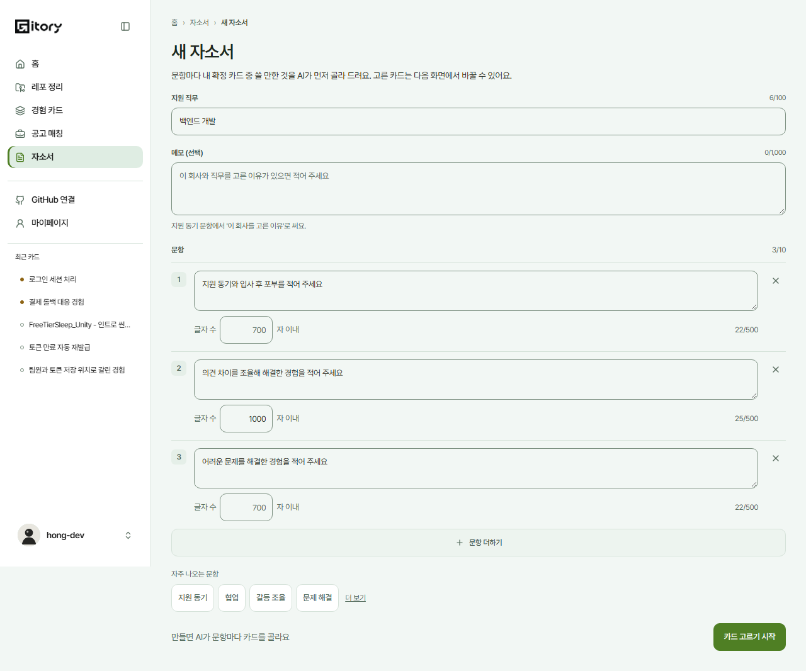
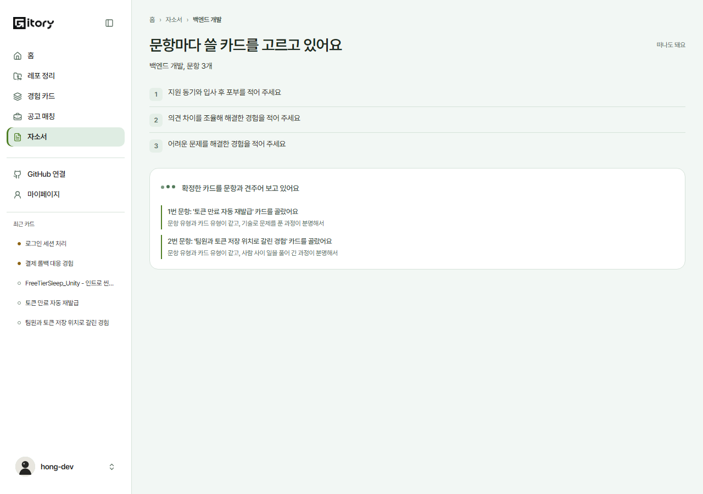
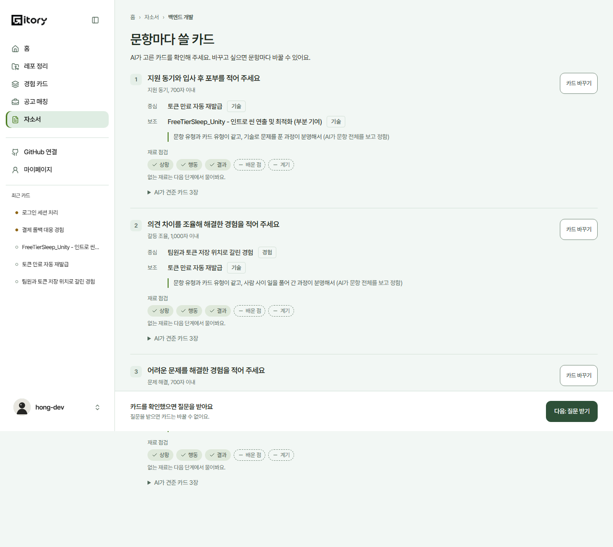
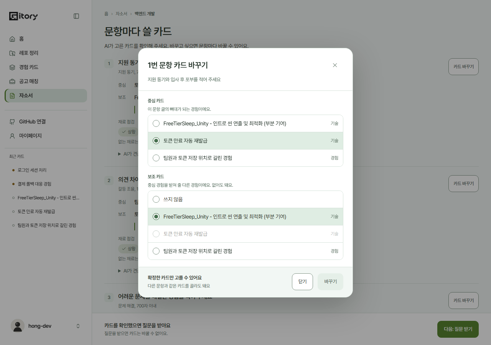
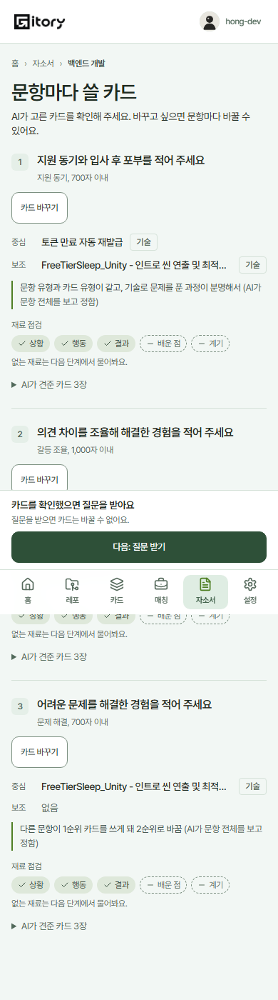
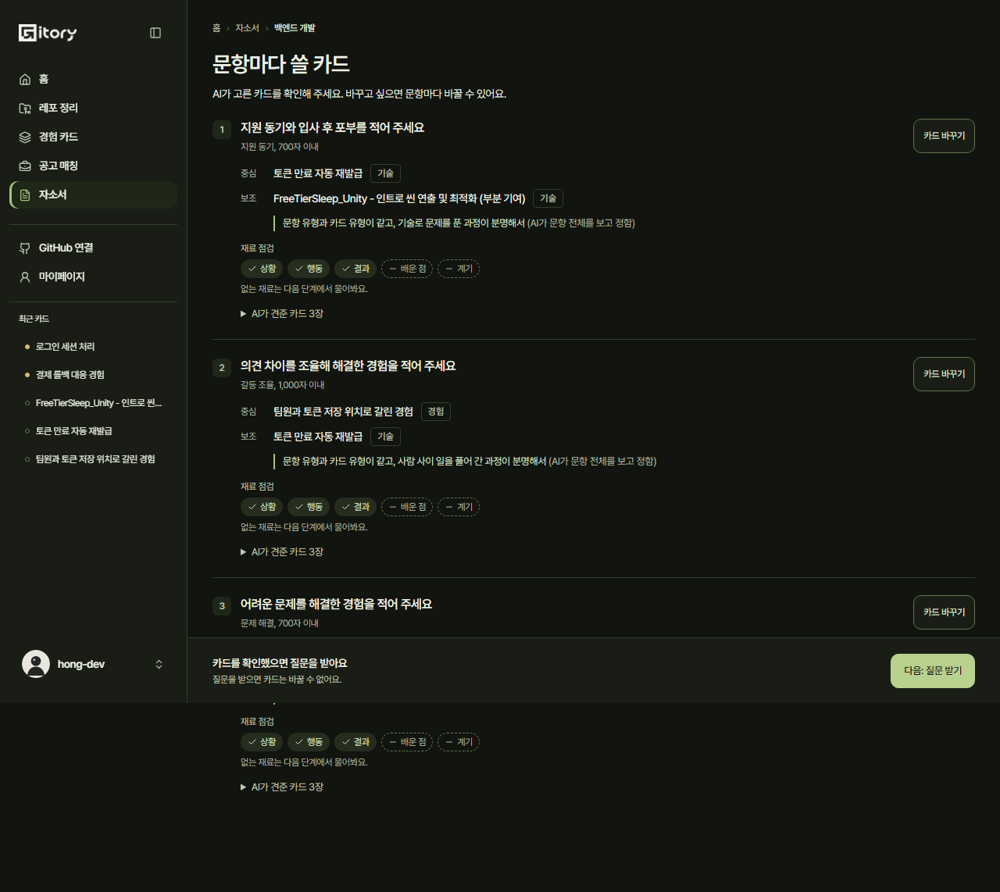
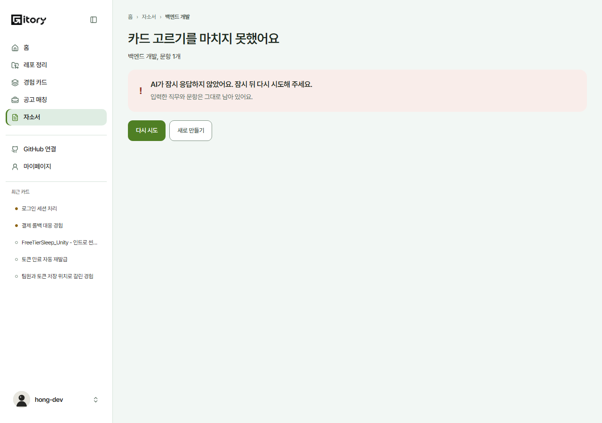
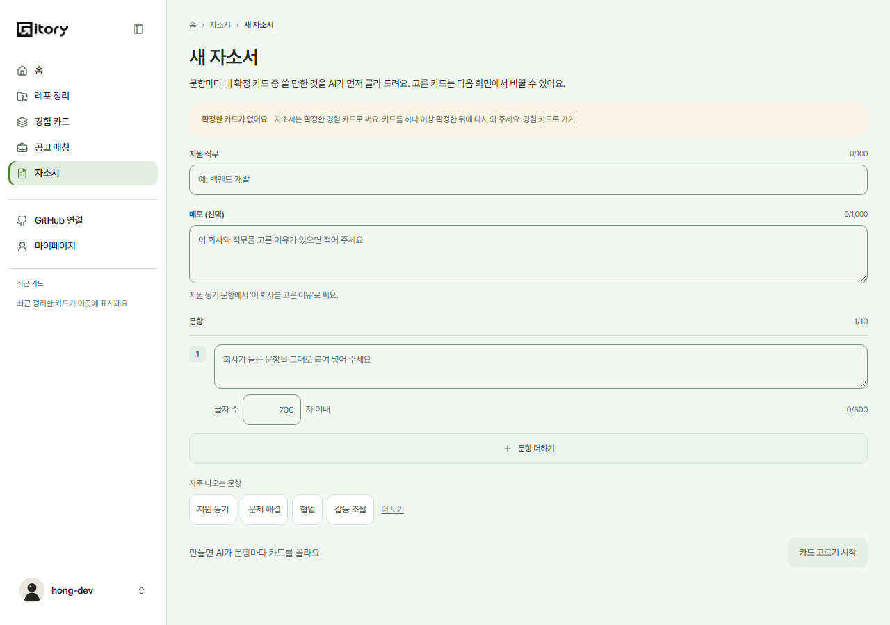

# 2026-10-31 자소서 화면 ① 입력 ② 기다림 ③ 카드 확인 (#517)

계약은 [자소서 계약](2026-10-28-COVER_LETTER.md)(#492, #549)이고 서버는 #497, #527, #585 로 머지됐다. 이 PR 은 그 계약대로 ①~③을 붙이고, ④ 이후(질문, 초안)는 #518 에서 같은 화면에 이어 붙인다.

## 화면

| 주소 | 화면 | 하는 일 |
| --- | --- | --- |
| `/cover-letters` | 목록 | 최근 만든 순. 단계 이름(카드 고르는 중, 카드 확인 …)과 고친 날 |
| `/cover-letters/new` | ① 입력 | 지원 직무(100자), 메모(1,000자, 선택), 문항 1~10개(500자, 글자 수 100~5,000, 비우면 700) |
| `/cover-letters/:id` | ② ③ 실패 | 응답의 `stage` 가 화면을 정한다 |

사이드바와 폰 아래 메뉴에 "자소서"를 더했다.

### ① 입력
- **예시 문항 버튼**: 지원 동기를 먼저, 그다음 내 확정 카드의 문항 유형(`themes`)을 세어 많은 유형 3개, 나머지는 "더 보기". 카드가 없거나 유형이 모자라면 계약 표 순서로 채운다. 누르면 빈 문항 칸을 먼저 채우고, 다 차 있으면 문항을 더한다.
- **요청 키**: 입력을 하나라도 고치면 새 `Idempotency-Key` 를 만든다. 같은 키는 내용을 바꾸지 않은 재전송에만 쓴다(계약: 같은 키는 처음 자소서를 돌려준다).
- **확정 카드가 없으면** 들어오자마자 "확정한 카드가 없어요"와 경험 카드로 가는 길을 보이고 시작 버튼을 막는다. 서버 422 `NO_CONFIRMED_CARDS` 도 같은 안내로 받는다. 한도(429)와 그 밖의 실패는 입력 칸 아래에 그 자리에서 보인다(입력은 그대로).
- 빈 칸, 범위를 벗어난 글자 수는 보내기 전에 그 칸 아래에 알린다.

### ② 카드 고르기 기다림 (`ASSIGNING`)
- 서버 `pollAfterMs`(1.5초)마다 다시 읽는다. 문항 목록과 함께 `steps.assign` 을 문장으로 쌓는다: "2번 문항: '결제 중복 승인 막기' 카드를 골랐어요" 아래에 고른 이유. 감독이 바꾼 줄, 겹침을 정리한 줄도 같은 방식. 지운 카드는 "지운 카드", 모르는 `actor`, `kind` 는 그 줄을 건너뛴다.
- "떠나도 돼요" — 다른 화면에 갔다 와도 이어진다.

### ③ 카드 확인 (`ASSIGNED`)
- 문항마다 구분선으로 나눈다(상자 안 상자 없음). 문항 유형과 글자 수, 중심, 보조 카드(카드 화면으로 가는 링크), 고른 이유와 누가 정했는지.
- **재료 점검**: 상황, 행동, 결과, 배운 점, 계기 중 이미 있는 것은 채운 칩, 없는 것은 점선 칩. "없는 재료는 다음 단계에서 물어봐요."
- **AI가 견준 카드**는 접어 둔다.
- 중심 카드 자리는 넷으로 가른다: 카드 있음 / 지움(`primaryCardDeleted`) "고른 카드가 지워졌어요" / 고르기 실패(`assignedBy: FAILED`) "직접 골라 주세요" / 맞는 카드 없음 "이 유형 경험을 카드로 만들어 두면…"과 카드 만들기.
- **카드 바꾸기**: 내 확정 카드에서 중심, 보조(쓰지 않음 가능)를 고른다. 중심으로 고른 카드는 보조에서 막는다(서버 400). 바꾼 게 없으면 저장 버튼이 꺼져 있다.
- **다음: 질문 받기**: `POST …/asks`. 질문을 받으면 카드를 바꿀 수 없다고 미리 말한다. 카드 없는 문항이 있으면 그 수를 함께 말한다.

### 실패 (`FAILED`)
- "{카드 고르기, 질문 만들기, 초안 쓰기}를 마치지 못했어요"와 이유(AI 일시 장애 / 서버). `retryable === true` 일 때만 "다시 시도"(실패한 단계만 다시 돈다), 아니면 "새로 만들기".

## Mock
- `src/mock/coverLetters.ts`: 계약대로 검증(400, 404, 409, 422, 같은 키)하고 분석 Job 처럼 경과 시간으로 진행한다(카드 고르기 6초, 질문 만들기 4초). `steps.assign` 은 시간이 지날수록 한 줄씩 늘어난다.
- 시나리오 `?demoScenario=cover-letter-failed`: 카드 고르기를 한 번 실패시킨다(다시 시도하면 된다). `?demoScenario=empty`: 카드가 없을 때.
- Mock 카드 하나(`card_04`)에 문항 유형을 붙였다.

## 지표
`cover_letter_created`(문항 수), `cover_letter_cards_changed`(문항 번호), `cover_letter_asks_started`(카드 없는 문항 수). 직무, 문항 글은 싣지 않는다.

## 화면
| | |
| --- | --- |
| ① 입력 |  |
| ② 기다림 |  |
| ③ 카드 확인 |  |
| 카드 바꾸기 |  |
| 폰 |  |
| 다크 |  |
| 실패 |  |
| 카드 없음 |  |

## 검증
- `src/test/cover-letter-517.test.tsx` 14개: 응답 읽기(빠진 칸, 모르는 값), 예시 순서, AI 줄 문장, 중심 카드 넷 상태, Mock 계약(같은 키, 422, 400, 409, 카드 지움), ③ 안내와 카드 바꾸기 막기, 실패 다시 시도 조건, ① 입력 검사와 예시 버튼, 카드 없음 안내.
