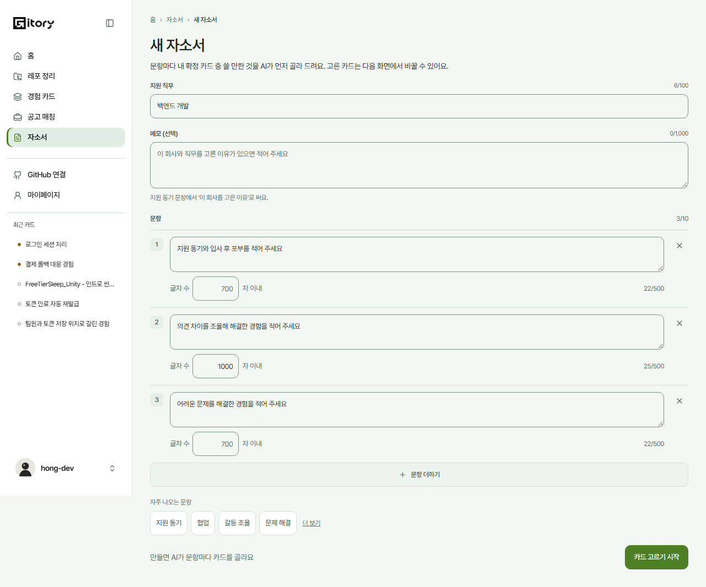
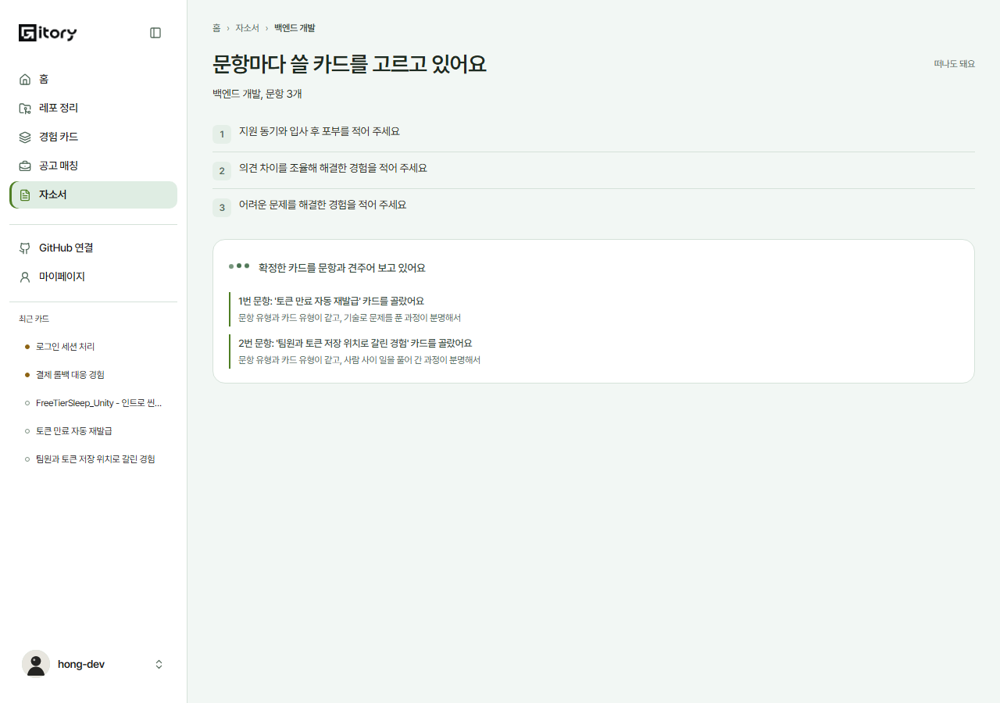
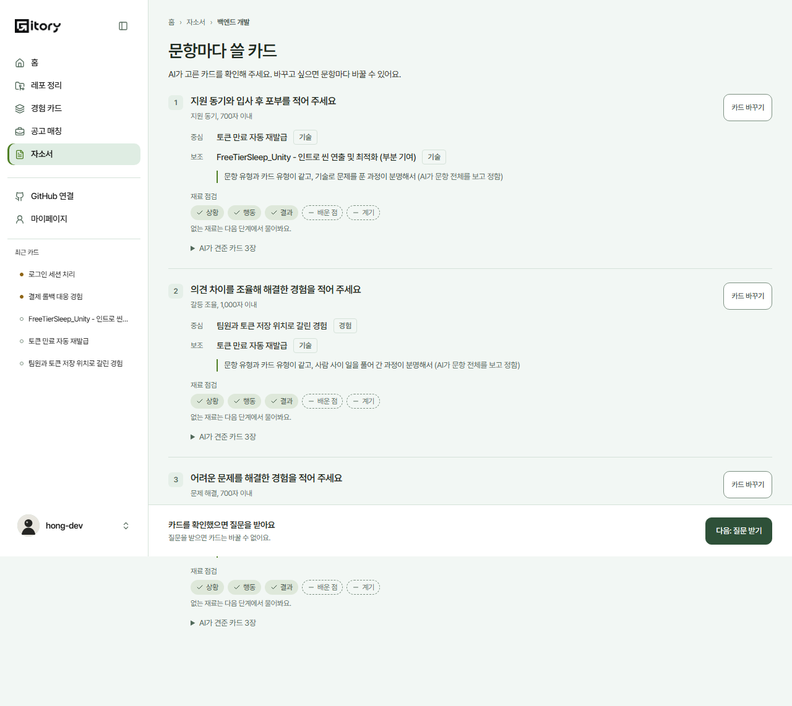
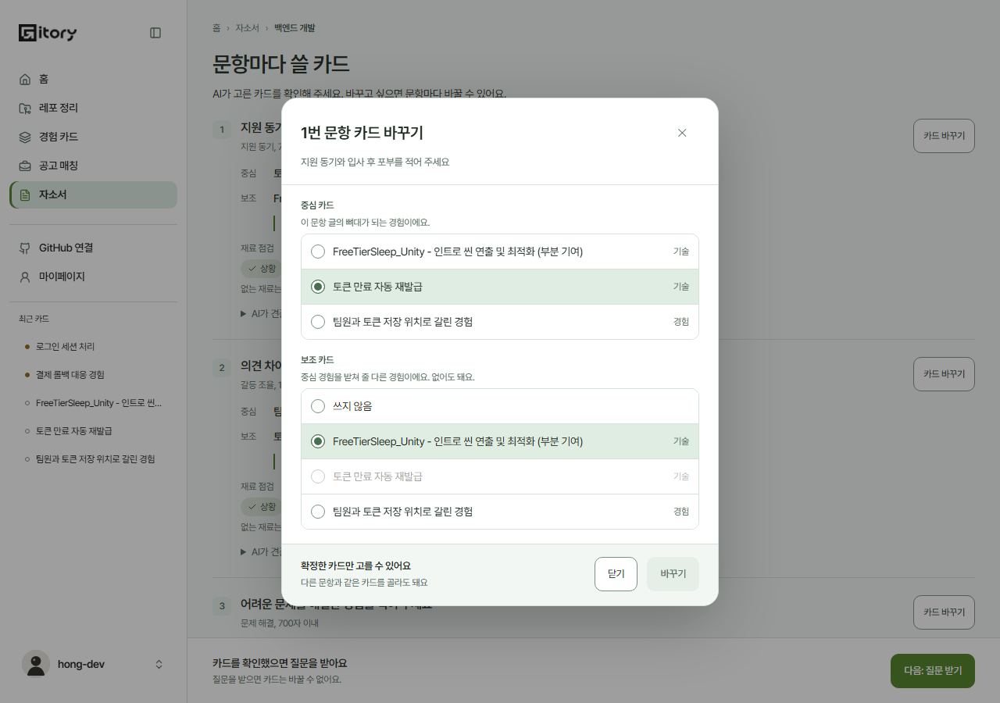
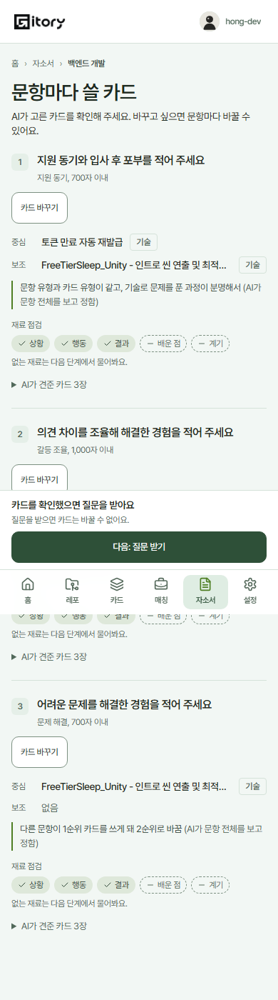
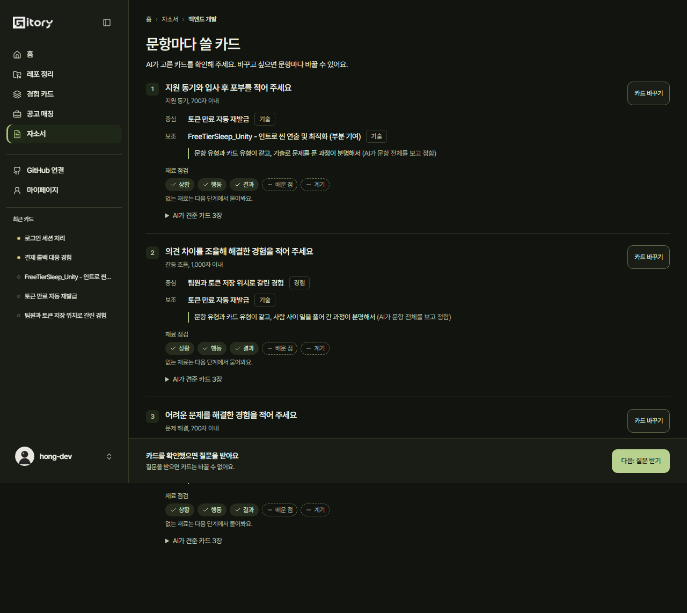
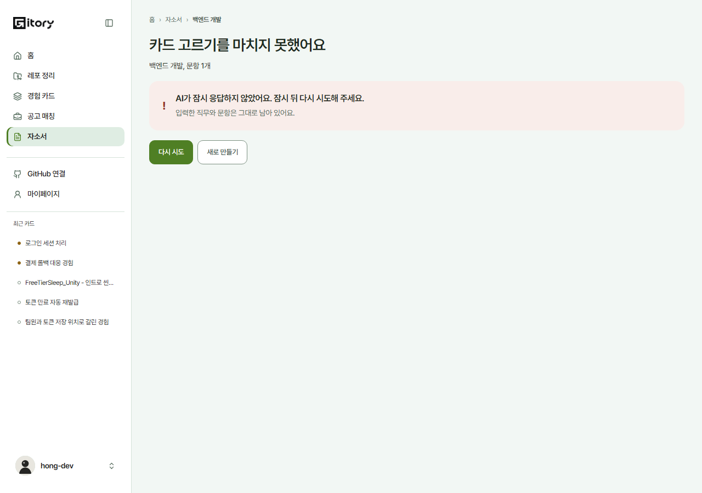
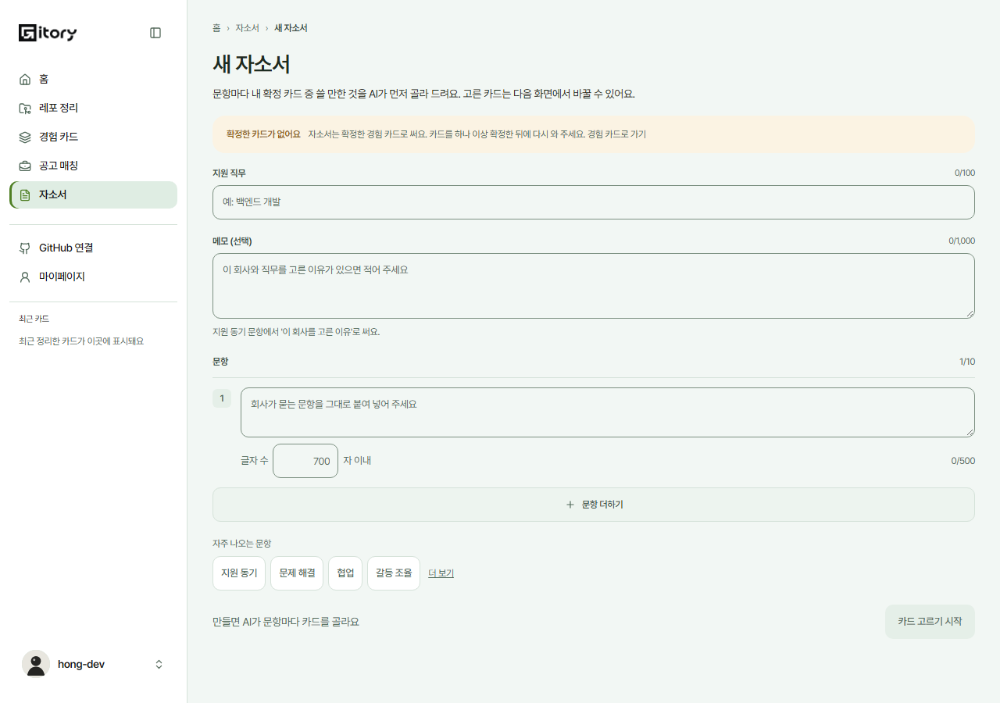

# 2026-10-31 자소서 화면 ① 입력 ② 기다림 ③ 카드 확인 (#517)

> (2026-11-05) ① 입력에서 지원 이유와 강점을 뺐고, ③ 카드 확인과 ④ 질문 화면이 없어졌다. 만들면 화면이 다음 단계를 이어 보내 초안까지 멈추지 않고, 빈 곳은 ⑥ 초안의 대화가 묻는다. 아래에서 지원 이유·강점·③·④ 를 설명하는 부분은 이전 화면의 기록이다.

계약은 [자소서 계약](2026-10-28-COVER_LETTER.md)(#492, #549)이고 서버는 #497, #527, #585 로 머지됐다. 이 PR 은 그 계약대로 ①~③을 붙이고, ④ 이후(질문, 초안)는 #518 에서 같은 화면에 이어 붙인다.

## 화면

| 주소 | 화면 | 하는 일 |
| --- | --- | --- |
| `/cover-letters` | 목록 | 최근 만든 순. 단계 이름(카드 고르는 중, 카드 확인 …)과 고친 날 |
| `/cover-letters/new` | ① 입력 | 지원 직무(100자), 지원 이유(1,000자, 필수 · #738), 강점(12개 중 최대 3개, 선택), 문항 1~10개(500자, 글자 수 100~5,000, 비우면 700) |
| `/cover-letters/:id` | ② ③ 실패 | 응답의 `stage` 가 화면을 정한다 |

사이드바와 폰 아래 메뉴에 "자소서"를 더했다.

### 단계 표시줄 (#745)
- 새 자소서와 자소서 화면의 모든 단계에서 이동 경로 바로 아래에 `1 문항 · 2 카드 · 3 질문 · 4 초안` 한 줄을 둔다(목록에는 없다). 단계는 `flowStep(stage, failedStep)`(`lib/coverLetterCopy.ts`): 새 자소서 1, `ASSIGNING`·`ASSIGNED` 2, `ASKING`·`ASKED` 3, `DRAFTING`·`DRAFTED` 4, `FAILED` 는 실패한 단계(`ASSIGN` 2 · `ASK` 3 · `DRAFT` 4, 모르는 값은 2).
- 지금 단계는 파랑 알약(`--bg-selected` 바탕, `--accent-decoration` 선, `aria-current="step"`), 끝난 단계는 회색 ✓(화면 읽기 프로그램에는 '끝남'), 남은 단계는 흐린 회색. 640px 아래에서는 '2/4 카드' 알약 하나만 보이고, 단계 목록은 화면 읽기 프로그램에 그대로 남는다.

### ① 입력
- **두 묶음 (#745)**: ① '어디에 내나요' — 지원 직무, (공고에서 왔으면) 지원 공고 블록, 지원 이유, 강점 칩. ② '문항' — 제목 옆 'n/10', 아래 안내 '회사가 묻는 문항 문장을 그대로 붙여 넣어요 — 답은 여기에 쓰지 않아요', 그 아래 '자주 나오는 문항' 칩이 문항 목록 **위에** 있다. 처음에는 문항 한 줄.
- **문항 한 줄 (#745)**: 번호 · 한 줄 높이 글 칸(문장이 줄을 넘길 때만 늘어난다) · 흐린 ✕. 글자 수는 칸 안 오른쪽 끝의 흐린 '700자 이내' 버튼이고, 누르면 그 자리에서 숫자 칸이 된다(Enter·칸 벗어남 저장, Esc 취소). 비워 두면 서버가 700 으로 본다. 범위를 벗어나면 그 글자가 호박색이 되고, 만들기를 누르면 칸 아래에 이유를 보인다. 640px 아래에서는 '700자 이내'가 칸 안 오른쪽 아래로 내려간다. 문항마다 있던 'n/500' 은 뺐다.
- **아래 막대 (#745)**: '만들면 문항마다 쓸 카드를 골라요' + 검은 '카드 고르기'. 지원 이유가 규칙을 어기면 버튼이 꺼지고 막대에 호박색 '지원 이유를 채우면 만들 수 있어요', 만들기를 눌렀는데 빈 칸이 있으면 '빠진 칸을 채워 주세요'.
- **예시 문항 버튼**: 지원 동기를 먼저, 그다음 내 확정 카드의 문항 유형(`themes`)을 세어 많은 유형 3개, 나머지는 "더 보기". 카드가 없거나 유형이 모자라면 계약 표 순서로 채운다. 누르면 빈 문항 칸을 먼저 채우고, 다 차 있으면 문항을 더한다.
- **요청 키**: 입력을 하나라도 고치면 새 `Idempotency-Key` 를 만든다. 같은 키는 내용을 바꾸지 않은 재전송에만 쓴다(계약: 같은 키는 처음 자소서를 돌려준다).
- **확정 카드가 없으면** 들어오자마자 "확정한 카드가 없어요"와 경험 카드로 가는 길을 보이고 시작 버튼을 막는다. 서버 422 `NO_CONFIRMED_CARDS` 도 같은 안내로 받는다. 한도(429)와 그 밖의 실패는 입력 칸 아래에 그 자리에서 보인다(입력은 그대로).
- 빈 칸, 범위를 벗어난 글자 수는 보내기 전에 그 칸 아래에 알린다.
- **지원 이유 (필수, #738)**: 칸 아래 안내 '지원 동기 문항에서 이 회사를 고른 이유로 써요. 공백을 빼고 20자 이상 적어 주세요.' 흐린 예시는 'MEMO_EXAMPLE' 문장. 적기 시작하면 처음 걸린 규칙 하나를 호박색 한 줄로 보인다('20자 이상 적어 주세요 · 지금 12자', 'URL 은 넣을 수 없어요' 등, 규칙은 계약 문서 '지원 이유 규칙'). 규칙을 다 지켜야 '카드 고르기' 가 켜진다(#745 에서 버튼 이름과 막대 문구를 바꿨다). 안내 줄은 `aria-live="polite"` 라 스크린 리더가 바뀐 줄을 읽는다.
- **내 강점 (선택)**: 제목 옆 '최대 3개'. '일하는 방식' · '사람과 일할 때' 두 묶음에 칩 6개씩(넓은 화면은 묶음 이름이 왼쪽 칸), 누르면 켜고 끄는 버튼(`aria-pressed`, 높이 44px, 고른 칩은 파랑). 3개를 고른 뒤 네 번째를 누르면 고르지 않고 '3개까지 고를 수 있어요. 하나를 빼고 골라 주세요' 를 보인다. 요청에는 고른 순서대로 코드만 싣는다.

### ② 카드 고르기 기다림 (`ASSIGNING`)
- 서버 `pollAfterMs`(1.5초)마다 다시 읽는다. 종이 위 문항마다 **상태 한 줄**(#745): '카드를 고르는 중'(점 셋) → '✓ 카드를 골랐어요'(맞는 카드가 없거나 고르지 못하면 그 말). 아래는 종이 뼈대 세 줄. `steps.assign` 은 여백 메모로 붙는다: "'결제 중복 승인 막기' 카드를 골랐어요" 아래에 고른 이유. 감독이 바꾼 줄, 겹침을 정리한 줄도 같은 방식. 지운 카드는 "지운 카드", 모르는 `actor`, `kind` 는 그 줄을 건너뛴다.
- 제목 아래 한 줄 '보통 1~2분 걸려요 · 떠나도 돼요' — 다른 화면에 갔다 와도 이어진다.

### ③ 카드 확인 (`ASSIGNED`)
- **문항마다 두 칸 (#745)**: 860px 이상에서 왼쪽은 번호 · 문항 · '문제 해결 · 700자 이내' · 글자 버튼 '카드 바꾸기'(이름은 'n번 문항 카드 바꾸기'), 오른쪽은 고른 카드 타일(굵은 제목 = 카드 화면 링크, 기술/경험 칩). 덧붙일 경험(보조 카드)이 있으면 그 아래에 작고 옅은 타일로 끼우고 뒤에 2° 기운 카드 한 장을 둔다. 860px 아래는 위아래로 놓인다. 카드 요약(`CardRef`)에 상황 글이 없어 타일에는 제목과 종류만 있다.
- **고른 이유 한 줄**: `pickReason`(내가 바꿨으면 '직접 고른 카드예요.') 끝에 작은 링크 '견준 카드 N장' — 누르면 견준 카드 목록이 펼쳐지고 고른 카드는 파랑 + '· 고름'. 예전의 회색 메모 상자(같은 이유를 되풀이)와 '작성 AI' 꼬리표는 없앴다.
- **재료 한 줄**: '재료 3/5 · 배운 점, 계기는 다음에 물어요'(상황, 행동, 결과, 배운 점, 계기 기준, 빠진 이름만 호박색, 다 있으면 '다 있어요'). 예전 재료 칩 다섯 개는 없앴다.
- 중심 카드 자리는 넷으로 가른다: 카드 있음 / 지움(`primaryCardDeleted`) "고른 카드가 지워졌어요" / 고르기 실패(`assignedBy: FAILED`) "직접 골라 주세요" / 맞는 카드 없음 "이 유형 경험을 카드로 만들어 두면…"과 카드 만들기.
- **카드 바꾸기**: 내 확정 카드에서 중심, 보조(쓰지 않음 가능)를 고른다. 중심으로 고른 카드는 보조에서 막는다(서버 400). 바꾼 게 없으면 저장 버튼이 꺼져 있다.
- **다음: 질문 받기**: `POST …/asks`. 막대 둘째 줄 '질문을 받은 뒤에는 카드를 바꿀 수 없어요'. 카드 없는 문항이 있으면 그 수를 함께 말한다.

### ⑥ 초안 알림 줄 — 지원 이유를 쓸 수 없을 때 (#738)
- 응답의 `memoUsable === false` 면 패널 맨 위 알림 줄(#727 '살펴볼 것')의 첫 줄로 '지원 이유가 글로 쓰기 어려워서 채팅에서 다시 물어요 → 채우기' 를 보인다. 누르면 지원 동기 문항(없으면 첫 문항)의 채우기 대화를 연다. `true`·`null` 이면 보이지 않는다.

### 실패 (`FAILED`)
- "{카드 고르기, 질문 만들기, 초안 쓰기}를 마치지 못했어요"와 이유(잠시 응답을 받지 못함 / 서버). 단계 표시줄은 실패한 단계에 머문다. `retryable === true` 일 때만 "다시 시도"(실패한 단계만 다시 돈다), 아니면 "새로 만들기".

## Mock
- `src/mock/coverLetters.ts`: 계약대로 검증(400, 404, 409, 422, 같은 키)하고 분석 Job 처럼 경과 시간으로 진행한다(카드 고르기 6초, 질문 만들기 4초). `steps.assign` 은 시간이 지날수록 한 줄씩 늘어난다.
- 시나리오 `?demoScenario=cover-letter-failed`: 카드 고르기를 한 번 실패시킨다(다시 시도하면 된다). `?demoScenario=empty`: 카드가 없을 때.
- Mock 카드 하나(`card_04`)에 문항 유형을 붙였다.
- 지원 이유는 화면과 같은 `checkReason` 으로 막고(400), 강점은 정해진 코드 3개까지. 질문 단계가 끝날 때 memo 에 '무시하고' 가 있으면 `memoUsable: false`, 아니면 `true`.

## 지표
`cover_letter_created`(문항 수), `cover_letter_cards_changed`(문항 번호), `cover_letter_asks_started`(카드 없는 문항 수). 직무, 문항 글은 싣지 않는다.

## 화면
| | |
| --- | --- |
| ① 입력 |  |
| ② 기다림 |  |
| ③ 카드 확인 |  |
| 카드 바꾸기 |  |
| 폰 |  |
| 다크 |  |
| 실패 |  |
| 카드 없음 |  |

## 검증
- `src/test/cover-letter-738.test.tsx` 11개: 지원 이유 규칙 여섯(20자·한글·반복·URL·이메일·쓸 수 없는 글자), Mock 400·강점 검사, 시작 버튼 잠금과 안내 줄, 강점 최대 3개와 요청 본문, 옛 응답 읽기, `memoUsable: false` 알림 줄. e2e `cover-letter-reason-738.spec.ts`: 지원 이유 → 강점 둘 → 초안.
- `src/test/cover-letter-517.test.tsx` 14개: 응답 읽기(빠진 칸, 모르는 값), 예시 순서, AI 줄 문장, 중심 카드 넷 상태, Mock 계약(같은 키, 422, 400, 409, 카드 지움), ③ 안내와 카드 바꾸기 막기, 실패 다시 시도 조건, ① 입력 검사와 예시 버튼, 카드 없음 안내.
