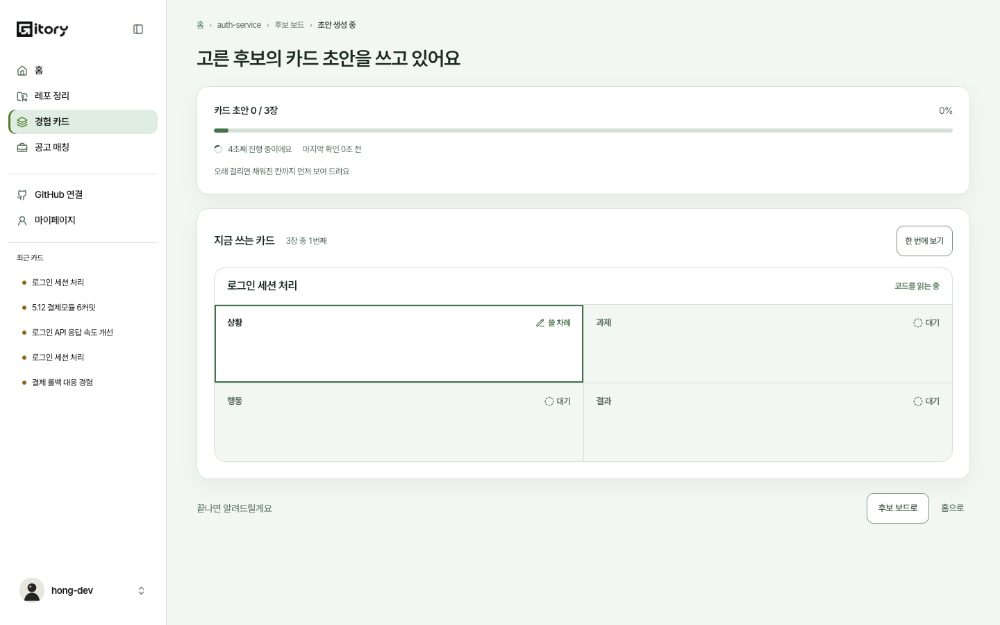
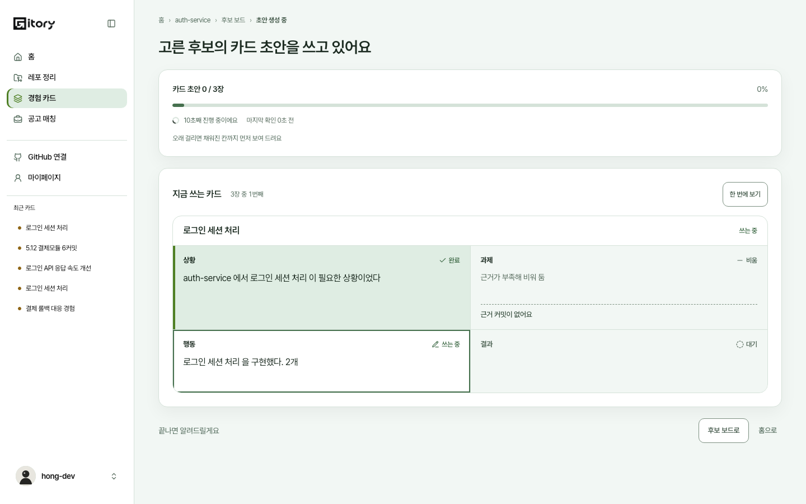
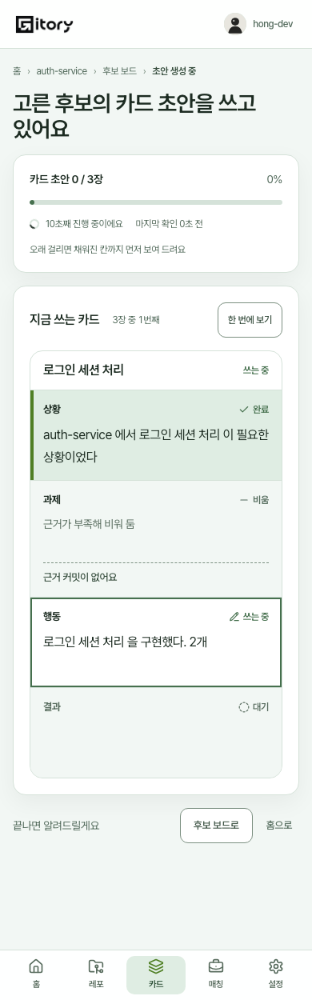
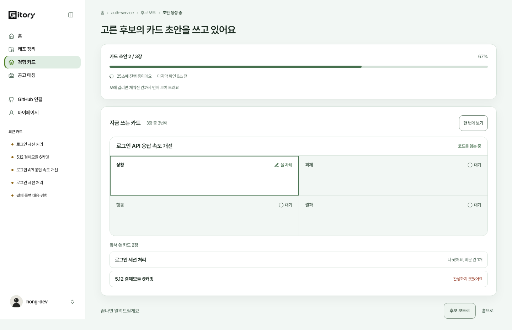

# 카드 초안을 쓰는 동안 STAR 칸이 채워지는 화면 (#617)

'초안 생성 중' 화면의 `n / m장` 진행 막대 아래에서, AI 가 지금 쓰는 카드 한 장을 상황, 과제, 행동, 결과 네 칸 틀로 보여 준다. 칸이 AI 가 쓰는 순서대로 채워지고, 다 쓰면 다음 카드로 넘어간다. 서버와 AI 는 #622 가 만들고, 이 문서는 화면이 정한 것을 적는다. 어떤 색과 움직임을 쓸지와 다 쓴 카드를 두는 방식은 디자인에 맡겨졌고, 아래 2절에 판단과 이유를 적었다.

기준은 #622(`feature/star-live-be`) 위에 쌓은 브랜치다. 스키마 `Job.drafts`(`DraftLive`)는 #622 것을 그대로 쓴다.

## 1. 서버가 주는 것과 화면이 읽는 법

Job 상세 응답(1초마다 다시 읽음)의 `drafts` 한 곳만 본다. 새로 부르는 API 는 없다.

| 값 | 뜻 | 화면이 쓰는 법 |
|---|---|---|
| `drafts` | 카드를 쓰는 순서대로 `DraftLive` 목록. 카드 초안 Job 이 아니거나 서버가 진행을 잃으면 `[]` | `[]` 거나 필드가 없으면(옛 서버) 진행 막대만 그린다 |
| `state` | `WAITING`, `READING`, `WRITING`, `DONE`, `FAILED`. 서버는 카드를 한 장씩 차례로 쓴다 | 읽는 동안(`READING`)은 상황 칸에 커서만 보인다 |
| `slots[].text` | 그 칸에 지금까지 쓴 전체 글(늘어난 부분이 아니다). 끝난 문장까지만 온다 | 앞부분이 같으면 이어서 펼치고, 다르면 지우고 새로 쓴다 |
| `slots[].round` | 다시 쓰면 오른다 | 올라가면 달라진 곳까지 지우고 새 글을 쓴다 |
| `slots[].done`, 빈 `text` | `done` 인데 글이 `''` 이면 AI 가 근거가 없어 비운 칸 | '근거가 부족해 비워 둠' |
| `steps` | 카드 상세 `draftSteps` 와 같은 모양 | 칸 옆 과정(3절). 문장과 구분 규칙은 `draftStepGroups` 를 그대로 쓴다 |

화면이 보이는 글은 서버가 준 글의 앞부분뿐이다. 글자를 만들어 내지 않고, 글은 모두 텍스트 노드로만 그린다(HTML 해석, 줄바꿈 변환 없음).

## 2. 디자인 판단

- **틀**: 지금 쓰는 카드 한 장이 한 덩어리 틀이다. 넓은 화면은 2열, 390과 320에서는 한 줄에 한 칸씩 세로로 쌓인다. 최종 카드 화면과 같은 글자 크기(16px, 줄 간격 1.75)를 써서 다 쓴 글이 자리 잡힌 모습과 어긋나지 않는다.
- **칸 상태**(색만으로 가르지 않는다, 칸 이름 옆에 글자도 쓴다)

  | 칸 | 모습 | 글자 |
  |---|---|---|
  | 아직 안 쓴 칸 | 비워 둔 바탕 | 대기 |
  | 지금 쓰는 칸 | 두꺼운 윤곽, 바탕은 흰색, 글 끝에 깜빡이는 커서 | 쓸 차례, 쓰는 중, 다시 쓰는 중 |
  | 다 쓴 칸 | 색을 채우고 왼쪽에 띠 | 완료 |
  | 근거가 없어 비운 칸 | 연한 바탕 | 비움 |
  | 카드가 실패해 쓰지 못한 칸 | 오류색 바탕 | 쓰지 못함 |

  '지금 쓰는 칸'을 채움이 아니라 윤곽으로 강조한 이유는, 채움이 '다 쓴 칸'의 뜻이어서 두 상태가 겹쳐 보이지 않게 하려는 것이다. 색은 모두 시맨틱 토큰(`--border-selected`, `--bg-selected` 등)이라 다크 테마도 따라간다.
- **움직임**: 움직이는 것은 글이 펼쳐지는 것과 커서 깜빡임뿐이다. 칸 색 바뀜은 0.3초 페이드다. 동작 줄이기를 켜면 글을 펼치지 않고, 커서도 깜빡이지 않고, 색도 바로 바뀐다.
- **칸 높이**: 서버가 이미 준 전체 글을 보이지 않게(`visibility: hidden`) 같은 자리에 겹쳐 칸 높이를 미리 잡는다. 글이 늘어도 아래 버튼과 목록이 밀리지 않는다. 이 글은 보조 기술에도 읽히지 않는다(`aria-hidden`).
- **다 쓴 카드를 두는 방식**: 다 쓴 카드는 '앞서 쓴 카드 N장' 아래에 접어 둔다(`
`). 눌러서 펼치면 네 칸의 글이 그대로 보인다. 제목 줄에 '다 썼어요, 비운 칸 1개', '완성하지 못했어요'를 쓴다. 지금 쓰는 카드는 항상 한 장이라 화면이 길어지지 않고, 다 쓴 글은 언제든 다시 읽을 수 있다. 카드가 3장 이상이면 둘째 카드는 데모에서 도중에 끊긴다(6절). 끊긴 카드는 쓴 칸까지만 남고 나머지 칸은 '쓰지 못함'이다.
- **칸 옆 과정**: 검사에 걸린 칸은 칸을 다 쓴 뒤 칸 안에 AI 가 한 일을 이어 붙인다. 예를 들어 결과 칸은 '근거 없는 숫자(50%)를 찾았어요', '이슈를 열어 봤어요', '다시 썼어요', '다시 검사해서 통과했어요'가 순서대로 나온다. 문장 규칙은 카드 상세 'AI 가 한 일'(`src/lib/draftSteps.ts`)과 같고, 칸 이름은 칸 제목이 말하니 '결과 칸:' 머리말만 뗀다(`draftStepGroups(steps, field)`). 이슈 제목 같은 덧붙임과 바퀴 이름('1번째 고쳐 쓰기')도 같다. 이 과정은 카드를 다 쓴 뒤 카드 상세에도 그대로 남는다.
- **글 끝 화살표 대신**: 과정 사이의 방향은 글자 화살표가 아니라 아이콘 쉐브론(장식, `aria-hidden`)으로 이었다. 용어집 3.2절은 문구 안의 글자 화살표를 쓰지 않는다.

화면(데모, 카드 3장). 읽는 동안은 상황 칸에 커서만 있고, 쓰기 시작하면 한 칸씩 펼쳐지며, 둘째 카드가 끊기면 쓴 칸까지만 남는다.

| 읽는 중 (1440) | 쓰는 중 (1440) |
|---|---|
|  |  |

| 쓰는 중 (390) | 앞서 쓴 카드와 끊긴 카드 (1440) |
|---|---|
|  |  |

다크 테마(마이페이지에서 켠 것) 1440은 직접 봤다. 320과 390은 가로로 넘치지 않고 네 칸이 세로로 쌓이는 것을 e2e 로 확인했다.

## 3. 펼침 규칙 (`src/lib/liveDraft.ts`)

화면과 분리한 모델이고 시계를 직접 읽지 않는다(시각을 넣어 준다). 가짜 시계 없이 시각 숫자만으로 시험한다(`src/test/live-draft-model.test.ts`).

1. **속도**: 서버에서 글이 한꺼번에 몰려 와도 초당 40자로 일정하게 펼친다. 한 번에 한 칸만 쓰고(상황, 과제, 행동, 결과 순) 커서는 그 칸 하나에만 있다. 뒤 칸은 앞 칸이 끝나야 비움이나 완료로 바뀐다.
2. **읽는 동안**: 카드가 `READING` 이면 상황 칸에 커서만 있다. AI 가 8초쯤 읽는 시간이다.
3. **카드 넘기기**
   - 지금 보이는 카드 뒤 카드가 글을 쓰기 시작하면(`WRITING` 이상) 보이는 카드의 남은 글은 바로 마치고 넘어간다.
   - 뒤 카드가 아직 읽는 중이면 보이는 카드를 끝까지 펼친 뒤 1.5초 두었다가 넘어간다.
   - 폴링이 밀려 여러 카드가 한꺼번에 와도 카드를 건너뛰며 마지막 카드부터 쓴다. 중간에 들어온 사람은 끝난 카드는 접힌 목록으로 보고 끝나지 않은 첫 카드부터 본다.
4. **다시 쓰기**: `round` 가 오르거나 글이 앞 글을 이어 쓰지 않고 바뀌면(서버가 저장될 초안의 글로 맞출 때) 보이던 글에서 달라진 곳까지 지우고 새 글을 쓴다. 지우는 건 초당 160자이고 0.6초를 넘기지 않는다. 지우고 다시 쓰는 전체도 3초를 넘기지 않는다(넘으면 남은 글을 바로 보인다). 아직 보이지 않은 칸이 다시 쓰이면 지울 것 없이 새 글을 쓴다. 지난 `round` 의 글은 무시한다.
5. **Job 이 끝난 뒤**: 마지막 카드를 다 펼치고 1.5초 두고서야 완료 화면(완성된 카드)으로 넘어간다. 끝난 지 15초가 지나면 남은 글을 바로 마친다(아주 긴 글이 화면을 붙잡지 않게). Job 이 실패하거나 취소되면 붙잡지 않는다. 카드가 Job 의 끝 상태보다 먼저 완성으로 바뀌어도(전역 알림이 카드를 먼저 다시 읽는 경우) 화면이 보던 Job 을 끝까지 읽어서 펼친다. 끝 상태를 5초 안에 못 읽으면 놓아준다.
6. **깨진 응답**: `drafts` 가 갑자기 `[]` 거나, 카드가 줄었거나, 카드 상태가 거꾸로 가거나, 칸이 사라져도 이미 받은 것을 유지하고 펼치기를 마친다.

## 4. 접근성

- 글이 늘어나는 영역은 `aria-live` 가 아니다. 낭독 영역(`role="status"`)은 카드 밖 한 곳이고 카드가 시작될 때('N번째 카드를 쓰기 시작했어요. 제목')와 끝날 때('N번째 카드를 다 썼어요', '완성하지 못했어요')만 문구가 바뀐다.
- 펼쳐지는 중인 칸의 글은 `aria-hidden` 이고, 칸을 다 쓰면 읽힌다. 스크린 리더는 반쪽짜리 글을 듣지 않는다.
- 커서와 상태 아이콘은 장식이라 `aria-hidden` 이다. 상태는 '쓰는 중', '완료', '비움' 같은 글자로도 있다.
- 동작 줄이기(`prefers-reduced-motion`)를 켜면 펼치지 않고 오는 대로 한 번에 보이며 끝나면 바로 넘어간다. 켜지 않은 사람에게는 '한 번에 보기' 버튼(`aria-pressed`, 44px)이 있다. 몇 초 넘게 움직이는 글을 멈출 수 있어야 한다는 기준(WCAG 2.2.2)에 맞춘 것이다.
- 포커스를 가져가지 않는다. 다 쓴 카드 목록의 제목 줄(44px)은 키보드로 열 수 있다.

## 5. 개인정보와 코드 이름

서버가 준 글(칸 글, 카드 제목, 단계의 값과 이유)을 지표 이벤트, 주소, 콘솔에 싣지 않는다. 이 기능은 새 지표를 만들지 않았다. `track('draft_generated')` 는 카드 id 와 상태만 싣는 그대로다(`src/test/live-card-draft-page.test.tsx` 마지막 시험).

## 6. 데모(목)

실서버가 줄 수 있는 모양 그대로 `drafts` 를 시간에 따라 내려 준다(`src/mock/draftLive.ts`). 경과 시간만으로 계산해 폴링 간격과 새로고침에 상관없이 결정적이다.

- 카드마다 8초 읽고(`READING`), 네 칸을 2초 안에 몰아 쓴다(`WRITING`). 뒤 카드는 `WAITING`.
- 첫 카드: 결과 칸을 '근거 없는 숫자(50%)'로 썼다가 검사에 걸려 몇 초 뒤 이슈를 열어 본 뒤 다시 쓴다(`round` 1). 과제 칸은 근거가 없어 비운다.
- 카드가 3장 이상이면 둘째 카드는 도중에 `FAILED`. 쓴 칸은 남고, 카드는 저장되지 않고 `draftFailure` 만 남는다(#419 의 다시 만들기 안내가 뜬다).
- 약한 후보가 섞인 Job(일부만 씀): 상황과 행동 칸만 주고 나머지 칸은 주지 않는다.
- 라이브 마지막 글은 저장된 카드와 같고, 라이브 단계는 카드 상세 'AI 가 한 일'로 남는다.
- 카드 한 장은 10초쯤이다. 카드가 많으면 전체를 36초 안으로 같은 비율로 줄인다. 이전 데모는 카드 수와 상관없이 8초였다.

## 7. 파일

| 파일 | 하는 일 |
|---|---|
| `src/lib/liveDraft.ts` | 펼침 모델(큐와 타임라인). 화면과 시계에서 분리 |
| `src/lib/useLiveDraft.ts` | 모델에 Job 의 `drafts` 를 넣고 시간을 흘리는 훅, 동작 줄이기, 끝난 뒤 붙잡기 |
| `src/features/cards/LiveCardDraft.tsx`, `.css` | 화면 |
| `src/features/cards/CardPage.tsx` | 진행 막대 아래에 붙이고, 끝난 뒤 붙잡는 조건을 더함 |
| `src/lib/draftSteps.ts` | `draftStepGroups(steps, field)` 로 칸 하나의 과정만 머리말 없이 |
| `src/mock/draftLive.ts`, `src/mock/store.ts` | 데모 Job 의 `drafts` |
| `src/test/live-draft-model.test.ts` 외 3개, `e2e/live-card-draft-617.spec.ts` | 시험 |
| `e2e/fe-followups-332-335.spec.ts` | 데모 카드 초안이 한 장에 10초쯤으로 길어져(최대 8장 36초) 이 시험의 기다리는 시간만 늘림 |
| `docs/screenshots/2026-10-31-live-card-draft/` | 위 화면 |

## 8. 확인하지 못한 것

- 실서버(#622)에 붙여 본 적은 없다. 스키마와 시험은 #622 의 `job-drafts-617.test.ts` 와 같은 모양을 쓴다. `round` 가 오르는 시점과 `written` 이 글을 저장될 초안으로 맞출 때 글이 앞 글을 이어 쓰지 않는 경우는 BE 코드에서 읽은 것이고, 실제 AI 응답으로 본 것은 아니다.
- 실제 AI 글은 목보다 길 것이다(글자 수를 모른다). 긴 글은 위 3절 5번의 15초 상한이 막는다.
- 서버가 둘로 늘어나 `drafts` 가 서버마다 달라지는 경우는 화면이 다루지 않는다(#622 가 Redis 로 옮길 때 같이 본다).
