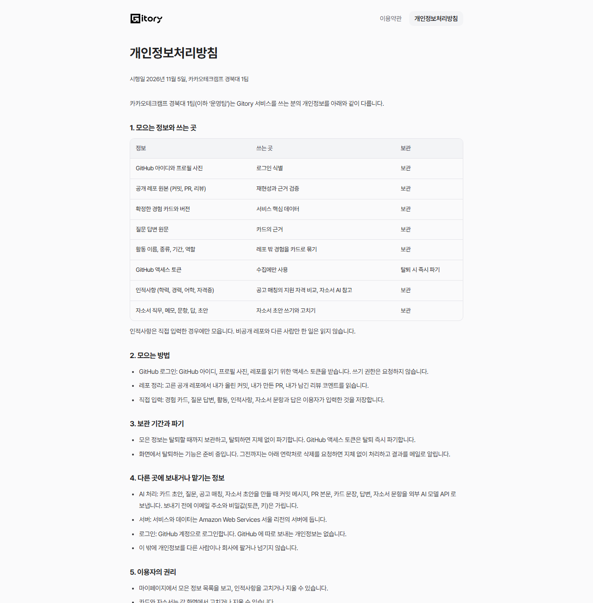
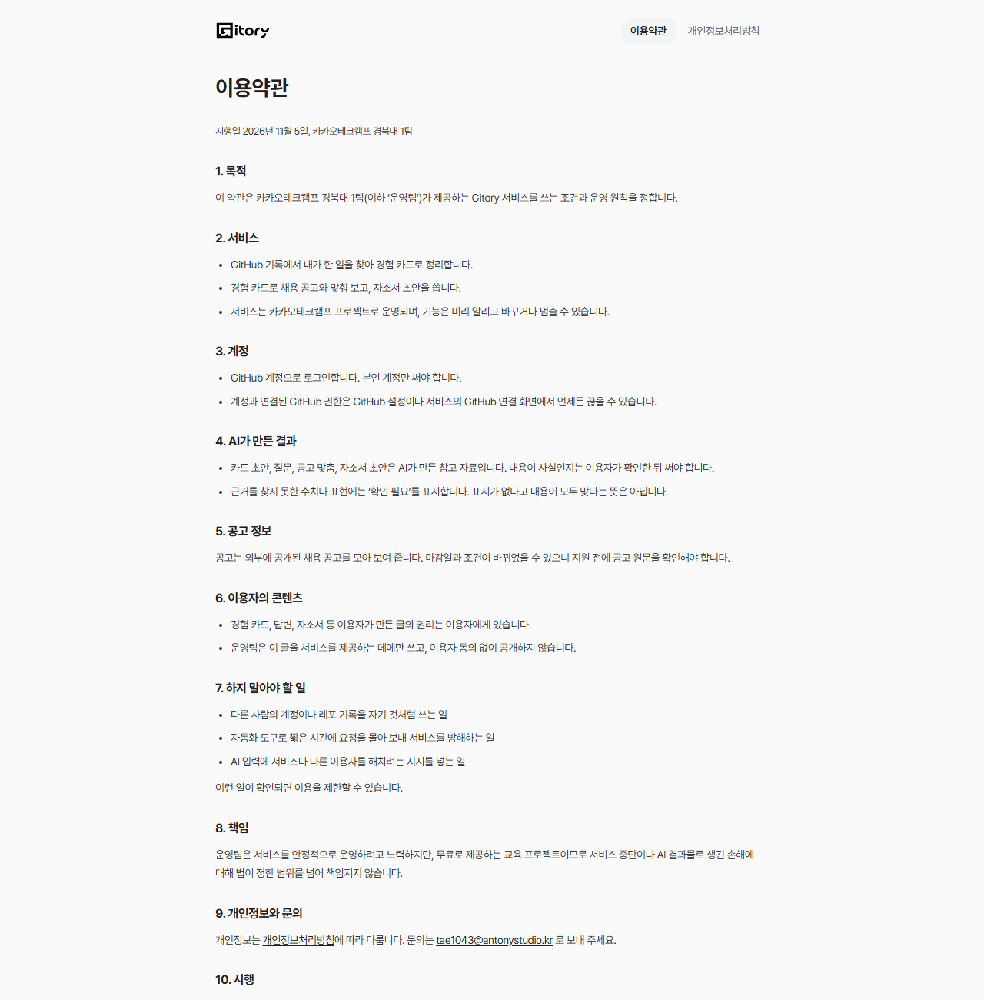
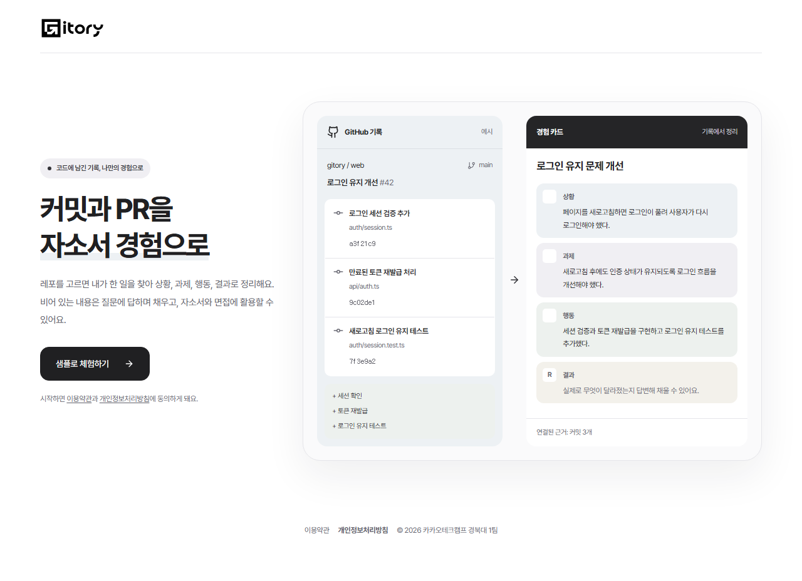
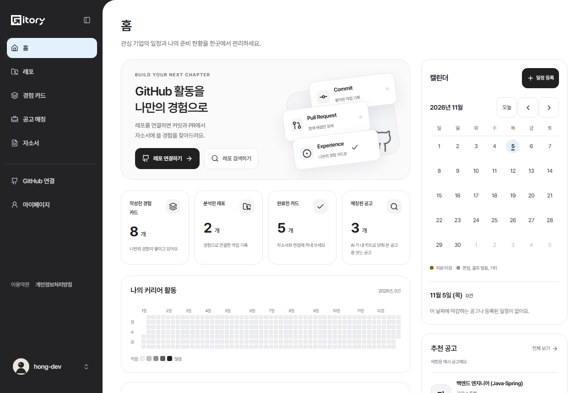
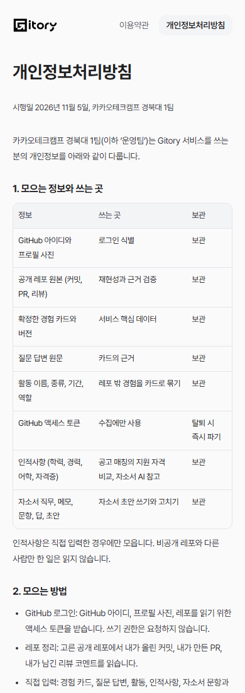
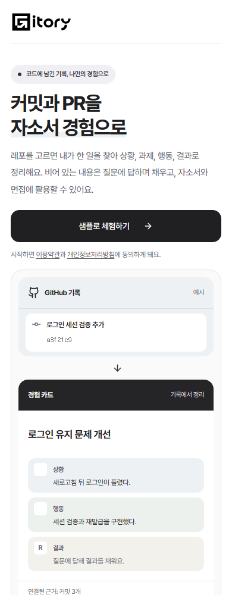

# 2026-11-05 개인정보처리방침과 이용약관

실제 배포에 필요한 정책 문서를 더했다. 로그인 없이 열리고(`/privacy`, `/terms`), 서비스 어디서든 같은 링크 줄(`LegalLinks`)로 이어진다.

- 운영 주체: 카카오테크캠프 경북대 1팀, 문의: tae1043@antonystudio.kr, 시행일 2026년 11월 5일 — 값은 `src/lib/legal.ts` 한 곳에만 있다.
- 모으는 정보 표는 마이페이지 '저장과 보관 정보'와 같은 목록(`COLLECTED`)을 쓴다. 한쪽만 고쳐 문서와 화면이 다른 말을 하지 않게 했다. 자소서 정보 줄을 더했다.
- 적은 내용은 코드와 운영 문서로 확인한 사실만이다: GitHub 읽기 범위(공개 레포의 내 커밋, PR, 리뷰), 쓰기 권한 없음, AI 로 보내기 전 이메일과 비밀값 가림(GUARDRAILS.md), 서버는 AWS 서울 리전(DEPLOYMENT.md), 토큰은 탈퇴 즉시 파기, 사용 지표는 id 와 개수만.
- 화면 탈퇴 기능이 아직 없어 '그전까지는 메일로 삭제 요청'이라고 적었다. 탈퇴 기능이 생기면 3장을 고친다.
- 링크 위치: 로그인 버튼 아래 동의 문구("시작하면 이용약관과 개인정보처리방침에 동의하게 돼요"), GitHub 권한 확인 창, 랜딩 맨 아래, 사이드바 아래(접으면 숨김), 마이페이지 맨 아래(폰). 개인정보처리방침 링크는 굵게.
- 폰 랜딩은 동의 문구가 들어와도 예시 카드가 첫 화면(650px 안)에 보이게 간격을 줄였다.

| | |
| --- | --- |
| 개인정보처리방침 |  |
| 이용약관 |  |
| 로그인 동의 문구, 아래 링크 |  |
| 사이드바 아래 |  |
| 폰 |   |
