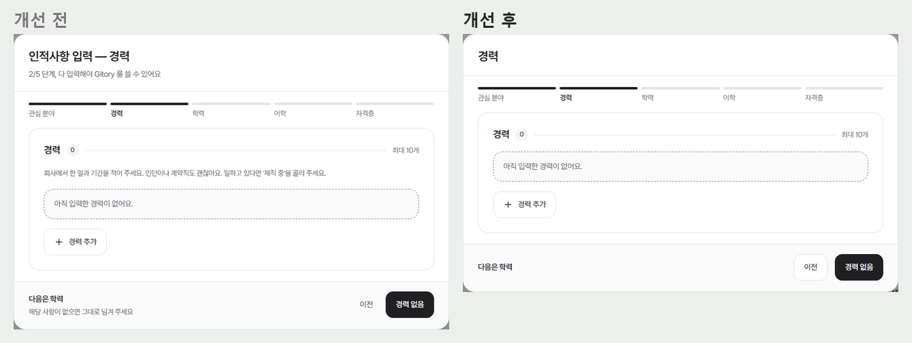
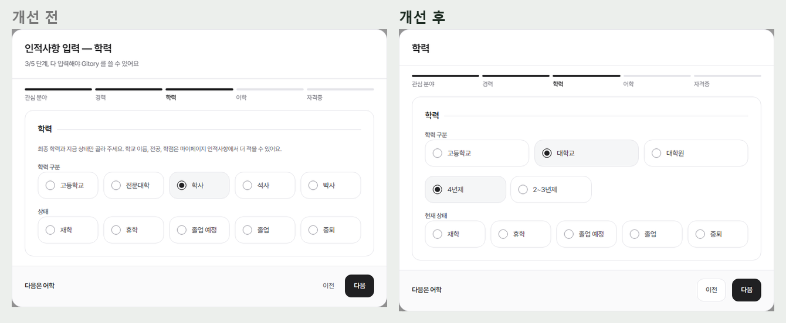
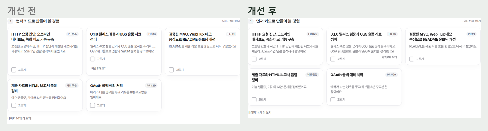
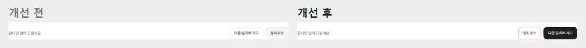
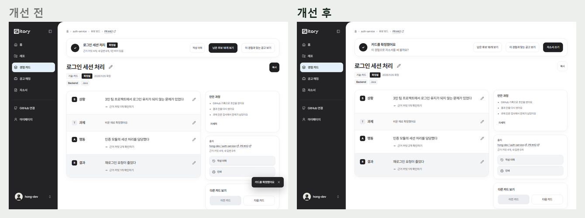
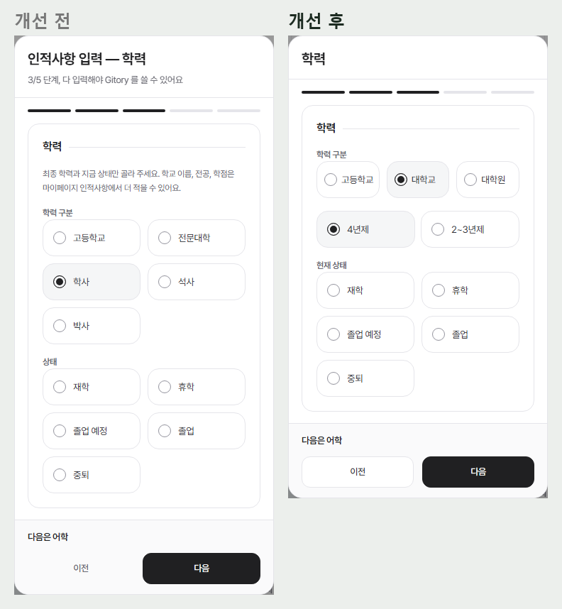
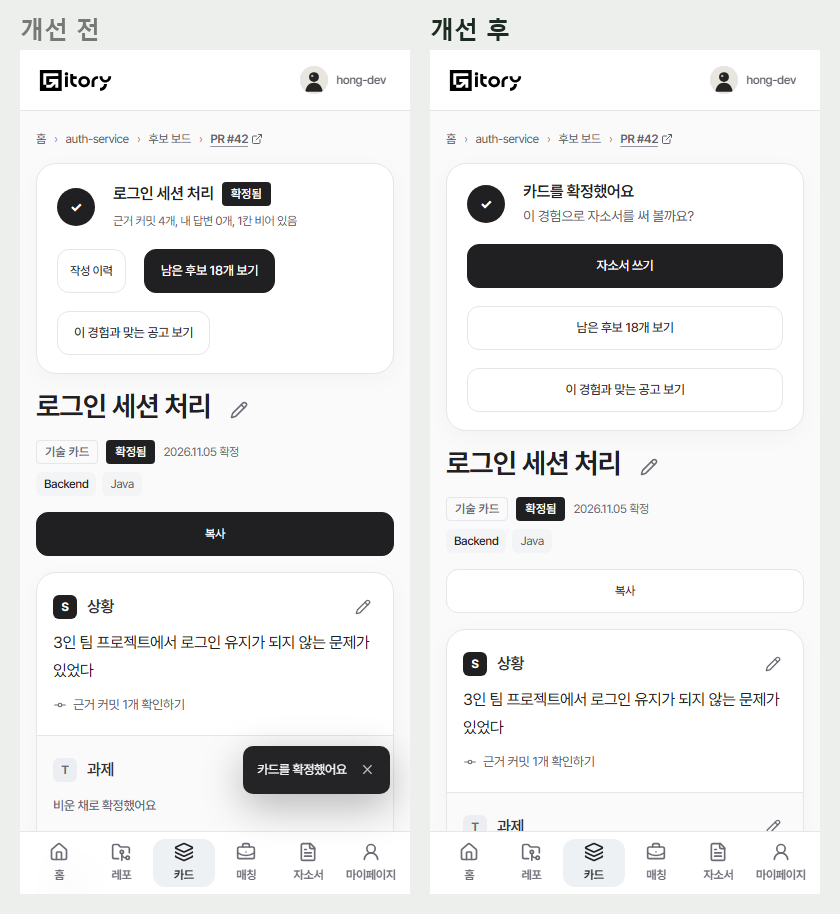

# 2026-11-05 P0 화면 손보기

전체 화면 점검(11/5)에서 사용자가 막히거나 실수하기 쉬운 네 곳을 먼저 고쳤다. 버튼은 점검의 규칙(주 버튼은 화면에 하나, 뒤로와 다른 선택지는 테두리 보조 버튼, 되돌릴 수 없는 일은 위험 버튼)을 따랐고 새 버튼 종류는 만들지 않았다.

| 화면 | 바꾼 것 |
| --- | --- |
| 처음 입력 창 | 제목은 단계 이름 하나("경력", "학력"). "2/5 단계, 다 입력해야…", 섹션 설명 줄, "해당 사항이 없으면…"을 뺐다(마이페이지 인적사항의 섹션 설명도 같은 컴포넌트라 함께). 이전은 테두리 보조 버튼 |
| 학력 구분 | 고등학교, 대학교, 대학원 셋으로 먼저 고르고 대학교(4년제, 2~3년제), 대학원(석사, 박사)만 한 줄 더 묻는다. 저장 값(HIGH_SCHOOL, BACHELOR, ASSOCIATE, MASTER, DOCTOR)은 그대로라 서버와 매칭은 바뀌지 않는다. 라벨은 "현재 상태" |
| 후보 카드 | 제목, 설명이 두 줄 자리를 늘 차지해 같은 줄 카드의 설명 시작과 "고르기" 높이가 맞는다. "커밋 N개 보기"는 고르기 줄 오른쪽. 잘린 제목은 마우스를 올리면 전체가 보인다 |
| 분석 중 | "다른 일 하러 가기"가 주 버튼, "정리 취소"는 위험 버튼으로 앞에 |
| 카드 확정 직후 | "카드를 확정했어요 / 이 경험으로 자소서를 써 볼까요?"와 자소서 쓰기(주 버튼), 남은 후보 보기와 맞는 공고 보기는 보조. 같은 말을 하던 토스트는 뺐다. 확정 카드의 복사는 보조 버튼 |

## 화면
| | |
| --- | --- |
| 처음 입력 창, 경력 |  |
| 처음 입력 창, 학력 |  |
| 후보 카드 |  |
| 분석 중 버튼 |  |
| 확정 직후 |  |
| 폰 |   |
