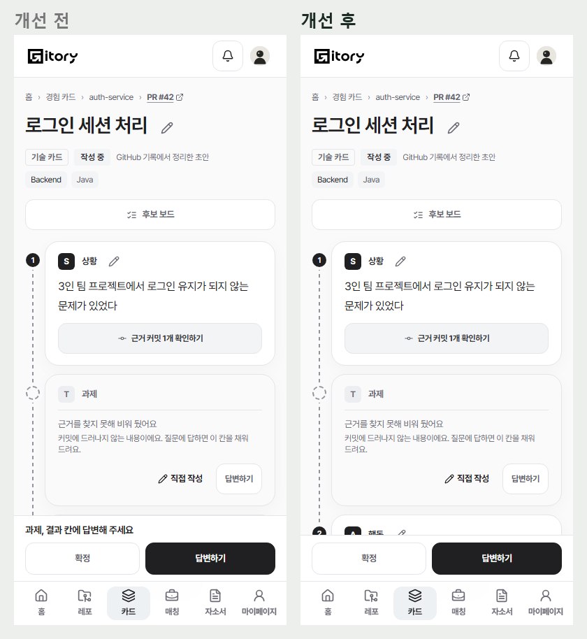
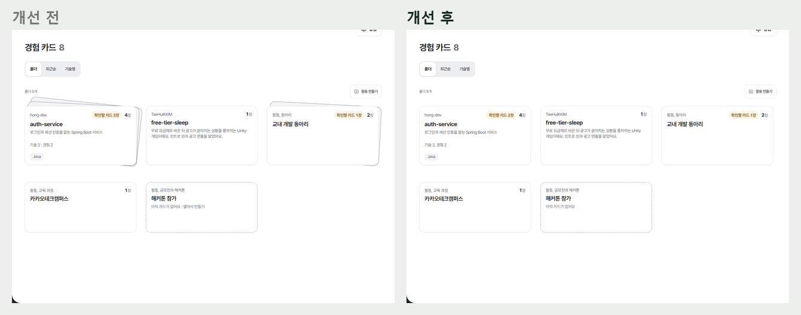
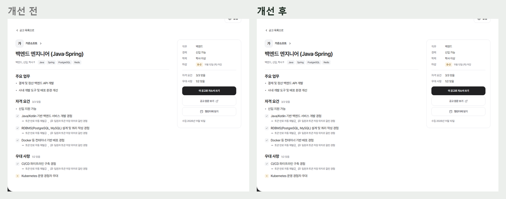
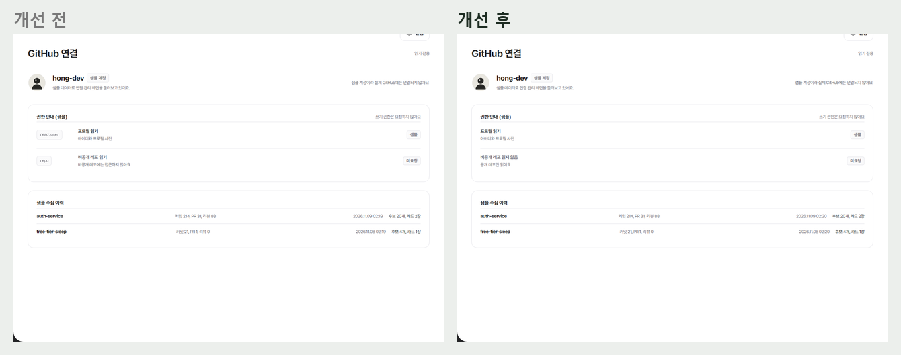
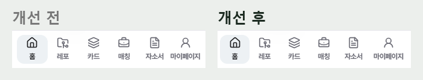
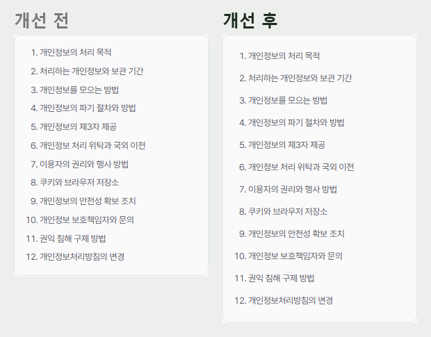

# 2026-11-10 카드, 설정, 작은 화면 손보기 (#920)

11/10 반응형 점검의 남은 것. #919 위에 쌓았다. 쓰는 칸 테두리(공통 규칙)는 #918 에서 고쳤다.

## 카드

- **'끝나면 알려 드릴게요' 뺐다**: 카드 쓰는 화면과 레포 분석 중 화면. 다른 일 하러 가기 버튼이 그 말을 대신한다.
- **카드 상세 폰 아래 고정 줄**: 설명 줄('과제, 결과 칸에 답변해 주세요')과 버튼 줄이 하단 메뉴 위에 쌓여 화면의 30% 가까이를 덮었다. 폰에서는 버튼 한 줄만 보이고 설명은 화면 읽기에만 준다(`StickyFooter compact`). 후보 보드처럼 설명이 개수를 말하는 화면은 그대로다.
- **경험 카드 폴더**: 겹친 종이 장식을 뺐다. '기술 2 · 경험 2' → '기술 2, 경험 2', '아직 카드가 없어요 · 열어서 만들기' → '아직 카드가 없어요'(폴더 전체가 링크라 '열어서 만들기'는 되풀이다). 폴더 안 요약 줄과 답변 화면 질문 버튼의 가운뎃점도 쉼표로.

## 공고 상세(맞춰 본 뒤)

- 근거 카드 줄의 쉼표가 '재발급 , 팀원과'처럼 양쪽으로 떨어져 보였다. 쉼표는 앞 이름에 붙이고 뒤만 띄운다.
- '제안을 골라 진행하기'는 고르기 전 꺼진 검정 버튼이라 고장 난 것처럼 보였다. 고르기 전에는 보조 버튼, 고르면 주 버튼.

## 설정

- GitHub 연결의 `read:user`, `repo` 코드 표시를 뺐다. '프로필 읽기'와 '비공개 레포 읽지 않음(공개 레포만 읽어요)'만 남긴다.

## 작은 화면(320px)

- **하단 메뉴**: 여섯 칸 중 다섯 글자 '마이페이지'만 칸 끝에 붙었다. 이름은 사이드바와 같게 두기로 했으므로(#520) 359px 이하에서 마지막 칸만 조금 넓힌다(양옆 8px 틈).
- **정책 링크와 개인정보처리방침 목차**: 폰에서 눌리는 높이를 32px 로(글 크기는 그대로). 목차는 한 줄에 하나.

## 화면

| | |
| --- | --- |
| 카드 상세(폰) |  |
| 경험 카드 폴더 |  |
| 공고 상세 근거 줄 |  |
| GitHub 연결 |  |
| 320px 하단 메뉴, 목차 |   |
