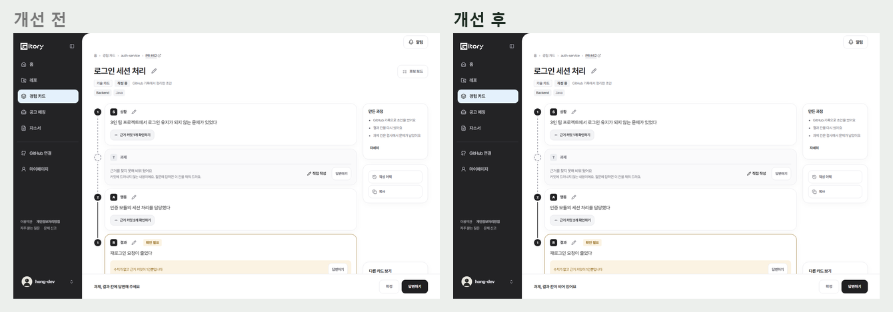
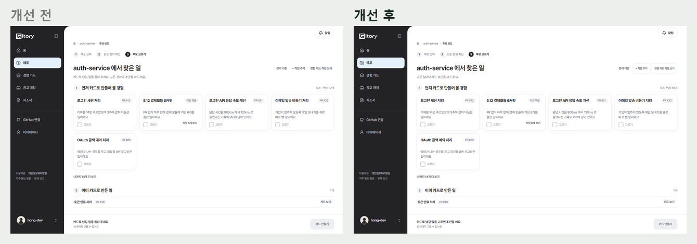
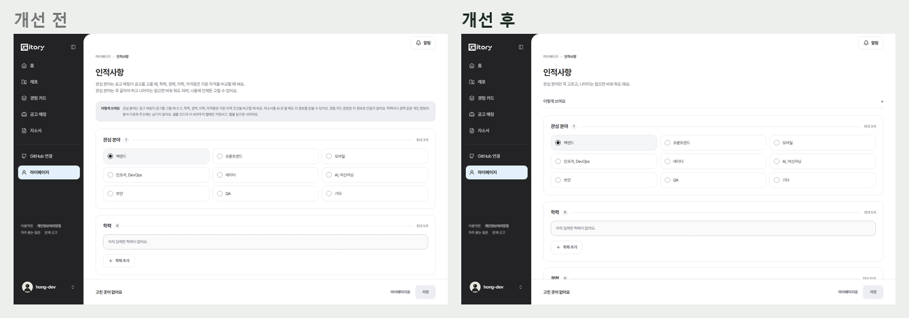
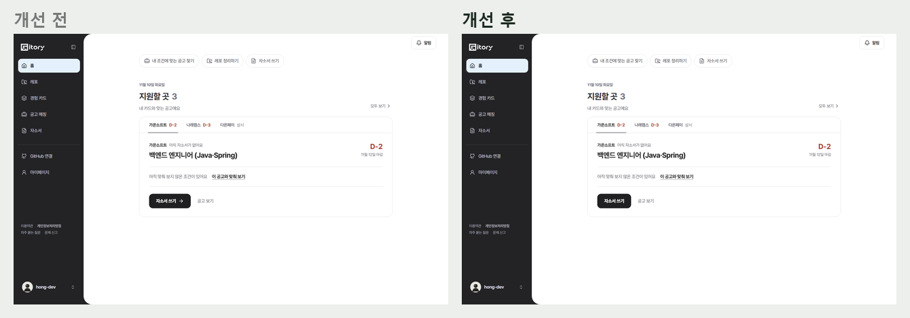
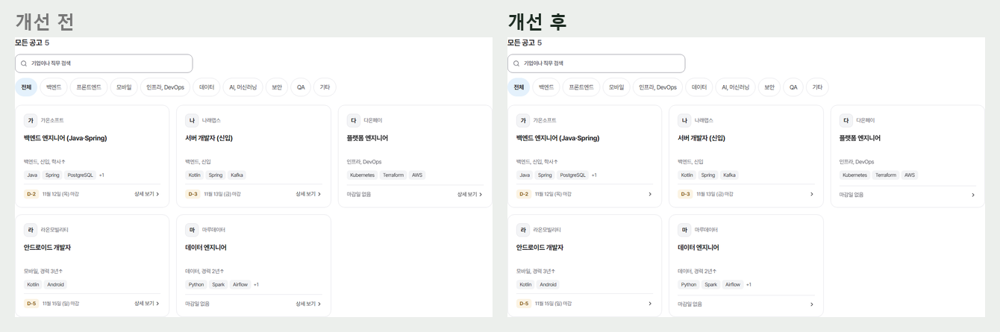
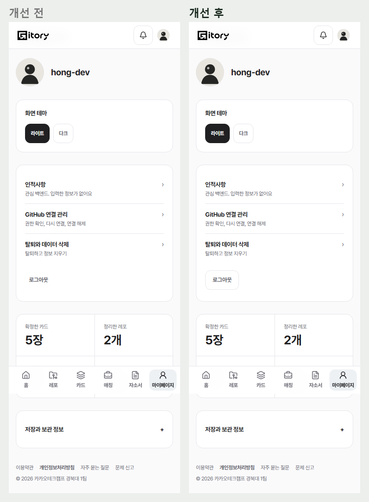

# 2026-11-10 문구와 버튼 위계 정리 (#805)

11/5 전체 화면 점검 P1, P2 중 앞 단계(#918, #919, #920)에서 하지 않은 것. #920 위에 쌓았다.

## 버튼

- **버튼 끝 화살표 8곳 제거**: 홈 지원할 곳(자소서 쓰기), 홈 시작 단계, 로그인(샘플로 체험하기, GitHub로 시작하기), 다음 할 일, 길잡이 세 곳, 레포 매칭 폴더로 가기. 화면 이동은 버튼 이름이 말한다.
- **카드 상세 '후보 보드' 버튼 제거**: 빵부스러기(레포 폴더)와 길이 겹친다. 후보 보드는 폴더 머리에서 연다.
- **후보 보드 머리**: 정리 기준은 부가 정보라 글자 버튼 그대로, '+ 직접 추가'와 '경험 카드 직접 쓰기'는 할 일이라 작은 보조 버튼.
- **마이페이지 로그아웃**: 글자 버튼 → 보조 버튼.
- **캘린더 일정 등록**: 홈의 검정 버튼은 지원할 곳의 한 걸음만 남기고 일정 등록은 보조 버튼.
- 답변하기 화면(답변 저장 = 주, 건너뛰기 = 보조)은 이미 규칙대로라 그대로.

## 문구

- **'~주세요' 정리**: 버튼이나 칸 이름이 이미 말하는 안내만 바꿨다. 오류처럼 사람이 할 일이 있을 때(다시 연결, 다시 시도, 입력 확인)와 자소서 문항 예시, 빈칸 표시는 그대로 둔다.
  - 카드 상세 아래 줄: '과제, 결과 칸에 답변해 주세요' → '과제, 결과 칸이 비어 있어요', '내용을 확인한 뒤 확정해 주세요' → '확정하면 공고 매칭과 자소서에 쓰여요', '상황과 행동을 작성해 주세요' → '상황과 행동을 쓰면 확정할 수 있어요'
  - 후보 보드: '카드로 남길 일을 골라 주세요. 고른 것마다 초안을 써 드려요.' → '고른 일마다 카드 초안을 써 드려요.', 아래 줄 '카드로 남길 일을 고르면 초안을 써요'
  - 레포 고르기 '레포를 하나 골라 주세요' → '정리할 레포를 고르면 다음으로 넘어가요', 새 카드 '제목을 적으면 작성을 시작해요', 홈 시작 단계 '확인이 필요한 카드만 보면 돼요', 자소서 짐작 탭 '확인하지 않아도 글은 완성이에요'
- **가운뎃점**: 길잡이 공고 이름과 메타, 자소서 진행 알림, 새 공고 알림, 레포 매칭 직무 줄, 후보 묶음 개수('5개, 전체 19개'). 브라우저 탭 제목('… · Gitory')은 관례대로 둔다.
- **매칭 타일 '상세 보기' 글자 제거**: 타일 전체가 링크라 화살표만 남긴다.
- **캘린더 설명 줄**('관심 있는 공고부터 면접까지…') 제거.
- **로그인 첫 화면**: 알약 라벨('코드에 남긴 기록, 나만의 경험으로')과 버튼 화살표 제거.
- **인적사항**: 제목 아래 두 줄 설명을 '관심 분야만 꼭 고르고, 나머지는 없으면 비워 둬도 돼요.' 한 줄로, '이렇게 쓰여요' 상자는 접힌 한 줄(열면 전체 설명)로.

## 그대로 둔 것

- 마이페이지 '준비 중' 줄은 이미 없다.
- 이용약관, 개인정보처리방침의 '화면에서 탈퇴하는 기능은 준비 중' 문장은 법 문서라 손대지 않았다 — 탈퇴 화면(/settings/leave)이 실서버에서 동작하면 문서를 고쳐야 한다.

## 화면

| | |
| --- | --- |
| 카드 상세 |  |
| 후보 보드 |  |
| 인적사항 |  |
| 홈 |  |
| 모든 공고 타일 |  |
| 마이페이지(폰) |  |
