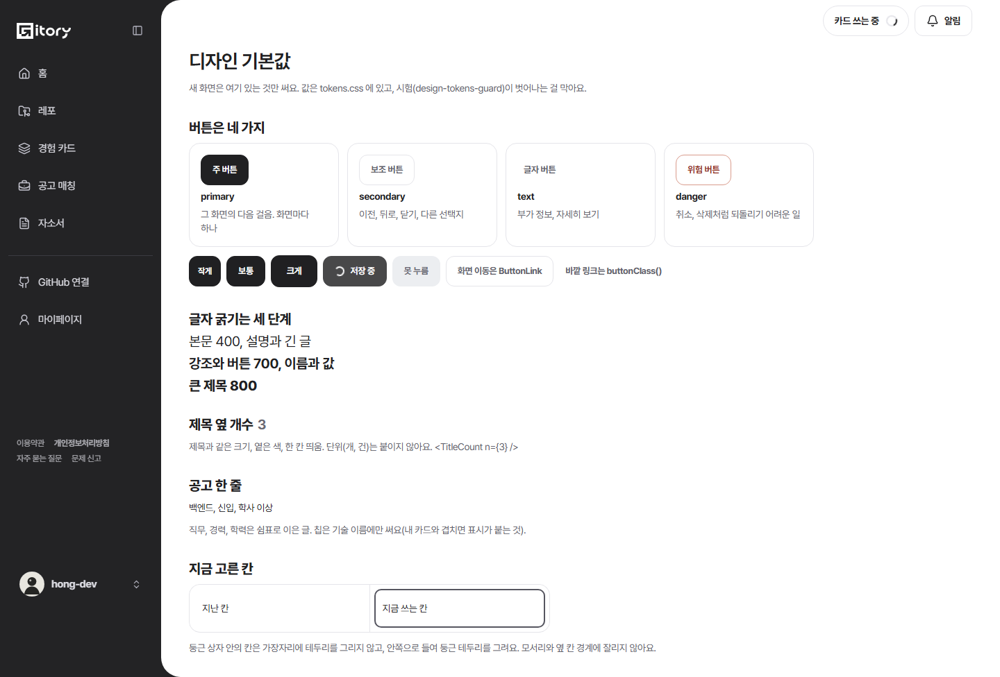
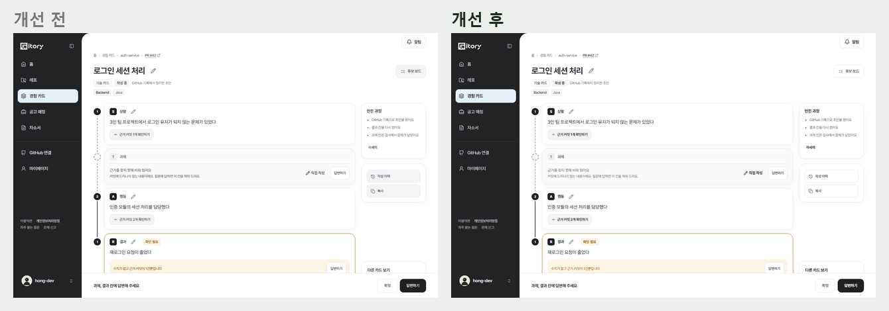
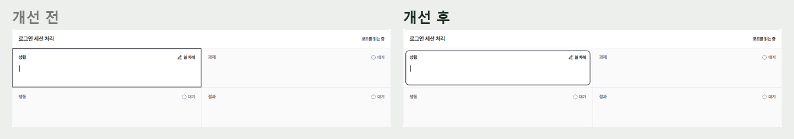
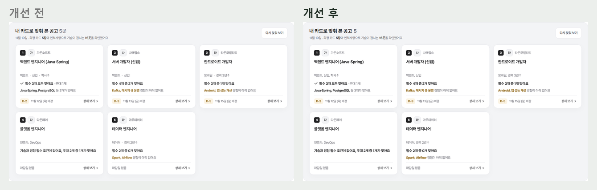
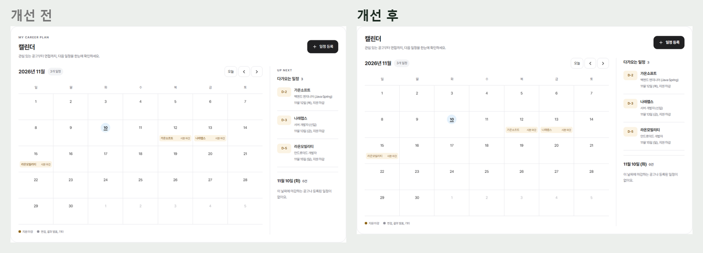
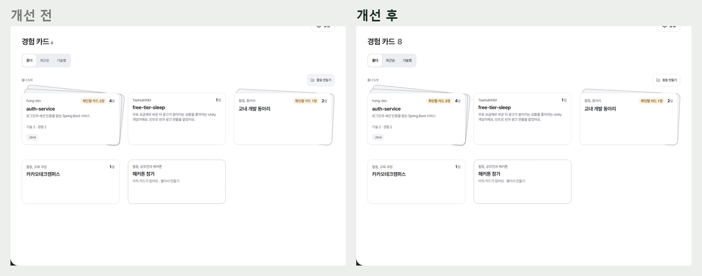
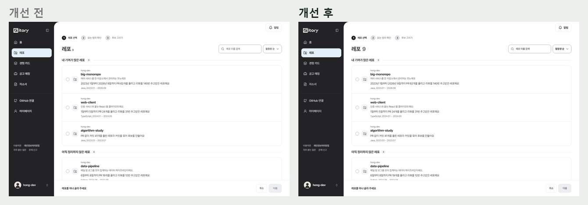
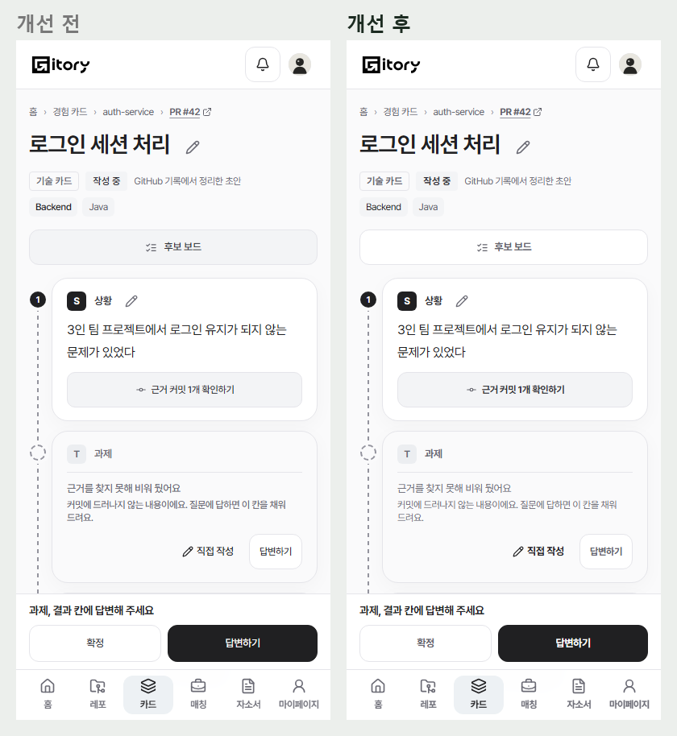
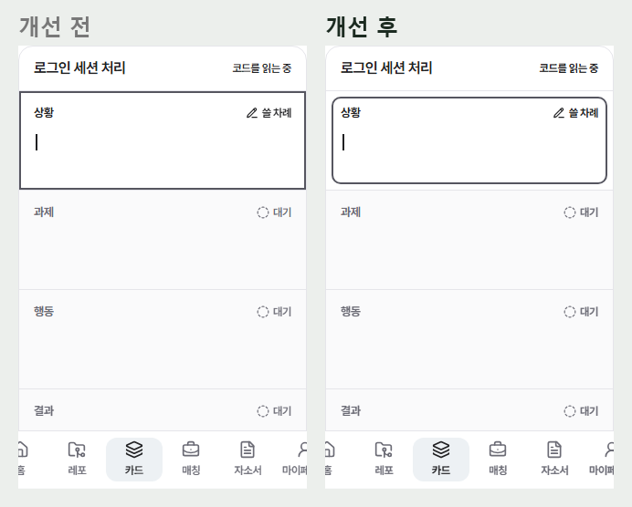

# 2026-11-10 디자인 기본값 — 버튼 네 가지, 굵기 세 단계, 제목 옆 숫자, 테두리 (#804, #918)

화면이 늘수록 같은 역할의 모양이 벌어졌다. 화면별로 고치기 전에 모든 화면이 기대는 기본값을 한 번에 정하고, 다시 벌어지지 않게 시험으로 막았다. 견본은 목에서 `/__ui`.

## 버튼은 네 가지

| 변형 | 모양 | 쓰는 곳 |
| --- | --- | --- |
| `primary` | 검정 채움 | 그 화면의 다음 걸음, 화면마다 하나 |
| `secondary` | 연한 글자 + 테두리 | 이전, 뒤로, 닫기, 다른 선택지 |
| `text` | 글자만 | 부가 정보, 자세히 보기 |
| `danger` | 빨간 글자와 테두리 | 취소, 삭제처럼 되돌리기 어려운 일 |

- 예전 `outline`(테두리)와 `ghost`(회색 채움)는 `secondary` 하나로 합쳤다. 회색 채움 버튼(작성 이력, 복사, 후보 보드)이 흰 바탕 테두리 버튼이 된다.
- 화면 이동은 `<ButtonLink to variant>`, 바깥 링크나 폼 버튼처럼 컴포넌트를 못 쓰는 곳만 `buttonClass(variant, size)`. `className="btn …"` 를 손으로 쓰던 81곳을 모두 바꿨다.
- 버튼 색, 테두리, 둥글기를 여러 파일(`layout-tio.css`, `mono-pastel.css`, `guidance.css`)이 차례로 덮어쓰던 것을 `ui.css` 한 블록으로 모았다. 둥글기는 실제로 보이던 12px 를 토큰(`--control-radius`)으로.

## 글자 굵기 세 단계

500, 550, 600, 650, 700, 750, 800 이 섞여 진하기 차이가 안 보였다. `--weight-regular` 400, `--weight-bold` 700, `--weight-heavy` 800 셋으로 맞췄다.

- 500, 550 → 400 / 600, 650 → 700 / 750 → 800. 버튼은 700, 큰 제목(`--heading-weight`)은 800.
- 유틸리티 클래스도 역할 이름으로: `w-500 w-600 w-700 w-800` → `w-regular w-bold w-heavy`.

## 그 밖의 기본값

- **제목 옆 개수** `<TitleCount n>`: '지원할 곳 3'처럼 제목과 같은 크기, 옅은 색, 한 칸 띄움, 단위 없음. 경험 카드, 레포, 모든 공고, 내 카드로 맞춰 본 공고, 다가오는 일정에 같게.
- **공고 한 줄**: 직무, 경력, 학력은 가운뎃점 대신 쉼표로 이은 글. 칩은 기술 이름에만(내 카드와 겹치면 표시가 붙는 것).
- **지금 고른 칸**: 둥근 상자 안 칸의 가장자리에 테두리를 그리면 모서리와 옆 칸 경계에 잘린다. 칸 안쪽으로 6px 들여 둥근 테두리를 따로 그린다(카드 쓰는 화면).
- **글과 버튼 한 줄**: 터치 높이(40px)를 준 글자 버튼은 글자를 그 가운데로 — 옆 문장과 어긋나지 않게(홈 '이 공고와 맞춰 보기').
- **클릭 커서**: 입력 칸 밖을 눌러도 깜박이는 글자 커서가 보이지 않게 `body { caret-color: transparent }`, 입력 칸은 기본 커서.
- **영어 대문자 라벨**: 캘린더 'MY CAREER PLAN', 'UP NEXT' 를 뺐다.

## 다시 벌어지지 않게

`src/test/design-tokens-guard.test.ts`(npm test 에서 돈다)

- 숫자 굵기(`font-weight: 600`)가 하나라도 있으면 실패
- `"btn btn--…"`, `className="btn"`, `btn--outline/ghost` 를 손으로 쓰면 실패
- tokens.css 밖의 #hex 색(지금 43개)과 단계 밖 글자 크기(지금 78개)는 `design-tokens-baseline.json` 의 파일별 개수를 넘으면 실패. 줄이면 통과하고, 기준을 낮추려면 `UPDATE_DESIGN_BASELINE=1 npx vitest run design-tokens`

## 화면

| | |
| --- | --- |
| 견본 `/__ui` |  |
| 카드 상세(보조 버튼, 굵기) |  |
| 쓰는 칸 테두리 |  |
| 맞춰 본 공고(숫자, 쉼표) |  |
| 캘린더(영어 라벨, 숫자) |  |
| 경험 카드, 레포 제목 숫자 |   |
| 폰 |   |
