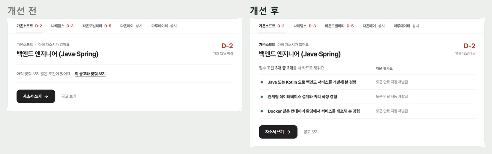
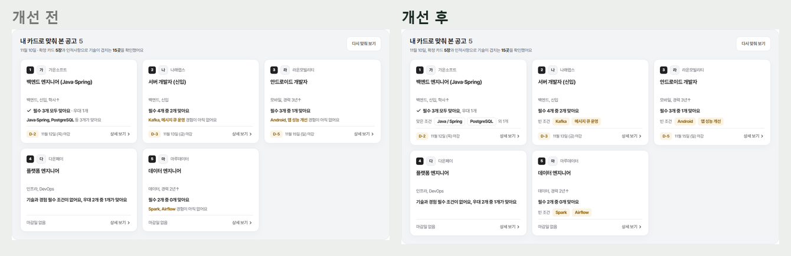
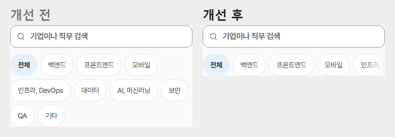
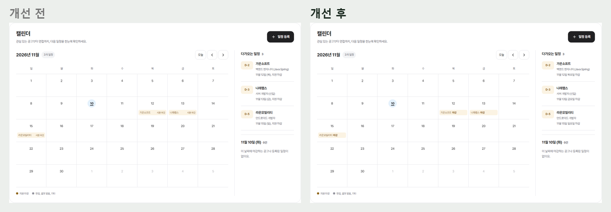
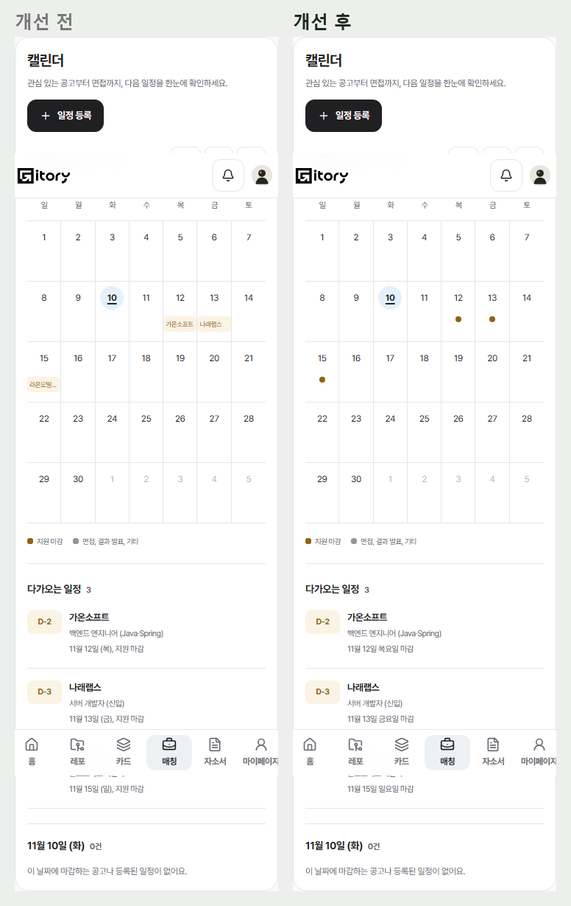
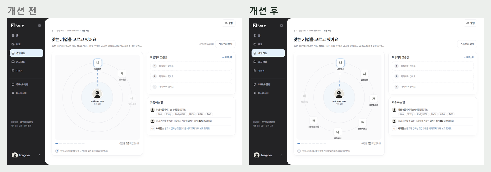

# 2026-11-10 홈, 공고 매칭, 캘린더 손보기 (#919)

11/10 반응형 점검에서 홈, 공고 매칭, 캘린더, 레포 매칭에 막히거나 이상하게 읽히는 곳을 고쳤다. 공통 기본값(#804, #918) 위에 쌓았다.

## 홈 '지원할 곳'

- **조건 점**: 빈 동그라미 테두리가 체크박스처럼 눌러 보고 싶게 생겼다. 채움은 초록 점, 비어 있음은 붉은 점(토큰 `--accent-met`, `--deadline-urgent`). 체크 아이콘도 점으로 맞췄다.
- 비어 있는 조건 오른쪽은 '채울 경험 찾기' 링크만. 상태는 왼쪽 점이 말한다.
- 회사와 상태 사이 가운뎃점 대신 회사 이름을 진하게.
- **맞춰 본 뒤에도 '아직 맞춰 보지 않은 조건'**: 전체 맞춰 보기가 끝나면(계산 중 → 끝) 공고 상세 캐시를 낡음으로 표시해 홈이 다음에 열 때 다시 읽는다(`useOverallRecommendation`). 목도 실서버처럼 전체 결과에 오른 공고는 판단이 저장된 것으로 본다.
- **탭이 폰에서 잘림**: 가로로 넘길 수 있는 쪽 끝을 흐린다(`useScrollEdges` + `.scroll-edges`). 다 보이면 흐림이 없다.
- '새 공고 N곳 · ', 카드 타일 출처 줄의 가운뎃점은 쉼표로.

## 공고 매칭 '내 카드로 맞춰 본 공고'

- 타일 아래 줄이 영어 기술 이름을 이어 붙이다 '…경험이 아직 없어요'로 끝나 한 문장으로 읽히지 않았다. **'빈 조건' / '맞은 조건' 이름표 + 칩**으로 나누고, 남으면 '외 N개'. 빈 조건 칩은 마감 색, 맞은 조건 칩은 테두리 칩. 한 조건의 기술 사이는 ' / '.
- '필수 3개 모두 맞아요 · 우대 1개', '11월 10일 · 확정 카드…', '필수·우대 조건' 의 가운뎃점은 쉼표로.
- **모든 공고 직무 칩**이 폰에서 네 줄로 늘어져 공고를 밀어냈다. 767px 아래에서는 한 줄 가로 스크롤, 끝 흐림.

## 캘린더

- 날짜 칸 칩이 '가온소프트 ……… 지원 마감'처럼 양 끝에 붙어 떨어져 보였다. '가온소프트 **마감**' 한 덩어리로(짧은 이름 `scheduleShort`: 마감, 면접, 발표, 일정). 읽어 주는 이름은 그대로 '가온소프트, 지원 마감'.
- 다가오는 일정 줄: 직무는 윗줄, 아래는 '11월 12일 목요일 마감' 한 덩어리. 날짜와 종류를 쉼표로 붙이지 않는다.
- 폰 날짜 칸은 칩이 잘려 안 보였다. 점(범례와 같은 색)으로 바꾸고 내용은 칸을 눌러 아래 목록에서 본다.

## 레포 매칭(맞는 기업 고르는 화면)

- 오른쪽 위 '나가도 계속 골라요' 뺐다.
- '필수 1개 · 우대 1개' → '필수 1개, 우대 1개'.
- '지금 하는 일' 목록 맨 위 줄이 반쯤 잘린 채 보이던 것: 위쪽 흐림을 한 줄 높이(56px)로 늘렸다.
- '이스트소프트·이스트시큐리티'는 서버가 준 회사 이름이라 그대로 둔다.

## 화면

| | |
| --- | --- |
| 홈(맞춰 본 뒤) |  |
| 맞춰 본 공고 |  |
| 직무 칩(폰) |  |
| 캘린더 |   |
| 레포 매칭 |  |
