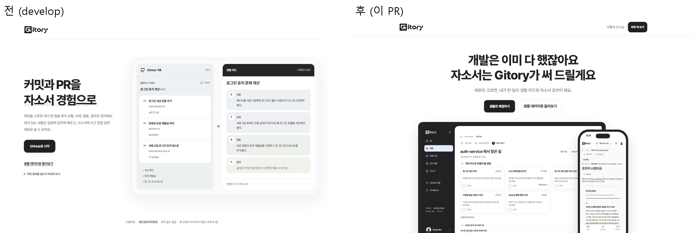
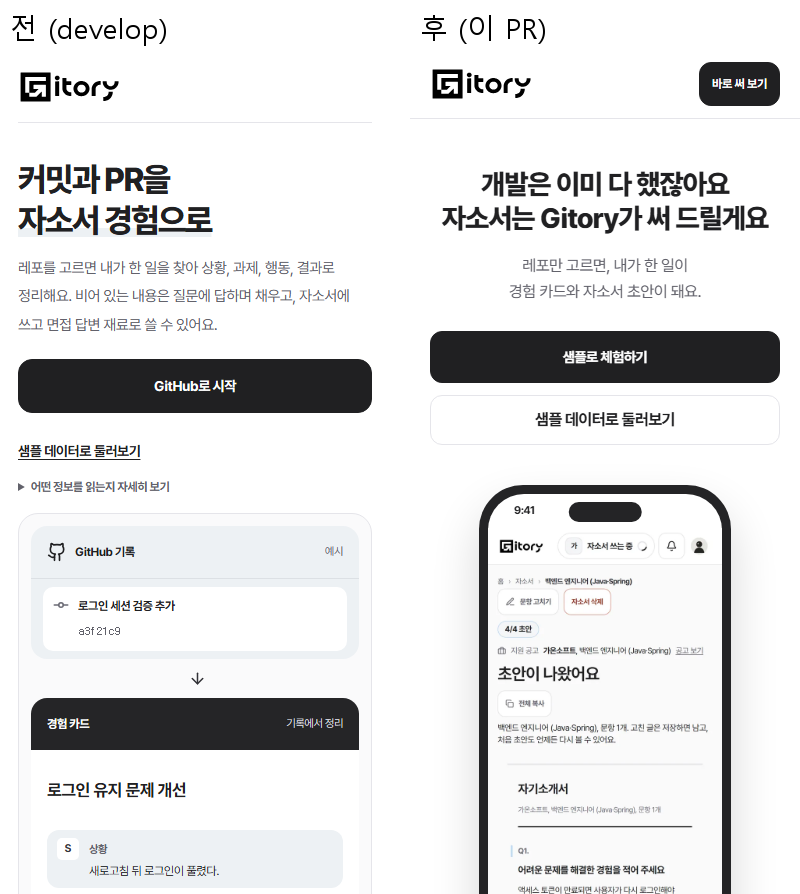
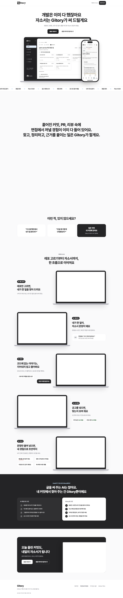
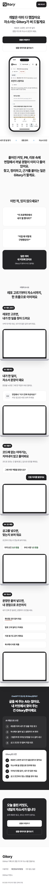

# 2026-11-11 첫 화면을 스크롤형 소개로 다시 만듦

11/11 오전 첫 화면 개편이 롤백된 뒤(#1038), 팀 피드백을 받아 시안을 따로 배포해 보고(gitory-prototypes.vercel.app) 고친 판을 옮겼다.
피드백 요지: 처음 들어가면 한 줄만 떠서 당황스럽다, 스크롤이 정적이다, 캡처가 잘려 있다, 써 보고 싶은 문구가 없다("카드가 뭔데?"), 무엇을 하는 서비스인지 바로 보여야 한다.

## 위에서 아래로

1. **히어로**(가운데 정렬): "개발은 이미 다 했잖아요 / 자소서는 Gitory가 써 드릴게요". 노트북 틀 안에서 실제 화면 시연 영상(16초, 후보 고르기 → 경험 카드 → 공고 → 자소서)이 반복되고 폰 화면이 겹친다. 휴대폰 폭에서는 노트북을 빼고 폰 하나만 크게.
2. **흐르는 띠**: 내가 한 일 찾기, 경험 정리, 자소서 초안, 공고 맞춰 보기, 면접 대비, 로그인 없이 체험.
3. **채워지는 문장**(가운데 정렬, PC 세 줄): 스크롤한 만큼 회색 구절이 검게 채워진다. PC는 150vh 동안 화면에 머물고(예전 시안 220vh는 막힌 느낌이라 줄임), 휴대폰은 고정 없이 지나가며 채운다.
4. **공감**: "이 프로젝트에서 내가 뭘 했더라?", "이걸 왜 이렇게 구현했었지?", "답은 이미 내 커밋에 있어요".
5. **01~05**: 레포 고르기, 경험 카드, 되묻기, 공고 매칭, 자소서. 설명은 한 문장씩. PC 우선 서비스라 다섯 단계 모두 PC 화면(노트북 틀)으로 보여 준다.
6. **AI 채팅과 다른 점**: "AI 채팅으로 쓰면"(직접 찾고 붙여 넣고 걸러 내고 대조) 대 "Gitory로 쓰면".
7. **시작 권유**와 **푸터**(롤백 전 판과 같은 구성: 소개 한 줄, 이용약관, 개인정보처리방침, 자주 묻는 질문, GitHub 저장소).

## 움직임

- 블록과 화면은 들어오면 떠오르고, 제목은 단어가 70ms 간격으로 나타난다. PC는 화면 아래 18% 앞에서 미리 시작한다.
- 로고 인트로(가운데 → 상단 바)는 **탭마다 처음 한 번만**. 새로고침이나 다시 들어오면 바로 본문. `?intro=1` 이면 다시 튼다(`sessionStorage` `gitory.landing-intro.seen`).
- 새로고침하면 맨 위에서 시작한다(`history.scrollRestoration = 'manual'`).
- 상단 바 로고를 누르면 맨 위로, 스크롤하면 상단 바에 옅은 그림자.
- 움직임 줄이기를 켜면 숨기는 것 없이 바로 보이고, 시연 영상도 틀지 않는다. IntersectionObserver 가 없으면 역시 숨기지 않는다.

## 문구 원칙

기능이 아니라 사용자가 얻는 것으로 쓴다. "문장마다 근거 커밋" 대신 "면접에서 '진짜 하셨어요?'에 커밋 링크로 바로", "서버가 대조" 같은 구현 설명과 통계 출처는 첫 화면에서 뺐다. 지금 없는 기능(합격 자소서 분석 등)은 쓰지 않는다.

## 테마, 자산

- 첫 화면은 다크 테마를 켜 둔 사람에게도 밝은 테마로 보인다(첫 화면에 있는 동안 `data-theme` 을 떼고, 떠나면 되돌린다).
- `public/landing/`: 샘플 데이터 화면 캡처(webp, PC 7장, 휴대폰 1장), 시연 영상 `demo.mp4`(250KB)와 첫 장면 `demo-poster.webp`. 합계 약 0.7MB.
- 예전 히어로 예시(`LandingExample.tsx`)는 지웠다.

## 화면

| | |
| --- | --- |
| 첫 화면 PC |  |
| 첫 화면 휴대폰 |  |
| 전체 PC |  |
| 전체 휴대폰 |  |
